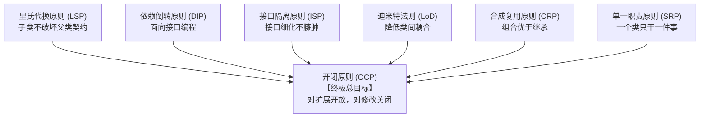

# 7大经典软件设计原则（期末考试必背终极速查指南）

---

## 🧭 知识总览与记忆口诀

这 7 大原则是所有 23 种设计模式的**基石与灵魂**，期末名词解释、简答题、代码改错题**必考至少 2~3 道**！

| 序号 | 原则名称 | 英文名称与缩写 | 核心口诀 / 一句话白话 |
| :---: | :--- | :--- | :--- |
| **3.1** | **开闭原则** | Open-Closed Principle (**OCP**) | **热烈欢迎新功能，坚决不改老代码**（对扩展开放，对修改关闭） |
| **3.2** | **里氏代换原则** | Liskov Substitution Principle (**LSP**) | **子类可以扩展父类，但绝不能篡改父类原有的行为** |
| **3.3** | **依赖倒转原则** | Dependency Inversion Principle (**DIP**) | **面向接口编程，不要面向具体类硬编码**（高层低层都依赖抽象） |
| **3.4** | **接口隔离原则** | Interface Segregation Principle (**ISP**) | **接口要小而专，不要设计大而全的“全能垃圾桶”接口** |
| **3.5** | **迪米特法则** | Law of Demeter (**LoD**) / 最少知识原则 | **只跟直接朋友说话，不和陌生人私下搭讪**（降耦合） |
| **3.6** | **合成复用原则** | Composite Reuse Principle (**CRP** / CARP) | **多用“组合/聚合”，少用“类继承”** |
| *附* | **单一职责原则** | Single Responsibility Principle (**SRP**) | **一个类只干一件事，只有一个引起它变动的原因** |

---

## 3.1 开闭原则（Open-Closed Principle, OCP）

### 1. 专业定义（期末标准作答）
> 软件实体（类、模块、函数等）应当**对扩展开放（Open for extension），对修改关闭（Closed for modification）**。
> 即在需要给系统增加新功能时，应通过**增加新的代码/扩展类**来实现，而不是修改现有的源代码。

### 2. 通俗大白话
> **电脑主机加内存条。**
> 当你的电脑内存不够用时，你是买一根新的内存条插在预留的插槽上（对扩展开放），还是把原来的主板拆开、焊掉原本的芯片（对修改关闭）？显然是加插槽扩展！

### 3. 代码反例 VS 正例
- ❌ **违背 OCP 的坏代码**：
  在简单工厂里用 `if-else` 判断咖啡种类：每加一个“拿铁”，就必须**修改工厂源码**加一个 `else if`。
- ✅ **遵循 OCP 的好代码**：
  工厂方法模式：新增“拿铁”时，**新建 `Latte` 和 `LatteFactory`**，原有所有类代码一行不碰。

### 4. 考试典型体现
- **对应模式**：工厂方法模式、抽象工厂模式、装饰者模式、策略模式。
- **期末考点陷阱**：开闭原则是面向对象设计的**终极总目标**，其他原则都是为了实现开闭原则而服务的手段！

---

## 3.2 里氏代换原则（Liskov Substitution Principle, LSP）

### 1. 专业定义（期末标准作答）
> 所有引用基类（父类）的地方，**必须能够透明地使用其子类的对象替代**，而程序不会产生任何错误或异常。
> 子类可以扩展父类的功能，但**不能改变父类原有的行为契约**。

### 2. 通俗大白话
> **“正方形不是长方形” / “假父亲与真儿子”。**
> 如果一个方法接收“鸟（父类）”，其逻辑是让鸟在天上飞；如果你写了一个“企鹅（子类）”继承了鸟，却在 `fly()` 里抛异常或什么都不做，程序当场崩溃！这就违背了里氏代换。子类不能砸了父类的招牌！

### 3. 代码反例 VS 正例
- ❌ **违背 LSP 的坏代码**：
  `Square`（正方形）继承 `Rectangle`（长方形），并在 `setWidth(w)` 时强行把 `height` 也改了。如果客户端写了一个按“长宽独立调整”给长方形扩容的算法，传入正方形时死循环崩溃！
- ✅ **遵循 LSP 的好代码**：
  子类**尽量不要重写父类已经实现了的具体方法**！如果子类必须改写父类的方法逻辑，说明它们根本不该是父子继承关系，应改为组合或共同继承一个更抽象的四边形基类。

### 4. 考试判定四要素（选择/判断题必考）
1. 子类必须完全实现父类的抽象方法，但**绝不能覆盖父类的非抽象方法**；
2. 子类可以增加自己特有的方法；
3. 子类重载父类方法时，**输入参数范围（前置条件）可以更宽松**，不能更严苛；
4. 子类重写父类方法时，**输出返回值范围（后置条件）可以更严格**，不能更宽泛。

---

## 3.3 依赖倒转原则（Dependency Inversion Principle, DIP）

### 1. 专业定义（期末标准作答）
> 1. 高层模块不应该依赖低层模块，**二者都应该依赖其抽象**；
> 2. 抽象不应该依赖细节，**细节应该依赖抽象**。
> 核心思想是：**针对接口编程，不要针对实现编程**。

### 2. 通俗大白话
> **司机会开车，但他不该只依赖“奔驰车”。**
> 如果司机考了驾照（依赖抽象“汽车接口”），无论是奔驰、宝马还是拖拉机，只要有方向盘和油门他都能开；
> 如果司机在脑子里焊死了“我只认奔驰底盘”（依赖具体类），换一辆奥迪他就不会开了！

### 3. 代码反例 VS 正例
- ❌ **违背 DIP 的坏代码**：
  ```java
  public class Driver {
      public void drive(Benz car) { car.run(); } // 强依赖具体类 Benz，换 BMW 必须改代码
  }
  ```
- ✅ **遵循 DIP 的好代码**：
  ```java
  public class Driver {
      public void drive(ICar car) { car.run(); } // 依赖抽象接口 ICar！传任何车都兼容！
  }
  ```

### 4. 考试典型体现
- **对应模式**：几乎所有模式！工厂方法、策略模式、模板方法。
- **框架应用**：**Spring 框架的核心底层——依赖注入（DI / IoC）**，就是依赖倒转原则最顶级的工业级体现。

---

## 3.4 接口隔离原则（Interface Segregation Principle, ISP）

### 1. 专业定义（期末标准作答）
> 客户端不应该被迫依赖于它不使用的方法。
> 一个类对另一个类的依赖应该**建立在最小的接口上**。要为各个类建立它们需要的专用接口，而不要试图去建立一个庞大臃肿的大接口供所有客户端使用。

### 2. 通俗大白话
> **拒绝臃肿的“全能遥控器”，提倡专用的“轻量面板”。**
> 如果定义了一个 `Animal` 接口，里面写了 `fly()`、`swim()`、`walk()`；那小狗实现该接口时，被迫必须写一个空的 `fly()` 方法，因为小狗根本不会飞！这就违反了接口隔离。应该拆分成 `IFlyable`、`ISwimmable` 多个轻量接口。

### 3. 代码反例 VS 正例
- ❌ **违背 ISP 的坏代码**：
  一个 `IOrder` 接口同时包含了：`insertOrder()`, `deleteOrder()`, `auditOrder()`（审核订单）, `exportExcel()`。普通用户端被迫依赖了只有管理员才用得到的 `auditOrder()`。
- ✅ **遵循 ISP 的好代码**：
  拆分为 `IUserOrderOperation`（普通操作）和 `IAdminOrderOperation`（审核管理）。各个客户端各取所需。

### 4. 考试必考辨析题：单一职责原则 (SRP) VS 接口隔离原则 (ISP)
- **单一职责原则（SRP）**：侧重于**职责**，针对的是**类和模块的内部实现**（一个类只专注做好一件事）；
- **接口隔离原则（ISP）**：侧重于**对外提供的接口契约**，针对的是**对外暴露的方法粒度**（接口要小，避免调用方被迫实现不需要的方法）。

---

## 3.5 迪米特法则（Law of Demeter, LoD / 最少知识原则）

### 1. 专业定义（期末标准作答）
> 一个软件实体应当尽可能少地与其他实体发生相互作用。
> 如果两个软件实体无须直接通信，那么就不应当发生直接的相互调用，可以通过第三方转发该调用。
> **口诀：只与你直接的朋友交谈（Talk only to your immediate friends）。**

### 2. 通俗大白话
> **找房子找中介，买电脑找柜台。**
> 你要租房，你不需要挨家挨户敲门认识房东的七大姑八大姨（强耦合）；你只需要联系中介（一个中介者），中介帮你搞定所有的杂事。

### 3. “直接朋友”是指什么？（期末填空/多选必考）
一个对象的“直接朋友”包括以下几种：
1. **当前对象本身（`this`）**；
2. **以参数形式传入当前对象方法中的对象**；
3. **当前对象的成员变量引用的对象**；
4. **当前对象的方法内部实例化的对象**。
❌ **非朋友**：`getA().getB().getC().doSomething()`（典型的链式过度调用，直接穿透到陌生人家里去了，严重违反迪米特法则）。

### 4. 考试典型体现
- **对应模式**：**外观模式（Facade）**（门面角色统一接待，屏蔽内部子系统）、**中介者模式（Mediator）**。

---

## 3.6 合成复用原则（Composite Reuse Principle, CRP / 组合优于继承原则）

### 1. 专业定义（期末标准作答）
> 尽量使用**对象组合（Composition）或聚合（Aggregation）**，而不是继承（Inheritance）关系来达到软件复用的目的。

### 2. 通俗大白话
> **人穿衣服，而不是人长出一件衣服。**
> 如果你想让一个人防寒，是给他穿一件羽绒服（组合，随时可脱可换可加），还是去基因改造让他身上长出一层羽绒（继承，焊死在一起，夏天直接热死）？组合比继承灵活得多！

### 3. 为什么继承有“原罪”？（继承的缺点必考简答）
1. **“白箱”复用破坏封装**：父类的内部实现细节对子类是透明可见的，父类一改动，所有子类连带受灾；
2. **缺乏动态灵活性**：继承是在**编译期**静态决定的，运行期间无法动态改变行为；
3. **容易造成“类爆炸”**：比如之前学的“毛笔 vs 蜡笔”（桥接模式）、“炒饭加配料”（装饰者模式），如果用继承会导致子类成百上千！

### 4. 考试典型体现
- **对应模式**：**装饰者模式**（继承+聚合）、**桥接模式**（维度分离组合）、**对象适配器模式**（内部聚合持有所需对象）、**策略模式**。

---

## 💡 终极期末大题串联（一秒通关思维模型）



> 🎯 **期末大题答题万能模板**：
> 如果考到某段代码有什么坏味道、该怎么重构：
> 1. 先看有没有写大量 `if-else` 或新增功能修改了原有类？$\rightarrow$ **违背开闭原则（OCP）**，改用**工厂方法/策略模式**；
> 2. 看有没有直接依赖具体类导致换个类就改代码？$\rightarrow$ **违背依赖倒转原则（DIP）**，抽成**抽象接口**；
> 3. 看子类是不是重写了父类已有的方法导致行为异常？$\rightarrow$ **违背里氏代换原则（LSP）**；
> 4. 看有没有写多层巨复杂的子类继承体系？$\rightarrow$ **违背合成复用原则（CRP）**，改为**聚合组合引用（桥接/装饰者）**！
