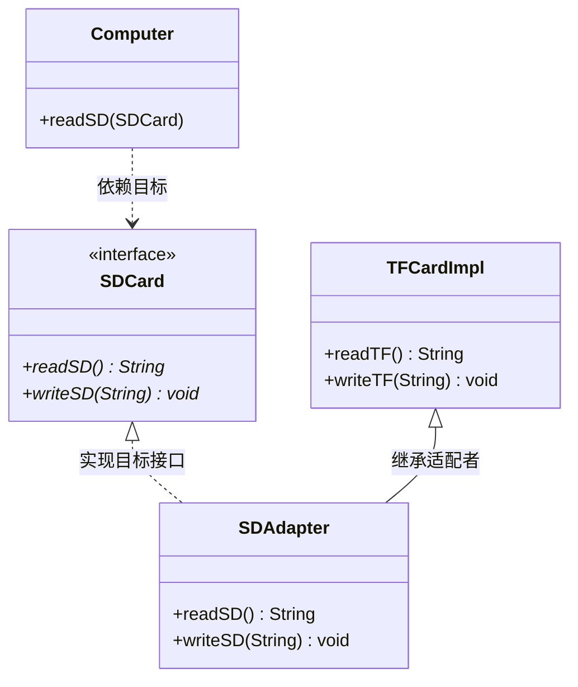
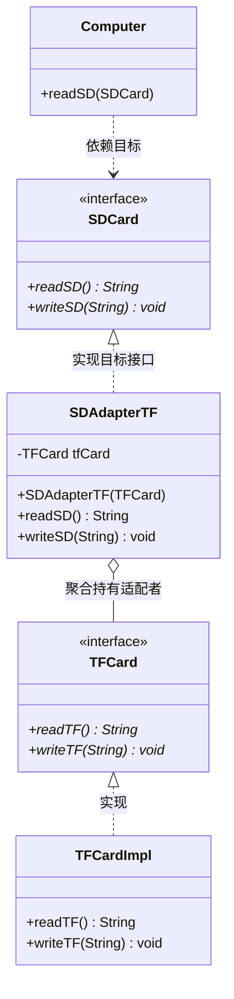

# 适配器模式（Adapter Pattern）期末复习笔记

---

## 📌 一、核心定义（一句话考点）
> **定义**：将一个类的接口**转换成客户希望的另一个接口**。适配器模式让那些接口不兼容而不能一起工作的类可以**协同工作**。
>
> 💡 **核心地位**：**GoF 23 种设计模式之一**（**结构型**模式，重要程度：★★★★☆）。
> - 别名考点：又称为**包装器（Wrapper）模式**。
> - 一句话本质：**“事后补救，接口转换”**。现实中的电源转换插头、Type-C 转 3.5mm 耳机转接线、TF 卡转 SD 卡卡套。

---

## 🎯 二、三大核心角色（期末必背）

| 角色名称 | 英文 | 本工程对应类 | 通俗比喻 | 职责说明 |
| :--- | :--- | :--- | :--- | :--- |
| **目标接口** | Target | [`SDCard.java`](object_adapter/SDCard.java) | 电脑支持的 SD 卡槽 | 客户端所期待的接口。当前业务真正需要调用的标准接口规范（如 `readSD()`、`writeSD()`）。 |
| **适配者类** | Adaptee | [`TFCard.java`](object_adapter/TFCard.java) / [`TFCardImpI.java`](object_adapter/TFCardImpI.java) | 手头已有的 TF 手机小卡 | 现存的需要被适配的类或接口。拥有真实的业务能力（如 `readTF()`），但接口与客户端不兼容。 |
| **适配器类** | Adapter | [`SDAdapter.java`](class_adapter/SDAdapter.java) / [`SDAdapterTF.java`](object_adapter/SDAdapterTF.java) | **卡套转换器** | 核心纽带。转换接口，将对目标接口（SDCard）的调用，转换为对适配者接口（TFCard）的调用。 |

---

## ⚖️ 三、类适配器 VS 对象适配器（期末必考核心大题）

适配器模式根据实现机制的不同，分为**类适配器（继承）**和**对象适配器（组合）**：

### 1. 结构与实现代码对比

| 比较维度 | 类适配器（Class Adapter） | 对象适配器（Object Adapter）<br>*(推荐做法)* |
| :--- | :--- | :--- |
| **实现机制** | **类继承（extends + implements）** | **对象聚合（implements + has-a）** |
| **代码结构** | ```java<br>public class SDAdapter extends TFCardImpl implements SDCard {<br>    public String readSD() {<br>        return readTF(); // 直接调父类方法<br>    }<br>}<br>``` | ```java<br>public class SDAdapterTF implements SDCard {<br>    private TFCard tfCard; // 聚合持有对象<br>    public SDAdapterTF(TFCard tfCard) {<br>        this.tfCard = tfCard;<br>    }<br>    public String readSD() {<br>        return tfCard.readTF(); // 委托给对象<br>    }<br>}<br>``` |
| **耦合度** | **强耦合**（静态编译期继承死） | **弱耦合**（运行期动态传入） |
| **扩展灵活性** | ❌ 只能适配一个具体的 Adaptee 类，无法同时适配其子类；且受限于 Java 单继承 | ✅ **可同时适配 Adaptee 及其所有子类**；也可以把多个不同适配者适配到同一个目标 |
| **符合原则** | 违背合成复用原则 | ✅ **严格符合“合成复用原则（CARP，组合优于继承）”** |

---

### 2. 类图对比（Mermaid）

#### (1) 类适配器类图（继承关系）：


#### (2) 对象适配器类图（关联聚合关系）：


---

## 🐞 四、你代码中 `NullPointerException` 的根本原因

之前你的 [`SDAdapterTF.java`](object_adapter/SDAdapterTF.java) 构造方法写成了：
```java
public class SDAdapterTF implements SDCard {
    private TFCard tfCard;

    // ❌ 错误代码：形参名叫 sdCard，方法体内却写了 this.tfCard = tfCard;
    public SDAdapterTF(TFCardImpI sdCard){
        this.tfCard = tfCard; // 这里的 tfCard 就是类属性本身（默认 null）！形参 sdCard 根本没用上！
    }

    @Override
    public String readSD() {
        return "使用适配器读取TF数据:" + tfCard.readTF(); // tfCard 依然是 null，调用必报空指针！
    }
}
```

### ✅ 修复方案：
统一形参名称，并在接口层面依赖抽象 `TFCard`：
```java
public SDAdapterTF(TFCard tfCard){
    this.tfCard = tfCard; // 正确完成赋值！
}
```

---

## 🚀 五、PPT 进阶扩展（PPT 10.6 考试拉分点）

### 1. 缺省适配器模式（Default Adapter / 单接口适配器）
- **痛点**：如果一个接口（如 GUI 的 `WindowListener`）里面定义了 7、8 个方法，但我们只需要重写其中的 1 个方法，直接实现接口会导致类里充满大量空的无用代码。
- **解法**：写一个抽象类 `WindowAdapter implements WindowListener`，把所有方法都给一个**空的默认实现 `{}`**。后续业务类只需继承 `WindowAdapter`，**按需重写自己关心的方法**即可。

### 2. 双向适配器（Bidirectional Adapter）
- 适配器同时实现两个接口：`class Adapter implements Target, Adaptee`；
- 内部同时持有两个对象的引用；
- 使得 A 可以把适配器当成 B 调用，B 也可以把适配器当成 A 调用，实现双向互通。

---

## ☕ 六、工业级与 JDK / 框架经典应用（期末满分案例）

### 1. Java I/O 字符流与字节流转换器（最经典对象适配器）
- `InputStreamReader` 是一个典型的适配器：
  ```java
  // 目标接口是 Reader（字符流），被适配者是 System.in（字节流 InputStream）
  BufferedReader reader = new BufferedReader(new InputStreamReader(System.in));
  ```
  `InputStreamReader` 实现了 `Reader` 接口，同时内部聚合了 `InputStream`，把字节流适配为字符流！

### 2. Spring MVC 的处理器适配器（`HandlerAdapter`）
- Spring 支持多种形式的 Controller（注解式 `@Controller`、实现 `HttpRequestHandler`、实现 `Controller` 接口等）；
- DispatcherServlet 面对形态各异的 Controller，通过 `HandlerAdapter` 统一进行适配调用。

### 3. JDBC 驱动（各大数据库的 JDBC Driver 适配不同的数据库引擎）
