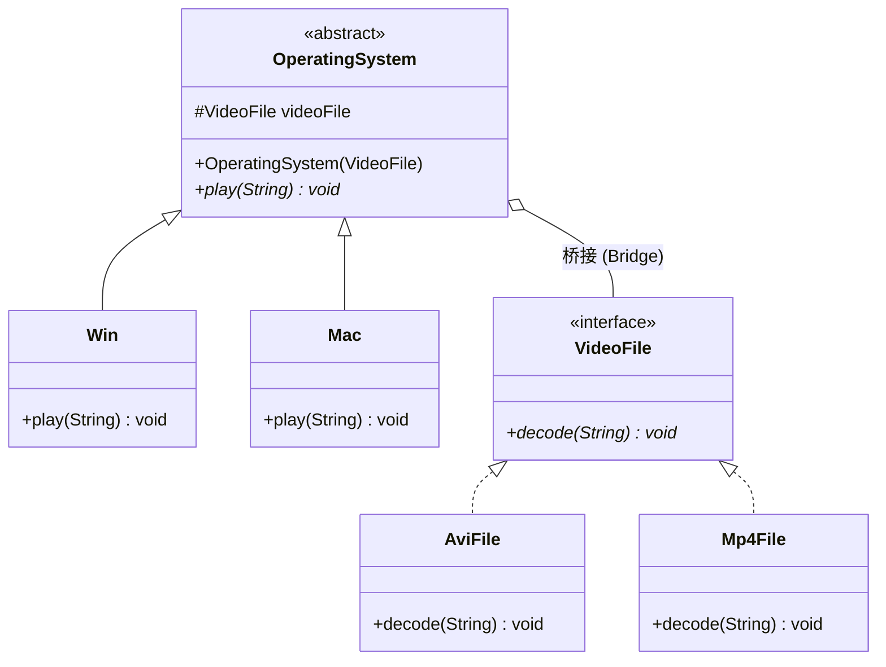

# 桥接模式（Bridge Pattern）期末复习笔记

---

## 📌 一、核心定义（一句话考点）
> **定义**：将**抽象部分与它的实现部分分离**，使它们都可以**独立地变化**。
>
> 💡 **核心地位**：**GoF 23 种设计模式之一**（**对象结构型**模式，重要程度：★★★☆☆）。
> - 别名考点：又称为**柄体（Handle and Body）模式**或**接口（Interface）模式**。
> - 一句话本质：**用“对象组合/聚合（乘法变加法）”取代“多层类继承（类爆炸）”**，专门解决系统中存在**两个独立变化维度**的问题。

---

## 🎨 二、生活经典比喻：毛笔 VS 蜡笔（PPT Slide 5-6 必考灵魂案例）

假设我们要画出 **3 种型号（大、中、小）**、**12 种颜色** 的画：

| 方案 | 现实工具 | 软件设计方案 | 类的数量计算 | 优缺点分析 |
| :--- | :--- | :--- | :--- | :--- |
| **蜡笔方案** | 蜡笔的型号与颜色紧绑在一起 | **传统多层继承** | **$3 \times 12 = 36$ 支蜡笔（36 个类）** | ❌ **类爆炸**。如果增加 1 个超大号，要再造 12 支蜡笔；增加 1 种颜色，要再造 3 支蜡笔。 |
| **毛笔方案** | **毛笔（维度一）+ 调色盘（维度二）** 蘸着画 | **桥接模式（对象组合）** | **$3 + 12 = 15$ 个类即可任意组合** | ✅ **独立扩展**。增加 1 种型号只加 1 支毛笔；增加 1 种颜色只加 1 个颜料盒。 |

---

## 🎯 三、四大核心角色（期末必考）

| 角色名称 | 英文 | 本工程对应类 | PPT 对标 | 职责说明 |
| :--- | :--- | :--- | :--- | :--- |
| **抽象化角色** | Abstraction | [`OperatingSystem.java`](OperatingSystem.java) | `Abstraction` | 维度一的抽象基类。内部维护一个指向实现化角色的引用（`protected VideoFile videoFile;`），充当连接两个维度的**“桥梁”**。 |
| **扩展抽象化角色** | RefinedAbstraction | [`Win.java`](Win.java)、[`Mac.java`](Mac.java) | `RefinedAbstraction` | 维度一的具体子类。扩展父类业务（如 Windows 系统播放、Mac 系统播放），并调用桥接引用的具体实现。 |
| **实现化角色** | Implementor | [`VideoFile.java`](VideoFile.java) | `Implementor` | 维度二的接口。定义底层的基本操作方法（如解码 `decode()`），不直接与外界业务耦合。 |
| **具体实现化角色** | ConcreteImplementor | [`AviFile.java`](AviFile.java)、[`Mp4File.java`](Mp4File.java) | `ConcreteImplementor` | 维度二的具体实现类。具体给出特定格式的解码实现。 |

---

## 💡 四、结构类图与独立扩展维度（Mermaid）

---

## ❓ 五、期末高频简答与深度思辨题

### Q1：为什么子类构造方法里非要写 `super(videoFile)`？
**答题核心要点**：
1. 父类 `OperatingSystem` 拥有带参构造函数 `public OperatingSystem(VideoFile videoFile)`，用于初始化成员变量 `this.videoFile`，且父类没有提供无参构造函数；
2. 子类（如 `Win`）在实例化时，JVM 规定**必须首先调用父类的构造方法完成父类成员的初始化**；
3. `super(videoFile)` 的作用就是把子类接收到的 `VideoFile` 具体对象（如 `AviFile`）传递给父类构造器，使子类能够继承并使用这个被“桥接”进来的对象。

### Q2：桥接模式和策略模式看起来都是一个类聚合一个接口，它们有什么本质区别？
| 对比维度 | 策略模式（Strategy） | 桥接模式（Bridge Pattern） |
| :--- | :--- | :--- |
| **核心意图** | 算法的自由切换，消灭 `if-else` | **解开两个独立变化维度的强耦合，防止类继承爆炸** |
| **继承体系** | 通常只有**单边**有继承体系（只有 Strategy 有很多具体策略实现类，Context 往往只是一个单一的业务类） | **双边都有平行的继承体系**（左边维度有 `OperatingSystem -> Win, Mac`，右边维度有 `VideoFile -> Avi, Mp4`，两端各自独立扩展） |
| **生活场景** | 出门旅行选交通工具（坐飞机/坐高铁） | 毛笔与颜料盒、不同品牌电脑与不同品牌配件 |

### Q3：桥接模式 VS 适配器模式（PPT Slide 28 重点）
- **适配器模式（Adapter）**：属于**事后补救措施**。原本两个接口不兼容，为了协同工作加一个适配器转换。
- **桥接模式（Bridge）**：属于**事前顶层设计**。在系统设计初期就预料到有两个独立维度的变化，提前将它们解耦分离。

---

## 💻 六、工业级与 JDK / 数据库经典应用（期末满分案例）

### 1. JDBC 驱动（Java 数据库连接，PPT Slide 27 教科书案例）
- **维度一（抽象化）**：Java 应用程序调用的官方标准 API（`java.sql.Connection`、`Statement`）；
- **维度二（实现化）**：各大数据库厂商提供的具体驱动实现（`com.mysql.cj.jdbc.Driver`、`OracleDriver`）；
- **桥梁作用**：`DriverManager` 将 Java 标准接口与具体的数据库底层驱动桥接在一起，换数据库只需换驱动 jar 包，业务代码一行不用改。

### 2. Java 虚拟机（JVM 跨平台，PPT Slide 25 案例）
- **维度一**：高层字节码指令与 Java 应用；
- **维度二**：底层硬件平台与操作系统指令集（Windows JVM、Linux JVM）。
