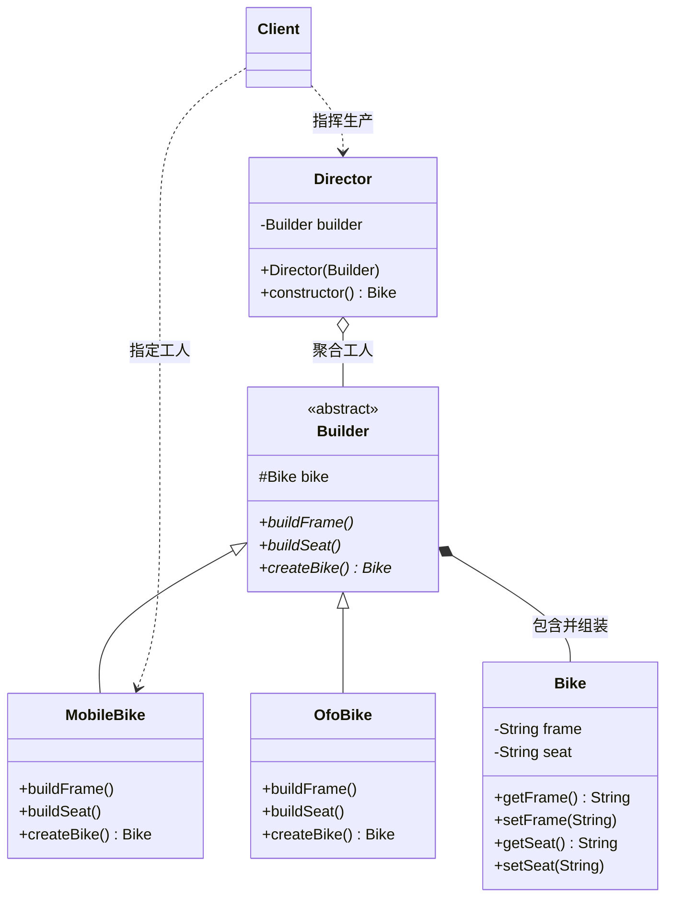

# 建造者模式 / 创建者模式（Builder Pattern）期末复习笔记

---

## 📌 一、核心定义（一句话考点）
> **定义**：将一个复杂对象的**构建与它的表示分离**，使得同样的构建过程可以创建不同的表示。
>
> 💡 **核心思想**：“模块化组装”。主要用于创建由多个零部件组成的**复杂复合对象**（比如自行车有车架、车座；电脑有CPU、主板、内存）。

---

## 🎯 二、传统 GoF 建造者模式的四大角色（期末必考）

| 角色名称 | 英文 | 本工程对应类 | 通俗比喻 | 职责说明 |
| :--- | :--- | :--- | :--- | :--- |
| **产品角色** | Product | [`Bike.java`](Bike.java) | 最终成品（自行车） | 包含多个部件的复杂复合对象。 |
| **抽象建造者** | Builder | [`Builder.java`](Builder.java) | 工人规范标准 | 规定生产各个零部件的规范方法（如 `buildFrame()`、`buildSeat()`）以及交付成品的方法 `createBike()`。 |
| **具体建造者** | ConcreteBuilder | [`MobileBike.java`](MobileBike.java)、[`OfoBike.java`](OfoBike.java) | 具体的工人（摩拜装配工、ofo装配工） | 实现抽象建造者的方法，负责具体生产出符合特定规格的零部件。 |
| **指挥者角色** | Director | [`Director.java`](Director.java) | **工程总指挥 / 车间主任 / 流水线** | **负责控制构建算法和组装顺序**。严格按照流水线步骤指挥工人干活，并最终交付产品。 |

---

## 💡 三、结构与调用类图（Mermaid）



---

## ❓ 四、期末核心拷问与考点（大题重点）

### Q1：指挥者（Director）到底有什么作用？为什么不让 Client 直接调用 Builder？
**答题核心要点**：
1. **固定构建算法与工序顺序（防止翻车）**：
   - 复杂对象的组装具有严格的工序先后顺序（如：盖房子必须“先地基 $\rightarrow$ 再主体 $\rightarrow$ 再封顶”，绝对不能颠倒）。
   - 如果放权给 Client 自己调，Client 可能会**颠倒工序**或者**漏调某个部件**（比如忘了装车座），导致造出残次品。
2. **封装复用组装流程**：
   - 各种业务场景下造自行车的工序是固定的。通过 Director 的 `constructor()` 将工序统一封装，避免在每一个客户端都重复写一遍组装逻辑。
3. **彻底解耦“零部件制作细节”与“组装工序”**：
   - **Builder 负责“怎么做零件”**；
   - **Director 负责“按什么顺序拼起来”**。两者职责分离，任何一方改动互不影响。

---

### Q2：现代开发中（如图片所示）参数多时的链式 Builder 是怎么回事？
**答题核心要点**：
现代工业级开发（源自经典著作《Effective Java》）常采用**简化的链式内部类 Builder**（省略了抽象 Builder 和 Director 类）。

```java
Phone phone = new Phone.Builder()
    .cpu("intel")
    .mainboard("华硕")
    .memory("金士顿")
    .screen("三星")
    .build();
```

**为什么参数多时推荐用它？解决的痛点是什么？**
1. **解决传统构造函数“重载地狱 / 伸缩式构造器（Telescoping Constructor）”**：
   - 当属性有 8~10 个时，传参极易错位（多个连续相同类型的参数传反了，编译器不会报错）。
2. **解决普通 `set` 方法的“半初始化 / 线程安全”问题**：
   - 用 `set` 方法赋值，对象在中间步骤处于不完整、不一致的状态；
   - 链式 Builder 在最后调用 `.build()` 时，可以**统一进行参数合法性校验**，并返回一个不可变的（Immutable）完整对象。

---

### Q3：建造者模式 VS 工厂模式有什么本质区别？（必考辨析题）

| 比较维度 | 工厂模式（Factory Pattern） | 建造者模式（Builder Pattern） |
| :--- | :--- | :--- |
| **关注点** | 关注**生产整件结果**（直接得到一辆自行车、一杯咖啡） | 关注**生产过程与细节组装**（先做车架，再做车座，再拼装） |
| **对象复杂度** | 创建的对象通常较为简单、单一 | 创建由多个复杂部件构成的复合对象 |
| **灵活性** | 统一生产标准规格产品 | 可以通过更换不同建造者或不同组装顺序，得到不同的零部件组合 |

---

## ☕ 五、JDK 与开源框架经典应用

1. **`java.lang.StringBuilder` / `StringBuffer`**：
   - 通过 `append(...)` 方法逐步组装字符串，最后调用 `toString()` 得到成品。
2. **Lombok 注解 `@Builder`**：
   - 自动生成静态内部类链式 Builder。
3. **Spring Framework 中的各类 Builder**：
   - `UriComponentsBuilder`、`BeanDefinitionBuilder` 等。
