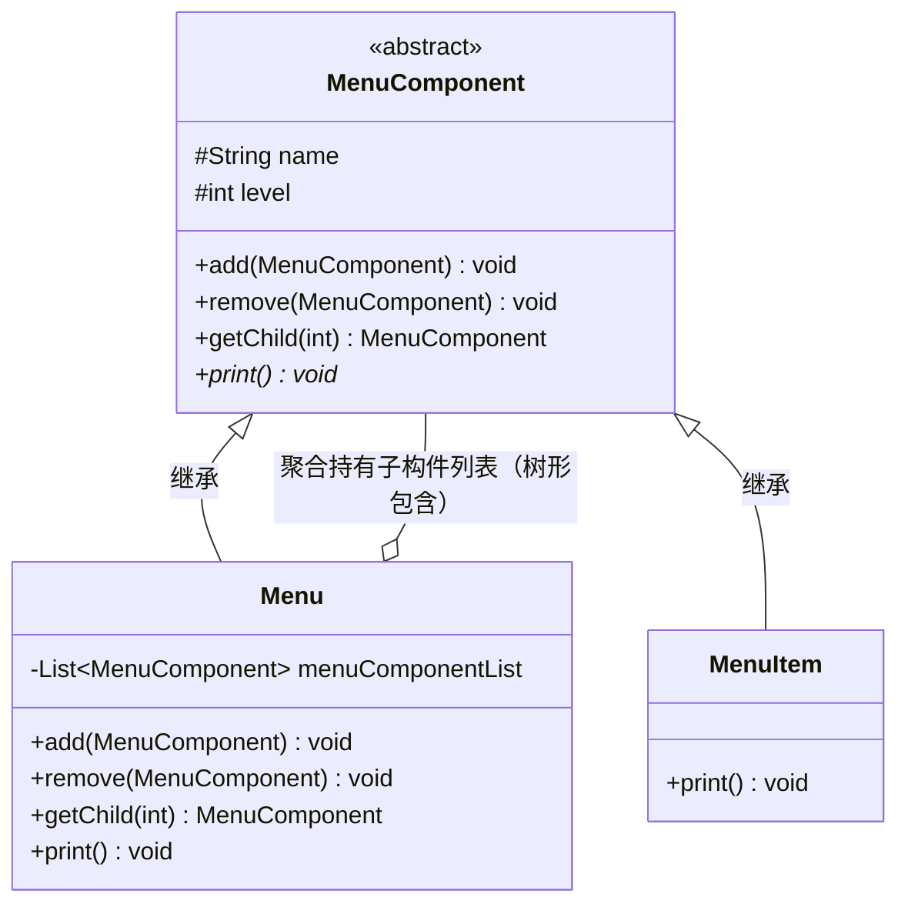

# 组合模式（Composite Pattern）期末复习笔记

---

## 📌 一、核心定义（一句话考点）
> **定义**：组合多个对象形成**树形结构**以表示**“部分-整体”**的结构层次。组合模式对**单个对象（叶子对象）**和**组合对象（容器对象）**的使用具有**一致性**。
>
> 💡 **核心地位**：**GoF 23 种设计模式之一**（**对象结构型**模式，重要程度：★★★★☆）。
> - 一句话本质：**用面向对象的方式处理“树形目录结构”**（如文件夹与文件、系统菜单与菜单项、公司组织架构）。

---

## 🎯 二、三大核心角色（期末必背）

| 角色名称 | 英文 | 本工程对应类 | 树形结构对应 | 职责说明 |
| :--- | :--- | :--- | :--- | :--- |
| **抽象构件** | Component | [`MenuComponent.java`](MenuComponent.java) | 树节点基类 | 定义叶子构件和容器构件的公共接口及默认行为（声明了 `print()` 业务方法，以及管理子节点的 `add()`、`remove()`、`getChild()`）。 |
| **容器构件** | Composite | [`Menu.java`](Menu.java) | **树枝节点（文件夹）** | 容器节点。内部维护一个集合容器（`List<MenuComponent>`），用于存储子构件；实现业务方法时，通常采用**递归调用**。 |
| **叶子构件** | Leaf | [`MenuItem.java`](MenuItem.java) | **叶子节点（具体文件）** | 末端节点，**没有子节点**。实现抽象构件定义的业务方法（如具体的打印）。 |

---

## 💡 三、结构类图与递归时序（Mermaid）



### `print()` 递归调用流程：
```text
Client -> component.print() [总系统]
            │
            ├──> 打印: --总系统
            │
            ├──> 递归调用 menu1.print() [菜单管理]
            │       ├──> 打印: ----菜单管理
            │       ├──> 递归调用 item1.print() -> 打印: ------域名访问
            │       ├──> 递归调用 item2.print() -> 打印: ------菜单访问
            │       └── ...
            │
            ├──> 递归调用 menu2.print() [角色管理]
            │       └── ...
            └── ...
```

---

## ⚖️ 四、透明组合 VS 安全组合（期末最核心辨析题）

PPT（Slide 12-15）重点讲解了组合模式的两种实现形式，这是**期末简答/选择/填空必考重难点**！

| 比较维度 | 透明组合模式（Transparent）<br>*(你当前工程采用的形式)* | 安全组合模式（Safe） |
| :--- | :--- | :--- |
| **管理子节点的方法<br>（add/remove/getChild）声明在何处？** | 声明在 **抽象构件（Component）** 中 | **只声明在 容器构件（Composite）** 中，抽象构件中完全没有这些方法 |
| **叶子节点是否有 add/remove？** | **有**（继承自抽象类，但通常抛出异常或空实现） | **没有**（编译器直接阻止调用） |
| **对客户端的透明性（一致性）** | ✅ **完全透明**。在客户端看来，叶子和容器具备一模一样的方法，客户端可以**完全面向 `MenuComponent` 编程** | ❌ **不透明**。客户端必须区别对待容器和叶子；若要调 `add`，变量必须声明为具体的 `Menu` 类型 |
| **安全性** | ❌ **不够安全**。如果客户端误拿 `MenuItem`（叶子）去调用 `.add()`，编译能通过，但**运行时会抛异常** | ✅ **绝对安全**。叶子根本没有 `add` 方法，若误调在**编译期就会直接报错** |

---

## ❓ 五、`print()` 方法执行原理与期末深度问答

### Q1：`print()` 方法到底是怎么实现整棵树层级打印的？
**答题核心要点**：
1. **缩进打印（`level`）**：
   - 无论是 `Menu` 还是 `MenuItem`，打印自身名称前，都根据自己的 `level` 属性循环打印 `--`，形成类似树形目录的缩进视觉效果。
2. **递归驱动（遍历子集合）**：
   - 叶子节点（`MenuItem`）只打印自己；
   - 容器节点（`Menu`）打印完自己后，通过 `for(MenuComponent c : menuComponentList) c.print();` 遍历子集合；
   - 触发多态递归：如果子节点是叶子，直接打印；如果子节点还是容器，继续向下递归深入，直到把整棵树的枝枝叶叶全部打印完成。

### Q2：组合模式的核心优点和缺点是什么？
- **优点**：
  1. **一致性对待**：客户端调用 `print()` 时，根本不需要写 `if (isFolder) ... else ...`，无论是对待单项还是整棵树，操作一模一样；
  2. **极易扩展（符合开闭原则）**：增加新的叶子构件或容器构件极其简单，树的层级结构可以无限嵌套。
- **缺点**：
  - **难以对容器构件中的子构件类型进行约束**：在 Java 泛型中写的是 `List<MenuComponent>`，容器可以装任何构件，很难在编译期限制“某类文件夹只能装文本文件，不能装图片文件”。

---

## ☕ 六、JDK 与常见框架经典应用（期末加分项）

1. **Java AWT / Swing GUI 容器体系（PPT Slide 30 核心案例）**：
   - `java.awt.Component` $\rightarrow$ 抽象构件；
   - `java.awt.Container`（如 `JPanel`、`JFrame`） $\rightarrow$ 容器构件（可以继续添加按钮、文本框、子面板）；
   - `java.awt.Button`、`Checkbox` $\rightarrow$ 叶子构件。
2. **文件系统与杀毒软件**：
   - 查杀某个目录（`Folder.killVirus()`），内部递归调用子目录和文件的 `killVirus()`。
3. **XML / HTML DOM 树解析**：
   - DOM 树中的 `Node`、`Element` 与 `TextNode`。
