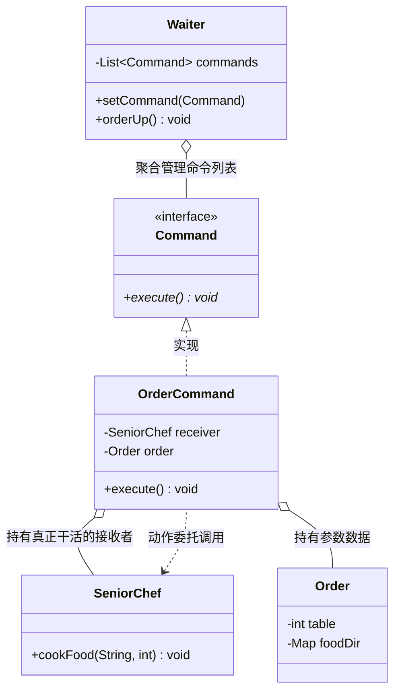

# 命令模式（Command Pattern）期末复习笔记

---

## 📌 一、核心定义（一句话考点）
> **定义**：将一个请求**封装为一个对象**，从而使我们可用不同的请求对客户进行参数化；对请求排队或者记录请求日志，以及支持可撤销的操作。
>
> 💡 **核心抓手**：**把“方法调用（动词）”变成“独立对象（名词）”**！
> - 属于 **GoF 23 种设计模式之一**（**对象行为型**模式）；
> - 又称为**动作（Action）模式**或**事务（Transaction）模式**。

---

## 🎯 二、核心四大角色（期末考试必考）

| 角色名称 | 英文 | 本工程对应类 | PPT 对标 | 通俗比喻与职责 |
| :--- | :--- | :--- | :--- | :--- |
| **抽象命令** | Command | [`Command.java`](Command.java) | `Command` | 声明执行命令的抽象接口（核心方法：`execute()`，扩展方法：`undo()`）。 |
| **具体命令** | ConcreteCommand | [`OrderCommand.java`](OrderCommand.java) | `ConcreteCommand` | **“订单小票”**。持有具体的接收者（厨师）和点单数据（菜单），实现 `execute()` 方法，负责把具体请求转达给接收者。 |
| **调用者 / 请求发送者** | Invoker | [`Waiter.java`](Waiter.java) | `Invoker` | **“服务员”**。持有命令对象（或命令队列集合），通过调用命令对象的 `execute()` 来发出请求，**自身完全不需要知道命令内部是如何实现的**。 |
| **接收者** | Receiver | [`SeniorChef.java`](SeniorChef.java) | `Receiver` | **“大厨”**。最终真正执行具体业务逻辑的人（真正颠勺做菜），是干脏活累活的底层。 |

---

## 💡 三、结构类图与标准调用链（Mermaid）

---

## ❓ 四、灵魂拷问与期末深度简答题（大题必考）

### Q1：为什么不直接让顾客找厨师点菜？为什么要封装出“服务员”和“命令小票”？
**答题核心要点**：
如果顾客直接调用厨师（`chef.cookFood(...)`），相当于请求发送者与接收者**强耦合**，会导致以下致命问题：
1. **无法排队（队列化）**：全餐厅 50 桌客人全堵在厨房门口喊，厨师无法管理请求先后顺序。有了命令小票，服务员可以把订单放入**命令队列（CommandQueue）**按序执行。
2. **无法撤销（Undo / 撤单）**：直接喊话无法撤销；而命令小票可以在厨师真正开火前，被服务员从待办队列中抽取撤销。
3. **无法记录请求日志（Log / 审计重放）**：方法调用稍纵即逝；而命令作为一个**对象**，可以序列化存入数据库/日志文件，系统宕机重启后可重放恢复，财务也能据此对账。
4. **批处理（宏命令 MacroCommand）**：顾客点了一整桌菜，服务员攒齐一批命令后一次性触发，支持组合批处理。

### Q2：命令模式的核心缺点是什么？
- **具体命令类膨胀**：如果系统操作非常多（增加、删除、修改、移动、查询...），针对每一个操作都要建一个 `ConcreteCommand` 类，导致系统中具体命令类数量急剧增加。

---

## 🚀 五、PPT 进阶扩展（PPT 18.5 考试拉分点）

### 1. 撤销（Undo）与恢复（Redo）
- 在 `Command` 接口中增加 `undo()` 方法；
- 调用者（Invoker）内部维护一个**命令历史栈（`Stack<Command>`）**；
- 执行命令时 `push` 入栈；点击撤销时 `pop` 出栈并调用其 `undo()`。

### 2. 宏命令（Macro Command / 组合命令）
- **命令模式 + 组合模式（Composite）** 联用；
- 一个宏命令对象内部包含一个命令集合 `List<Command>`；
- 执行宏命令的 `execute()` 时，递归触发内部所有子命令的 `execute()`，实现“一键执行一系列动作”。

### 3. 记录请求日志（Log Recovery）
- 将命令对象通过 Java 序列化（`Serializable`）写入日志文件；
- 作用：防止断电或崩溃丢失任务，重启后反序列化重新执行，实现事务持久化。

---

## ☕ 六、JDK / 经典技术中的应用（期末必背）
1. **GUI 按钮事件监听（Swing / AWT）**：
   - `JButton`（Invoker）绑定一个 `ActionListener`（抽象命令），点击按钮触发 `actionPerformed()`（即 `execute`），完全不知道具体业务是谁做的。
2. **多线程任务体系（Java 并发体系）**：
   - `Runnable` / `Callable` 就是典型的 **Command 接口**！
   - `Thread` / `ThreadPoolExecutor` 就是 **Invoker（调用者/线程池执行者）**；
   - 线程池可以自由地给任务**排队、延迟执行、记录状态**，这就是最纯正的命令模式！
