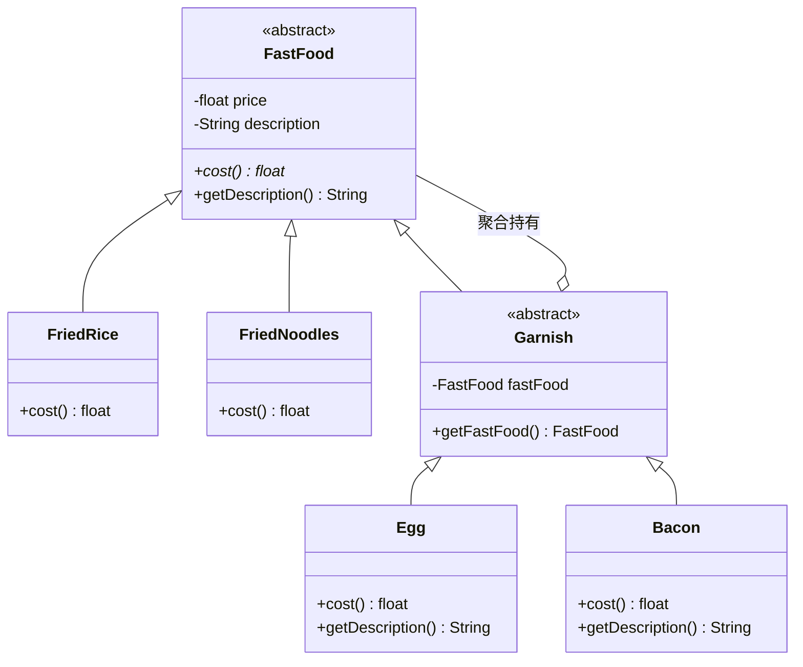

# 装饰者模式（Decorator Pattern）期末复习笔记

---

## 📌 一、核心定义（一句话考点）
> **定义**：在不改变现有对象结构的情况下，动态地给一个对象增加一些额外的职责（功能）。
> 
> 💡 **核心思想**：“动态组合优于类继承”，就像“俄罗斯套娃”或“人穿衣服”，通过一层层包装来扩展功能。

---

## 🎯 二、核心四大角色（期末必背概念）

| 角色名称 | 英文 | 本工程对应类 | 通俗理解 | 职责与考点 |
| :--- | :--- | :--- | :--- | :--- |
| **抽象构件** | Component | [`FastFood.java`](FastFood.java) | 统一身份证 | 规定了规范标准。定义业务方法（如 `cost()`、`getDescription()`），使客户端以统一视角看待被装饰前后的对象。 |
| **具体构件** | ConcreteComponent | [`FriedRice.java`](FriedRice.java)、[`FriedNoodles.java`](FriedNoodles.java) | 实心底料 / 毛坯房 | 核心业务本体，是递归调用的**终点（刹车片）**。提供初始的基础功能和价格。 |
| **抽象装饰者** | Decorator | [`Garnish.java`](Garnish.java) | 配料大管家 | **既继承了构件，又聚合了构件**。把保存被包装对象（`fastFood`）的公共代码收口在此，防止每个配料重复编写。 |
| **具体装饰者** | ConcreteDecorator | [`Egg.java`](Egg.java)、[`Bacon.java`](Bacon.java) | 具体加料 / 衣服 | 具体的增强类。负责给原对象添加具体职责（如加 1 块钱、追加字符串说明），并调用被包装对象的原方法。 |

---

## 💡 三、结构与类关系图（继承 + 聚合）



---

## ❓ 四、高频期末简答题（考点精析）

### Q1：为什么 `Garnish`（抽象装饰者）既要继承 `FastFood`，又要聚合 `FastFood`？
- **继承 `FastFood`（is-a，类型一致性）**：
  让装饰后的对象依然是一个合法的 `FastFood`。这样客户端可以像使用纯炒饭一样使用加蛋炒饭，也可以**继续在外面套下一层装饰者**。
- **聚合 `FastFood`（has-a，行为委托与增强）**：
  装饰者自身不能独立成菜，必须持有被包装的对象，以便在被包装对象的基础之上添加新功能（加价、加说明）。

### Q2：装饰者模式相比普通“继承”有什么优势？
1. **防止“类爆炸”**：如果用继承，主食与配料的各种排列组合（炒饭加单蛋、炒饭加双蛋、加蛋加培根...）会导致子类成百上千；而装饰者模式只需要几个类即可在**运行时动态组合**。
2. **符合开闭原则（OCP）**：新增加一种配料（如芝士），只需要扩展一个新的具体装饰者类，无需修改原有主食和其他配料的代码。

### Q3：运行时调用执行逻辑是怎样的？
- 当执行 `FastFood f = new Bacon(new Egg(new FriedRice()));` 时：
  - 调用 `f.cost()`：
  - `Bacon` 触发 `getFastFood().cost()` 问 `Egg`；
  - `Egg` 触发 `getFastFood().cost()` 问 `FriedRice`；
  - `FriedRice` 到底返回 `10`；
  - `Egg` 收到 `10` 加上自身 `1` 返回 `11`；
  - `Bacon` 收到 `11` 加上自身 `2` 返回 `13`。

---

## ☕ 五、JDK 源码经典对应（高频考点）
**Java I/O 流体系是装饰者模式最经典的教科书级实现**：
- `InputStream` $\rightarrow$ 抽象构件（Component）
- `FileInputStream` $\rightarrow$ 具体构件（ConcreteComponent）
- `FilterInputStream` $\rightarrow$ 抽象装饰者（Decorator）
- `BufferedInputStream`、`DataInputStream` $\rightarrow$ 具体装饰者（ConcreteDecorator）

```java
// 完全等价于: new Bacon(new Egg(new FriedRice()))
InputStream in = new BufferedInputStream(new FileInputStream("data.txt"));
```
