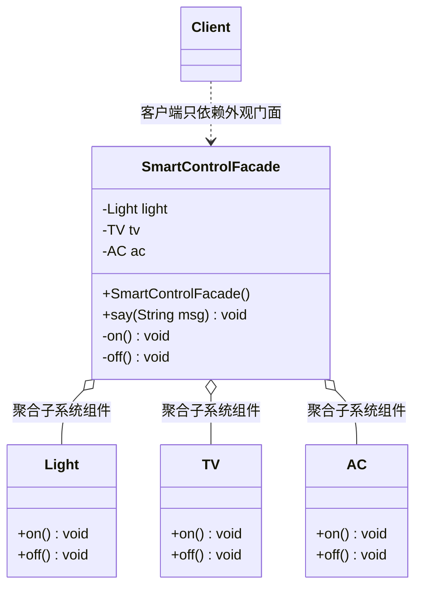
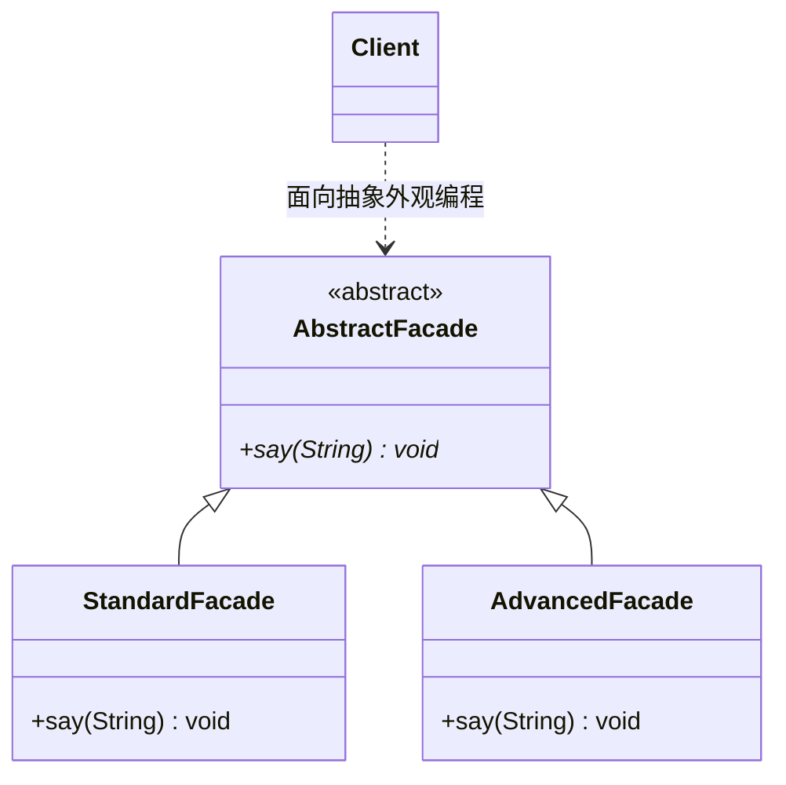

# 外观模式（Facade Pattern）期末复习笔记

---

## 📌 一、核心定义（一句话考点）
> **定义**：外部与一个子系统的通信必须通过一个**统一的外观对象**进行，为子系统中的一组接口**提供一个统一的入口**。外观模式定义了一个**高层接口**，这个接口使得这一子系统更加容易使用。
>
> 💡 **核心地位**：**GoF 23 种设计模式之一**（属于**对象结构型**模式），又称为**门面模式**。
> - 一句话本质：**“提供前台大堂经理，一站式代办”**。例如：去政务大厅办事不用跑税务局、工商局、社保局，直接找综合业务窗口；回家语音一句话打开灯、电视、空调。
> - 核心设计原则：**【迪米特法则（最少知识原则）】的最典型体现**（“不要和陌生人说话”，客户端只与外观类打交道）。

---

## 🎯 二、两大核心角色（期末必背）

| 角色名称 | 英文 | 本工程对应类 | 通俗比喻 | 职责说明 |
| :--- | :--- | :--- | :--- | :--- |
| **外观角色** | Facade | [`SmartControlFacade.java`](SmartControlFacade.java) | **智能音箱/管家** | 核心门面。客户端调用的唯一入口。内部聚合子系统各组件，负责将客户端请求委派给子系统内各对象协同完成。 |
| **子系统角色** | SubSystem | [`Light.java`](Light.java)、[`TV.java`](TV.java)、[`AC.java`](AC.java) | 智能灯、电视机、空调各家电 | 具体的各个独立业务类。负责实现各自的具体功能。它们只专注于自己的业务，并不知道外观角色的存在。 |

---

## 💡 三、结构与调用类图（Mermaid）



---

## 💻 四、代码剖析与执行逻辑

### 1. 没有外观模式 vs 有外观模式
- **没有外观模式**：客户端想要开灯、开电视、开空调，必须自己实例化 3 个类，分别调用 3 个对象的 `on()` 方法。客户端与 3 个子系统紧紧耦合在一起（网状调用）。
- **引入外观模式后**：
  ```java
  // 客户端只需一行代码，找管家！
  SmartControlFacade f1 = new SmartControlFacade();
  f1.say("oh! turn off the devices!");
  ```
  客户端与所有子系统彻底解耦，由 `SmartControlFacade` 统一调度执行。

### 2. 外观类的编码规范（PPT 避坑原则）
1. **不要试图通过外观类为子系统增加新行为**：
   - 外观类只负责**转发、编排与组合**子系统已有的方法，不应在外观类中编写具体的业务逻辑实现。
2. **外观模式并不阻止客户端直接访问子系统**：
   - 如果某个特定客户端需要更精细地控制某台空调的温度，依然可以直接调用 `AC` 的方法。

---

## ⚖️ 五、优缺点与设计原则（期末简答重点）

### 优点：
1. **对客户端屏蔽子系统组件**：减少了客户端所需处理的对象数目，使得子系统使用起来更加简单容易。
2. **松耦合关系**：客户端与子系统之间由强依赖变为通过外观类交互，子系统的变动通常不会影响调用它的客户端。
3. **符合迪米特法则（LoD）**：客户端只和它的“直接朋友”（外观对象）通信，降低了系统的耦合度。
4. **子系统间互不干扰**：一个子系统的修改对其他子系统没有任何影响。

### 缺点（期末常考）：
1. **不能很好地限制客户端直接使用子系统类**：无法强制完全隔离。
2. **在默认结构下，违背开闭原则（OCP）**：如果后续新增、删除或更换子系统组件（例如新加一个“窗帘 Curtain”），必须修改 `SmartControlFacade` 的源代码！

---

## 🚀 六、PPT 进阶扩展：抽象外观类的引入（解决违背 OCP）

### 痛点：
标准外观模式中，如果需要更换或增减子系统，必须改写外观类代码，**违背了开闭原则**。

### 解决方案：
引入**抽象外观类（`AbstractFacade`）**，客户端针对抽象外观类编程，并配合 **XML 配置文件 + Java 反射**：

当需要更换一套子系统控制逻辑时，只需增加一个新的具体外观子类，在配置文件中更换类名即可，完全符合开闭原则！

---

## 🏆 七、真题回放：2024 年期末压轴设计大题原题（10分）

> 📝 **2024 年太原理工大学期末试卷压轴题**：
> “某系统需要提供一个文件加密模块，包含读取源文件（`FileReader`）、求模加密（`CipherMachine`）、保存密文（`FileWriter`）三个独立业务类。要求提供一个统一的加密类，用户直接调用该加密类完成全部操作，无须与各个类直接交互。”
>
> **得分考点**：
> - 模式选型：**外观模式（Facade Pattern）**；
> - 选型理由：为多个复杂子系统提供统一简化的调用入口，符合**迪米特法则**；
> - 角色对应：`EncryptFacade`（外观角色），`FileReader`、`CipherMachine`、`FileWriter`（子系统角色）。

---

## ☕ 八、JDK / 经典开源应用（期末满分案例）

1. **JDBC 数据库工具类封装**：
   日常开发中，数据库操作需要先建 `Connection`，再创建 `Statement`，最后遍历 `ResultSet` 并处理资源关闭。我们编写的 `JDBCUtil` 工具类，把这一套繁琐流程打包成 `executeQuery(sql)`，就是最直观的外观模式。
2. **JavaEE Session 外观模式（Session Facade）**：
   在 EJB 与分布式系统中，通过 `SessionBean` 作为门面，管理业务对象间的复杂交互，为远程客户端提供粗粒度的服务层接口。
3. **Tomcat Servlet 中的 `RequestFacade`**：
   Tomcat 容器内部的 `Request` 对象功能极其强大且包含内部容器方法，为了防止开发者强转并调用容器内部方法，Tomcat 包装了一个 `RequestFacade` 传给 Servlet 的 `doGet/doPost`，只暴露标准的 `HttpServletRequest` 接口。
