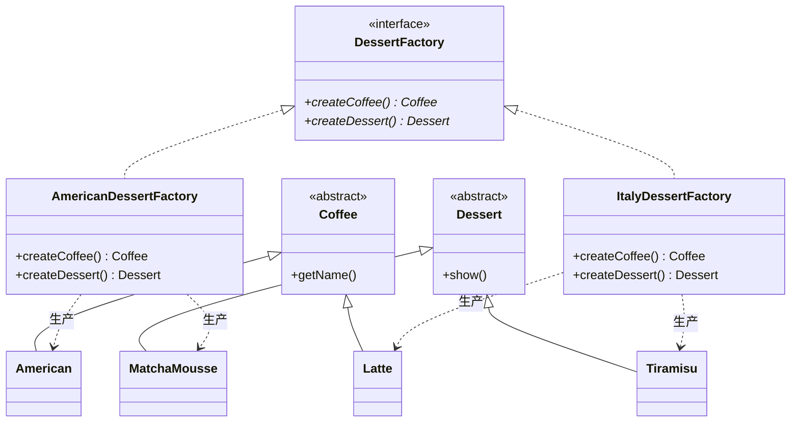

# 抽象工厂模式（Abstract Factory Pattern）期末复习笔记

---

## 📌 一、核心定义（一句话考点）
> **定义**：提供一个创建**一系列相关或相互依赖对象**的接口，而无需指定它们具体的类。
>
> 💡 **核心抓手**：抽象工厂生产的不是“单件物品”，而是**“成套的套装（产品族）”**！
> - **工厂方法模式**：只生产**一种**产品（只生产咖啡）；
> - **抽象工厂模式**：生产**一套配套产品**（既生产咖啡，又生产甜点）。

---

## 🧭 二、两大概念透析（期末名词解释必考）

很多同学觉得抽象工厂乱，根源在于没分清这两个概念：

```text
                  【产品等级】（横向：同一类事物）
                       咖啡              甜点
        ┌───────────────┴─────────────────┴───────────────┐
美式风格 │  美式咖啡 (American)    抹茶慕斯 (MatchaMousse)  │ ◄───【产品族】（纵向：同一个风格/品牌）
意式风格 │  拿铁咖啡 (Latte)       提拉米苏 (Tiramisu)      │ ◄───【产品族】（同一套搭配）
        └─────────────────────────────────────────────────┘
```

1. **产品等级（横向）**：同一种商品类型。比如“咖啡”是一个产品等级，“甜点”是另一个产品等级。
2. **产品族（纵向）**：同一风格、同一品牌的成套组合。比如：
   - 美式族套餐 = 美式咖啡 + 抹茶慕斯；
   - 意式族套餐 = 拿铁咖啡 + 提拉米苏。

👉 **抽象工厂的作用**：**一个工厂子类，专门负责生产一整个“产品族”（整套套餐）！**

---

## 🎯 三、核心四大角色（期末必考）

| 角色名称 | 英文 | 本工程对应类 | 职责说明 |
| :--- | :--- | :--- | :--- |
| **抽象工厂** | AbstractFactory | [`DessertFactory.java`](DessertFactory.java) | 声明了一组用于创建一整套产品的方法（`createCoffee()` + `createDessert()`）。 |
| **具体工厂** | ConcreteFactory | [`AmericanDessertFactory.java`](AmericanDessertFactory.java)、[`ItalyDessertFactory.java`](ItalyDessertFactory.java) | 实现抽象工厂，负责具体实例化**某一个特定产品族**（如意式工厂只生产拿铁+提拉米苏）。 |
| **抽象产品** | AbstractProduct | [`Coffee.java`](Coffee.java)、[`Dessert.java`](Dessert.java) | 为每一种产品等级声明接口（规范不同种类的产品行为）。 |
| **具体产品** | ConcreteProduct | [`American.java`](American.java)、[`Latte.java`](Latte.java)、[`Tiramisu.java`](Tiramisu.java)、[`MatchaMousse.java`](MatchaMousse.java) | 具体的商品实例，实现抽象产品接口。 |

---

## 💡 四、结构与类关系图（Mermaid）



---

## ⚖️ 五、工厂方法 VS 抽象工厂（期末高频辨析题）

| 对比维度 | 工厂方法模式（Factory Method） | 抽象工厂模式（Abstract Factory） |
| :--- | :--- | :--- |
| **工厂方法数量** | 只有一个方法（如 `createCoffee()`） | 有**多个**方法（如 `createCoffee()`、`createDessert()`） |
| **针对维度** | 针对**单一产品等级**（只造咖啡） | 针对**整个产品族**（造整套套餐） |
| **扩展新产品的表现** | 每加一种咖啡，加一个咖啡类和一个工厂类 | 新增一个“套餐族”（如法式套餐）非常优雅 |

---

## ❓ 六、高频期末简答/大题常考点

### Q1：抽象工厂模式最大的现实作用是什么？（为什么要用它？）
**答题核心要点**：
1. **强制“成套搭配”，防止产品混搭冲突**：
   - 比如：意式咖啡店要求端上来的必须是“拿铁 + 提拉米苏”。如果不使用抽象工厂，客户端如果误写成了 `new Latte()` 配 `new MatchaMousse()`，风格就乱套了；
   - 抽象工厂把成套逻辑固化在工厂内部，客户端只要选择了 `ItalyDessertFactory`，生产出来的产品**必定是同一风格的成套产品**。
2. **“一键换套件”极其方便**：
   - 客户端切换整套风格时，只需改动一行代码：
     `DessertFactory factory = new ItalyDessertFactory();` $\rightarrow$ 改为 `new AmericanDessertFactory();`，整套系统的咖啡和甜点全部瞬间统一切换！

### Q2：抽象工厂模式的“开闭原则倾斜性”是什么？（致命考点）
**答题核心要点**：
抽象工厂模式对“开闭原则”的支持呈现出**极大的不平衡性**：
1. **增加产品族（纵向增加）：完全支持开闭原则！**
   - 比如新增“法式风味套餐”（法式咖啡 + 马卡龙），只需新建 `FrenchDessertFactory`、`FrenchCoffee`、`Macaron`，**现有代码完全无需改动**。
2. **增加产品等级（横向增加）：严重违背开闭原则！**
   - 如果饭店要在每个套餐里再多加一种品类——“冰淇淋”，你必须：
     1. 修改抽象工厂 `DessertFactory`，增加 `createIceCream()` 方法；
     2. **所有的具体工厂子类（美式工厂、意式工厂、未来可能写的所有工厂）全部都必须修改一遍！**

---

## 💻 七、现实生活与经典源码对应（期末加分项）

### 1. 经典操作系统/跨平台 UI 皮肤切换（教科书案例）
- 抽象工厂：`UIFactory`（提供 `createButton()`、`createText()`）
- 具体工厂：`WindowsUIFactory`（生产 Win 风格按钮+输入框）、`MacUIFactory`（生产 Mac 风格按钮+输入框）
- 作用：保证一个界面上绝对不会出现“一半是 Windows 按钮，另一半是 Mac 输入框”的怪异混搭。

### 2. 数据库驱动（JDBC 连接池）
- 连接不同数据库时，需要一整套驱动组件（`Connection`、`Statement`、`ResultSet`）。
- 切换到 MySQL 时全套都是 MySQL 组件；切换到 Oracle 时全套都是 Oracle 组件，绝不会出现“用 MySQL 的连接配合 Oracle 的 SQL 解析器”。
