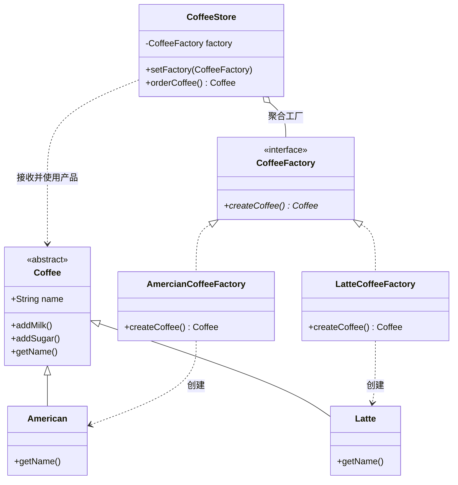

# 工厂方法模式（Factory Method Pattern）期末复习笔记

---

## 📌 一、核心定义（一句话考点）
> **定义**：定义一个用于创建对象的接口，让子类决定实例化哪一个类。工厂方法使一个类的实例化延迟到其子类。
>
> 💡 **核心地位**：**GoF 23 种设计模式之一**（属于创建型模式）。是对“简单工厂模式”的进一步抽象和推广，彻底解决了简单工厂违反开闭原则的问题。

---

## 🎯 二、核心四大角色（期末考试必考）

| 角色名称 | 英文 | 本工程对应类 | 通俗理解 | 职责与考点 |
| :--- | :--- | :--- | :--- | :--- |
| **抽象工厂** | AbstractFactory | [`CoffeeFactory.java`](CoffeeFactory.java) | “咖啡机制造厂标准” | 声明创建产品的工厂方法，返回一个抽象产品。任何具体工厂都必须实现它。 |
| **具体工厂** | ConcreteFactory | [`AmercianCoffeeFactory.java`](AmercianCoffeeFactory.java)、[`LatteCoffeeFactory.java`](LatteCoffeeFactory.java) | “美式咖啡机”、“拿铁咖啡机” | 实现抽象工厂中的工厂方法，**专一且直接地生产对应的具体产品**。 |
| **抽象产品** | Product | [`Coffee.java`](Coffee.java) | “咖啡统一规格” | 定义产品的规范，所有具体咖啡必须具备的公共接口/属性。 |
| **具体产品** | ConcreteProduct | [`American.java`](American.java)、[`Latte.java`](Latte.java) | “美式咖啡本体”、“拿铁本体” | 继承/实现抽象产品，是具体工厂实际生产出来的目标对象。 |

---

## 💡 三、结构与类关系图（Mermaid）



---

## ⚖️ 四、简单工厂 VS 工厂方法（期末高频对比大题）

| 比较维度 | 简单工厂（Simple Factory） | 工厂方法（Factory Method） |
| :--- | :--- | :--- |
| **GoF 23 种模式** | 否（编程习惯/过渡手段） | **是（经典创建型模式）** |
| **工厂类数量** | 只有一个具体的工厂类 | 抽象工厂接口 + 多个具体的工厂子类 |
| **开闭原则（OCP）** | ❌ **违背**。新增产品必须修改工厂内部的 `if-else` | ✅ **严格符合**。新增产品只需扩展新产品和新工厂，不修改原有代码 |
| **类膨胀（缺点）** | 无。类的数量较少，结构简单 | ⚠️ **存在严重的类膨胀**。每加一种产品，必须成对增加一个工厂类 |
| **适用场景** | 创建对象逻辑简单，产品种类极少且几乎固定不扩展 | 产品种类经常扩展，需要完全解耦创建逻辑与客户端 |

---

## ❓ 五、高频期末简答/深度思辨题

### Q1：增加 1 万种产品，就要增加 2 万个类，工厂方法模式这个类膨胀缺点如何破解？
**答题核心要点**：
1. **区分“数据差异”还是“行为差异”**：
   - 现实业务中绝大多数“1 万种咖啡”只是配方参数不同，应设计为数据库的一张表（数据配置驱动），而不是建立 1 万个 Java 类。
2. **结合反射与泛型（现代工业级做法）**：
   - 将工厂方法抽象为泛型工厂：`<T extends Coffee> T create(Class<T> clazz)`，通过反射创建对象。
3. **引入 Spring 框架等 IoC 容器（BeanFactory）**：
   - 不再手写工厂子类，而是通过 Spring 的 `@Component` 自动注册 Bean，Spring 的 `BeanFactory` 统一负责生产和管理，兼具开闭原则与无冗余工厂类。
4. **引入抽象工厂模式（Abstract Factory）**：
   - 当产品有“产品族”概念时，将同一风格的多个产品（如意式咖啡 + 意式甜点）合并到一个工厂中生产，大幅减少工厂类的数量。

### Q2：客户端（`Client`）现在要自己 `new AmercianCoffeeFactory()`，这不还是产生了耦合吗？
**答题核心要点**：
- 观察 [`CoffeeStore.java`](CoffeeStore.java)：**`CoffeeStore` 内部完全只面向抽象接口编程**（`CoffeeFactory` 和 `Coffee`），做到了完全解耦；
- 至于客户端最初决定用哪个具体工厂，通常在实际工程中由**配置文件读取**（如读取 `factory=com.study.AmercianCoffeeFactory`），或者由**依赖注入（DI）**自动传入，客户端代码同样无需硬编码 `new`。

---

## ☕ 六、JDK / 经典开源框架中的应用（期末必答案例）

### 1. `java.util.Collection` 与 `Iterator`（最经典的官方工厂方法）
- **抽象工厂**：`Collection`（集合接口）
- **具体工厂**：`ArrayList`、`LinkedList`、`HashSet`
- **抽象产品**：`Iterator`（迭代器接口）
- **具体产品**：`ArrayList.Itr`、`LinkedList.ListItr`
- **工厂方法**：`Collection.iterator()`
  ```java
  List<String> list = new ArrayList<>();
  // iterator() 就是工厂方法，ArrayList 决定了实例化哪个具体的 Itr 迭代器！
  Iterator<String> it = list.iterator();
  ```

### 2. SLF4J 日志框架（`LoggerFactory`）
- `Logger logger = LoggerFactory.getLogger(Client.class);`
- 底层根据配置动态决定返回 Logback、Log4j2 还是 JDK Logging 的 Logger 实现对象。
