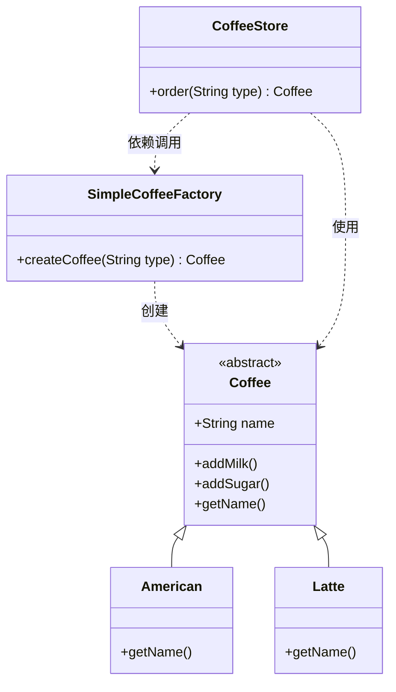

# 简单工厂模式（Simple Factory Pattern）期末复习笔记

---

## 📌 一、核心定义（一句话考点）
> **定义**：由一个工厂对象根据传入的参数，动态决定应该创建哪一种产品类（这些产品类通常继承自同一个父类或实现同一个接口）的实例。
>
> ⚠️ **高频考点**：简单工厂模式**不属于 GoF 23 种设计模式之一**，它更多是一种编程习惯或过渡模式。

---

## 🎯 二、核心角色划分（考试常考角色名）

| 角色名称 | 英文 | 本工程对应类 | 职责与作用 |
| :--- | :--- | :--- | :--- |
| **抽象产品** | Product | [`Coffee.java`](Coffee.java) | 定义产品的公共接口或抽象父类，规定产品的通用行为（如 `addMilk()`、`getName()`）。 |
| **具体产品** | ConcreteProduct | [`American.java`](American.java)、[`Latte.java`](Latte.java) | 具体实现某种产品，继承/实现抽象产品。 |
| **工厂类** | Factory | [`SimpleCoffeeFactory.java`](SimpleCoffeeFactory.java) | 核心角色。包含一个创建产品的方法（如 `createCoffee`），内部封装判断逻辑（`if-else` / `switch`），根据参数直接创建并返回具体产品实例。 |

---

## 💡 三、结构与调用流程（Mermaid 类图）



---

## ❓ 四、高频灵魂拷问（期末面试/简答题大题重点）

### Q1：既然多了一种咖啡依然要在工厂里加 `if-else`，为什么不直接在 `CoffeeStore` 里写？这不是多此一举吗？
**答题核心要点**：
1. **单一职责原则（SRP / 关注点分离）**：
   - `CoffeeStore` 的职责是处理**业务流程**（接单、加糖、加奶、打包）；
   - `SimpleCoffeeFactory` 负责**创建细节**。将业务逻辑与对象的创建逻辑彻底解耦。
2. **避免重复代码（集中管理）**：
   - 现实项目中，除了 `CoffeeStore`，可能还有 `自动售货机`、`外卖服务`、`线上App` 等多个地方需要创建咖啡；
   - 如果没有工厂，每个地方都要写一遍 `if-else`；一旦咖啡类型变动，全系统都要修改；
   - 有了工厂，创建逻辑收口在工厂**一个地方**，改动只影响工厂类。
3. **隐藏复杂构建细节**：
   - 真实场景中，`new` 一个对象可能需要读取配置、连接池、复杂参数；把这堆繁琐代码从业务层抽离出去。

### Q2：简单工厂模式最大的缺点是什么？违反了哪条设计原则？
**答题核心要点**：
- **最大缺点**：**严重违反了“开闭原则”（Open-Closed Principle, OCP）**。
- **解释**：对扩展开放，对修改关闭。系统新增加具体产品时，不得不修改工厂类的源代码（增加 `if-else` 分支），系统扩展性较差。

### Q3：后续如何演进解决简单工厂的缺点？
1. **演进一：工厂方法模式（Factory Method）**
   - 抽象出工厂接口，为每种咖啡提供独立工厂（如 `LatteFactory`、`AmericanFactory`）；
   - 新增咖啡只需扩展新类，不修改原有代码，彻底符合开闭原则。
2. **演进二：简单工厂 + 反射 + 配置文件（Spring IoC 容器的核心思想）**
   - 在工厂中使用 `Class.forName(...)` 读取配置文件，彻底干掉代码里的 `if-else`。

---

## ☕ 五、JDK / 框架中的经典应用（加分项）
- `java.text.DateFormat`：
  ```java
  DateFormat df = DateFormat.getDateInstance(DateFormat.SHORT, Locale.CHINA);
  ```
- `java.util.Calendar`：
  ```java
  Calendar cal = Calendar.getInstance();
  ```
