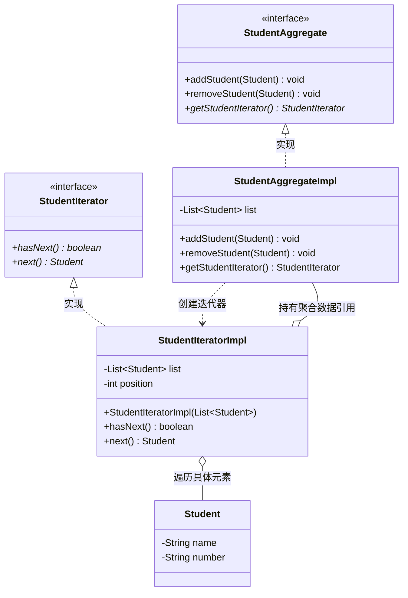

# 迭代器模式（Iterator Pattern）期末复习笔记

---

## 📌 一、核心定义（一句话考点）
> **定义**：提供一种方法**顺序访问一个聚合对象中的各个元素**，而又**无需暴露该对象的内部表示**。
>
> 💡 **核心地位**：**GoF 23 种设计模式之一**（**对象行为型**模式，重要程度：★★★★★）。
> - 又称为**游标（Cursor）模式**；
> - 属于被 Java 语言最彻底吸收内置的模式（Java 集合框架的核心骨架）。

---

## 🎯 二、四大核心角色与 Java 源码标准对标（期末必考）

| 角色名称 | 英文 | 本工程对应类 | Java JDK 标准对标 | 职责与考点 |
| :--- | :--- | :--- | :--- | :--- |
| **抽象聚合** | Aggregate | [`StudentAggregate.java`](StudentAggregate.java) | `Iterable` / `Collection` | 容器接口。声明存储管理元素的接口，最核心的方法是**声明工厂方法获取迭代器**（如 `getStudentIterator()` 或 `iterator()`）。 |
| **具体聚合** | ConcreteAggregate | [`StudentAggregateImpl.java`](StudentAggregateImpl.java) | `ArrayList` / `LinkedList` | 具体容器。真正存储数据结构（数组/链表），实现抽象聚合方法，返回一个绑定了当前容器数据的具体迭代器对象。 |
| **抽象迭代器** | Iterator | [`StudentIterator.java`](StudentIterator.java) | `java.util.Iterator` | 迭代器接口。声明遍历元素所需的标准方法：`hasNext()`、`next()`、`remove()`。 |
| **具体迭代器** | ConcreteIterator | [`StudentIteratorImpl.java`](StudentIteratorImpl.java) | `ArrayList.Itr`（内部类） | 真正执行遍历。维护一个**游标指针（如 `int position = 0`）**，记录遍历位置，实现越界检查和元素提取。 |

---

## 💡 三、结构类图与依赖关系（Mermaid）



---

## ❓ 四、高频期末简答与核心考点（大题必考）

### Q1：为什么要把“存储数据（聚合容器）”和“遍历数据（迭代器）”拆分成两个独立的类？
**答题核心要点**：
1. **单一职责原则（SRP）**：
   - 容器类的职责只有一件事：**管理数据的存储增删**；
   - 迭代器类的职责只有一件事：**管理遍历游标与访问顺序**。两者职责分离，任何一方改动互不影响。
2. **支持“多个客户端同时独立遍历”**：
   - 如果游标直接写在容器类里面，一旦有两个线程或两段代码同时遍历该容器，共用同一个游标指针必然导致**状态冲突错乱**；
   - 拆分成独立迭代器后，每次调用 `getStudentIterator()` 都会产生一个**拥有独立游标（`position = 0`）的新迭代器**，多处同时遍历互不干扰。
3. **隐藏底层数据结构的复杂性**：
   - 无论底层用的是连续数组、单向链表、双向链表还是二叉树，客户端调用统一的 `while(it.hasNext()) { it.next(); }`，对数据结构完全透明。

### Q2：空指针异常（`NullPointerException`）高发排查点？
- 具体迭代器构造函数漏写赋值：
  ```java
  public StudentIteratorImpl(List<Student> list) {
      this.list = list; // ⚠️ 切记不能漏写这行赋值，否则 list 为 null，调 list.size() 必抛 NPE！
  }
  ```

---

## ☕ 五、JDK 源码经典体现（期末满分加分项）

在 Java 中，迭代器模式无处不在：

### 1. 语法糖增强 for 循环（foreach）
平常写的：
```java
for (Student s : studentList) {
    System.out.println(s);
}
```
**底层被 javac 编译器完全翻译为迭代器模式代码**：
```java
Iterator<Student> it = studentList.iterator();
while (it.hasNext()) {
    Student s = it.next();
    System.out.println(s);
}
```

### 2. 内部类机制（`ArrayList.java` 源码）
在 JDK 的 `ArrayList` 源码中，具体迭代器 `Itr` 是作为 `ArrayList` 的**私有内部类（`private class Itr implements Iterator<E>`）**实现的，直接访问外部类的 `elementData` 数组，封装性极高。
