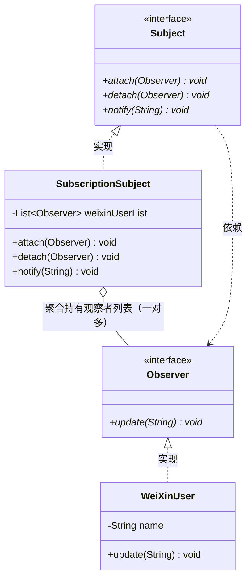

# 观察者模式（Observer Pattern）期末复习笔记

---

## 📌 一、核心定义（一句话考点）
> **定义**：定义对象间的一种**一对多依赖关系**，使得每当一个对象状态发生改变时，其相关依赖对象皆得到通知并被**自动更新**。
>
> 💡 **核心地位**：**GoF 23 种设计模式之一**（**对象行为型**模式，重要程度：★★★★★）。
> - 别名高频考点：又称为**发布-订阅（Publish/Subscribe）模式**、**模型-视图（Model/View）模式**、**源-监听器（Source/Listener）模式**。

---

## 🎯 二、四大核心角色（期末必考）

| 角色名称 | 英文 | 本工程对应类 | 通俗比喻 | 职责说明 |
| :--- | :--- | :--- | :--- | :--- |
| **抽象目标** | Subject | [`Subject.java`](Subject.java) | “公众号运营规范” | 定义观察目标（被观察者）的接口。规定了**增加订阅者（`attach`）、移除订阅者（`detach`）和广播通知（`notify`）**的标准方法。 |
| **具体目标** | ConcreteSubject | [`SubscriptionSubject.java`](SubscriptionSubject.java) | “具体公众号（如人民日报）” | 实现抽象目标。内部维持一个**观察者集合（`List<Observer>`）**；当自身有新动态时，遍历集合通知所有观察者。 |
| **抽象观察者** | Observer | [`Observer.java`](Observer.java) | “读者接口” | 为所有具体观察者定义统一的更新接口。声明接收到通知时所触发的响应方法（核心方法：`update(String msg)`）。 |
| **具体观察者** | ConcreteObserver | [`WeiXinUser.java`](WeiXinUser.java) | “具体的微信粉丝” | 实现抽象观察者。每个粉丝具体实现自己的 `update()` 逻辑（比如弹窗提示、震动或打印消息）。 |

---

## 💡 三、结构类图与广播通知时序（Mermaid）



### 广播通知交互流程：
```text
1. 订阅绑定阶段：
   Client: subject.attach(userA);
   Client: subject.attach(userB);

2. 状态改变触发广播：
   Client: subject.notify("新推文发布了！");
              │
              ├──> userA.update("新推文发布了！") -> 打印通知
              └──> userB.update("新推文发布了！") -> 打印通知
```

---

## 🧠 四、Java 语法答疑：为什么 `List` 里可以存 `Observer` 接口？

这是 Java 集合与多态的基础核心：
```java
private List<Observer> weixinUserList = new ArrayList<Observer>();
```

### 核心语法规则拆解：
1. **“接口不能实例化”到底指什么？**
   - 接口不能直接 `new Observer()`，因为接口里没有具体的代码实现；
2. **但“接口可以充当引用变量类型 / 泛型约束”！**
   - `List<Observer>` 的真正含义是：**“这个列表是一个多态容器，里面可以存放任何【实现了 Observer 接口】的具体类对象”**。
   - 比如你传入的 `new WeiXinUser("张三")`，因为 `WeiXinUser implements Observer`，根据向上转型规则，它完全符合要求！
3. **为什么必须放接口，而不是放具体类 `List<WeiXinUser>`？（设计模式精髓）**
   - 如果写 `List<WeiXinUser>`，以后系统想增加“短信通知（`SmsUser`）”或“邮件通知（`EmailUser`）”，这个列表就存不下了！
   - 面向接口设计，让公众号既能存微信用户，也能存短信用户，广播时只要一视同仁调一句 `obs.update(msg)`，**完美支持多态广播**！

---

## ⚖️ 五、观察者模式优缺点（期末大题常考）

### 优点：
1. **观察目标与观察者之间实现抽象解耦**：公众号根本不需要知道粉丝具体是张三、李四还是某台服务器，只知道他们实现了 `Observer` 接口。
2. **支持一对多的广播通信**：目标对象只需要发送一次通知，所有订阅者自动响应。
3. **符合开闭原则（OCP）**：新增加一种观察者（如短信接收类），原有的公众号和微信用户类一行代码都不用改。

### 缺点（必背）：
1. **通知耗时问题**：如果观察者非常多，逐个遍历调用 `update()` 会耗费较多时间（通常引入异步/多线程消息队列 MQ 优化）。
2. **循环依赖风险**：如果观察者和观察目标之间存在互相依赖（A 变了通知 B，B 变了又通知 A），可能引发死循环导致系统崩溃。

---

## 💻 六、现实技术与开源框架中的应用（期末满分案例）

### 1. Java 经典事件监听机制（AWT/Swing、Android 点击事件）
- **事件源（Button）** $\rightarrow$ `Subject`（目标）
- **点击监听器（`ActionListener`）** $\rightarrow$ `Observer`（观察者）
- `button.addActionListener(...)` $\rightarrow$ 对应 `attach()` 注册观察者！

### 2. 经典 MVC 架构（PPT Slide 29 重点）
- **Model（模型）** $\rightarrow$ 充当观察目标（Subject）；
- **View（视图）** $\rightarrow$ 充当观察者（Observer）；
- 当 Model 中的业务数据改变时，自动触发通知 View 刷新页面！

### 3. Spring 事件监听机制 / 消息中间件（MQ）
- Spring 的 `ApplicationEventPublisher`（发布事件）与 `@EventListener`（监听事件）；
- Kafka、RabbitMQ 的发布-订阅（Pub/Sub）消息队列。
