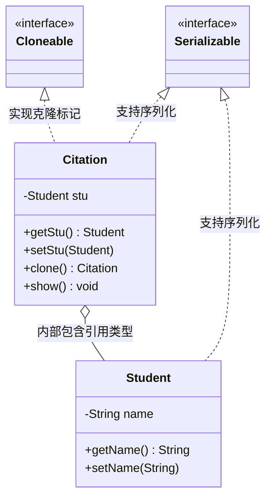

# 原型模式（Prototype Pattern）期末复习笔记

---

## 📌 一、核心定义（一句话考点）
> **定义**：用一个已经创建的实例作为原型，通过**复制（克隆）该原型对象**来创建一个和原型相同或相似的新对象。
>
> 💡 **核心地位**：**GoF 23 种设计模式之一**（**创建型**模式，重要程度：★★★★☆）。
> - 一句话本质：**“不通过 new 调构造函数，而是直接在内存中二进制拷贝对象”**（孙悟空拔一根毫毛变出一模一样的小猴子）。

---

## 🎯 二、三大核心角色（期末必背）

| 角色名称 | 英文 | 本工程/Java 对标 | 职责说明 |
| :--- | :--- | :--- | :--- |
| **抽象原型** | Prototype | `java.lang.Cloneable` 接口 | 声明克隆方法的接口规范（Java 中通过实现标记接口 `Cloneable` 来指定）。 |
| **具体原型** | ConcretePrototype | [`Realizetype.java`](Demo/Realizetype.java)、[`Citation.java`](test1/Citation.java) | 实现抽象原型的类，重写 `clone()` 方法，提供复制自身的核心逻辑。 |
| **访问类 / 客户类** | Client | [`Client.java`](Demo/Client.java)、[`CitationTest.java`](test1/CitationTest.java) | 提出创建请求，直接调用具体原型的 `clone()` 获取新对象。 |

---

## 💡 三、结构类图与克隆流程（Mermaid）



---

## 🔬 四、深度剖析：奖状案例中“浅克隆 VS 深克隆”的惨痛教训

你工程中的两个案例 [`test`](test/) 和 [`test1`](test1/) 完美展示了深浅克隆的差异：

### 1. 浅克隆翻车实录（`test` 目录）
在 `test` 中，奖状只有 `private String name;`。
- 因为 Java 中的 `String` 是不可变常量（每次修改都是指向常量池新地址），所以浅克隆看起来正常；
- **但是一旦奖状引入了真正的引用对象：`private Student stu;`**（`test1` 目录）：
  - 若使用浅克隆：`Citation c1 = citation.clone();`
  - 当我们修改 `c1.getStu().setName("李四")`；
  - **惨案发生**：原来的 `citation.getStu().getName()` **也变成了“李四”**！原对象的奖状被篡改了！因为两个奖状腹中**共享着同一个 `Student` 对象**！

---

## 🧠 五、序列化与深克隆核心疑难（零基础通俗大白话）

你最疑惑的几个点，我们用生活比喻一次性彻底讲明白：

### Q1：我没学过输入输出流，深克隆为什么要用“序列化”？到底在干嘛？
**大白话比喻：【乐高赛车的快递拆箱】**
1. **现状**：内存里的对象树非常复杂，一个 `Citation` 内部连着一个 `Student`，可能还连着学校、班级等一堆复杂指针。
2. **序列化（`ObjectOutputStream` 写出）**：
   - 相当于把这一整辆拼好的乐高赛车**完全拆散**，按照拼装图纸的规则，把每一个零件和连接顺序打成一串“二进制快递包裹”（字节流），存到了 `test.txt` 文件里；
3. **反序列化（`ObjectInputStream` 读入）**：
   - 相当于收到快递后，快递员**完全依照那张图纸，拿出一批全新的塑料零件，重新拼装出一辆一模一样的新赛车**！
4. **效果**：
   - 重新拼出来的这辆赛车，里面每一个零件（`Student`、`Citation`）都是全新生产出来的！
   - 原赛车和新赛车之间的任何指针、联系**彻底断开**，这就在不手动写递归克隆代码的情况下，**一键实现了最完美的“深克隆（Deep Clone）”**！

---

### Q2：为什么点开 `test.txt` 发现里面全是乱码？
**答题核心要点**：
- `test.txt` 虽然后缀叫 `.txt`，但它根本**不是给人肉阅读的纯文本（Plain Text）**！
- `ObjectOutputStream` 写入的是 Java 内部专用的**二进制序列化协议（Binary Stream）**：
  - 它以魔法头 `0xAC 0xED` 开头，里面记载了类的全限定名、类签名版本（`serialVersionUID`）、属性名、哈希值以及二进制内存数据；
- 你用记事本（以 UTF-8 或 GBK 字符集）去强行解码这一堆二进制机器码，不可见控制字符和二进制字节自然被渲染成了所谓的**“乱码”**。

---

### Q3：为什么 `Student` 和 `Citation` 必须都要 `implements Serializable`？
**答题核心要点**：
1. **`Serializable` 是 JVM 的“安检通行证”（标记接口）**：
   - 接口内部没有任何方法。它的唯一作用是明确告诉 Java 虚拟机：“我这个类的数据是安全的，允许被转换成二进制字节流运走/存盘”。
2. **对象图的递归安全性检查（防止抛出 `NotSerializableException`）**：
   - 当序列化 `Citation` 时，JVM 会检查它肚子里的所有成员变量；
   - 发现里面有一个成员 `Student stu`；
   - **如果 `Student` 没写 `implements Serializable`**，JVM 会认为这个类是不可序列化的敏感对象（或者包含线程、文件句柄等无法保存的系统资源），**立即抛出 `java.io.NotSerializableException` 异常，中断整个序列化**！
   - 所以：**整棵对象树上的每一个类，都必须持有 `Serializable` 通行证！**

---

## 🚀 六、PPT 进阶扩展：带原型管理器的原型模式（PPT 8.5 重点）

PPT（Slide 29-31）提到了原型模式的高级扩展——**原型管理器（Prototype Manager）**：

```text
[ 客户端 Client ]
       │ 1. 索取原型: get("三好学生奖状")
       ▼
[ 原型管理器 PrototypeManager ] ── 内部维护 Map/Hashtable ──> [ 预存原型模板集合 ]
       │ 2. 调模板的 clone()
       ▼
返回崭新的克隆对象给客户端！
```

- **本质**：**“原型模式 + 工厂模式 + 缓存池”** 的结合体。
- **作用**：内部维护一个 `Hashtable<String, Prototype>`。启动时预先初始化各种常用原型（如三好学生奖状模板、优秀干部奖状模板），客户端按需索取时，管理器在内存中 `clone()` 出一份新的交付给客户端使用。
