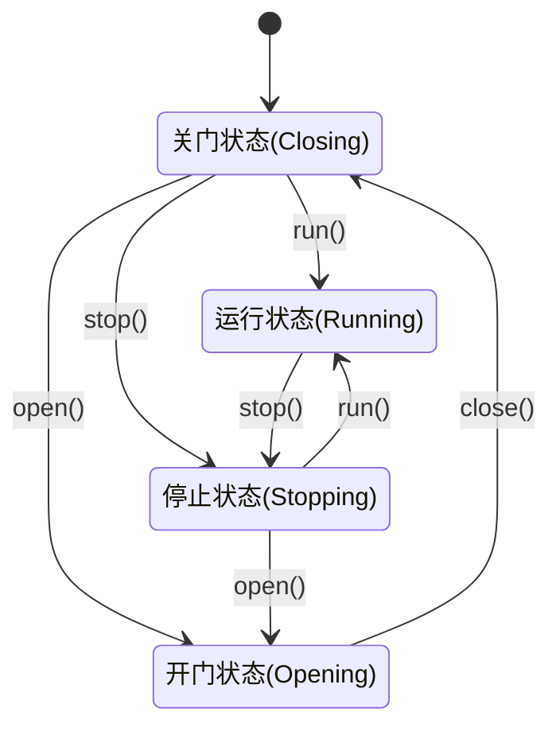
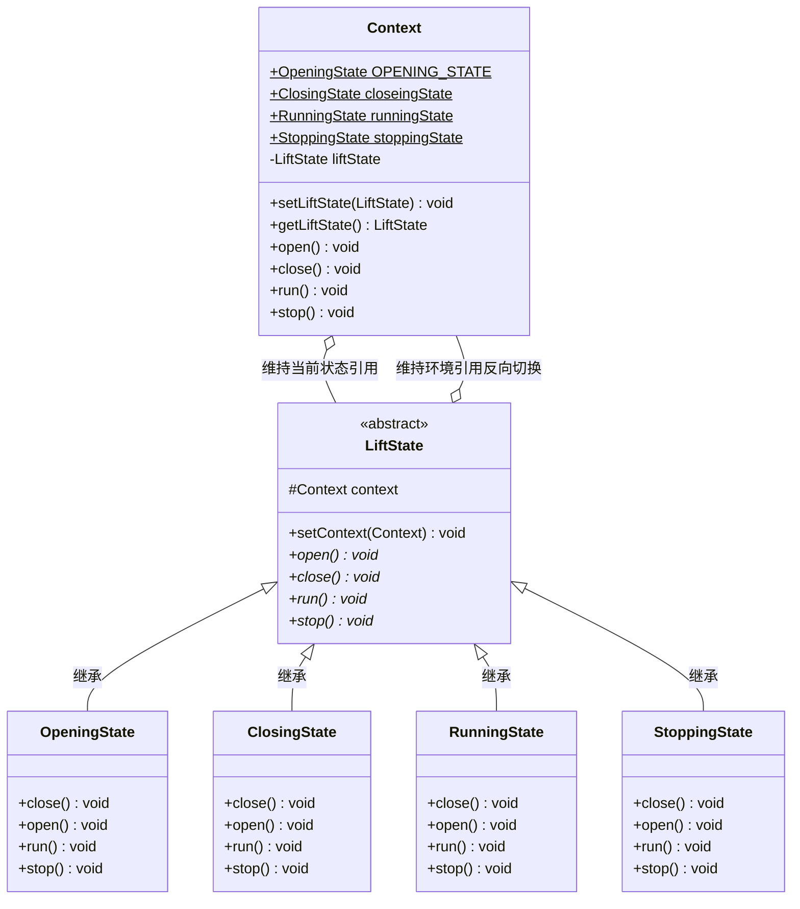

# 状态模式（State Pattern）期末复习笔记

---

## 📌 一、核心定义（一句话考点）
> **定义**：允许一个对象在其**内部状态改变时改变它的行为**，**对象看起来似乎修改了它的类**。
>
> 💡 **核心地位**：**GoF 23 种设计模式之一**（属于**对象行为型**模式），别名**状态对象（Objects for States）**。
> - 一句话本质：**“行为随着状态变，消除庞大 switch-case”**。把每一个状态对应的分支逻辑封装成独立的类，让状态类自行负责状态的检查和流转。
> - 生活比喻：人的心情（开心/愤怒/悲伤状态下对同一句话的反应不同）；水在固态（冰）、液态（水）、气态（汽）下的物理特性随温度状态自发改变。

---

## ⚖️ 二、重构前后对比（before VS after 核心痛点）

本工程中通过电梯案例演示了传统做法与状态模式重构后的鲜明对比：

### 1. 传统写法痛点（见 [`before/Lift.java`](before/Lift.java)）
```java
// 每一个动作方法中都要写一大堆繁重的 switch-case / if-else
public void open() {
    switch (this.state) {
        case OPEN: /* do nothing */ break;
        case CLOSING: System.out.println("开门"); setState(OPEN); break;
        case STOPPING: System.out.println("开门"); setState(OPEN); break;
        case RUNNING: /* 运行时不能开门 */ break;
    }
}
```
- **核心缺陷**：
  1. **代码膨胀，难以维护**：4 个状态 × 4 个动作 = 16 种分支判断，代码极其臃肿；
  2. **严重违背开闭原则（OCP）**：如果新加一个“维修中”或“故障锁定”状态，必须逐个修改 `open()`、`close()`、`run()`、`stop()` 每一个方法的 `switch` 结构，极易改出 Bug；
  3. **职责过重**：电梯类既负责电梯业务，又负责管理复杂的状态流转，违背单一职责原则（SRP）。

### 2. 状态模式解法（见 [`after/`](after/)）
把每个状态独立封装为一个类（`OpeningState`、`ClosingState`、`RunningState`、`StoppingState`），所有与状态相关的行为都在专门的状态类中实现，状态转换也由状态类自主完成。

---

## 🎯 三、三大核心角色（期末必背）

| 角色名称 | 英文 | 本工程对应类 | PPT 对标 | 职责说明 |
| :--- | :--- | :--- | :--- | :--- |
| **环境类 / 上下文** | Context | [`Context.java`](after/Context.java) | `Context` | 拥有多种状态的对象。维持一个对抽象状态类的引用（`liftState`），把外部对动作的请求委派给当前状态对象执行。 |
| **抽象状态类** | State | [`LiftState.java`](after/LiftState.java) | `State` | 接口或抽象类。声明所有具体状态所共有的公共业务方法（`open()`, `close()`, `run()`, `stop()`），并持有 `Context` 的引用。 |
| **具体状态类** | ConcreteState | [`OpeningState.java`](after/OpeningState.java)、[`ClosingState.java`](after/ClosingState.java)、[`RunningState.java`](after/RunningState.java)、[`StoppingState.java`](after/StoppingState.java) | `ConcreteState` | 实现抽象状态类。实现该状态下所允许的行为，并在执行后**控制环境对象切换到下一个状态**。 |

---

## 💡 四、状态转换逻辑与类图（Mermaid）

### 1. 电梯状态机流转图


### 2. 类结构图


---

## ⚖️ 五、优缺点与设计原则（期末考试陷阱）

### 优点：
1. **封装状态转换规则**：把分散在各个业务方法里的分支语句集中到了状态类中管理；
2. **消灭臃肿条件分支**：消除客户端和业务类中庞大的 `if-else / switch-case`；
3. **高内聚**：把特定状态下的所有行为封装在单独的类中；
4. **共享状态对象**：多个环境对象可以共享静态状态实例（如 `Context.OPENING_STATE`），减少系统内存消耗。

### 缺点（必背易错点）：
1. **类数量增加**：每个状态都需要定义一个具体状态类，导致类数量增多；
2. **结构与实现较复杂**：使用不当容易导致程序结构混乱；
3. **⚠️ 对开闭原则（OCP）支持并不好**：
   - 因为各个状态之间存在流转衔接关系，如果要增加一个新的状态类，往往必须修改现有的某些具体状态类（修改它们的流转目标），甚至还要修改环境类！

---

## 🥊 六、期末超高频对比：策略模式 VS 状态模式（PPT 原表）

| 对比维度 | 策略模式（Strategy Pattern） | 状态模式（State Pattern） |
| :--- | :--- | :--- |
| **核心意图** | 封装**可相互互换的算法**，供客户端主动选择 | 对象的行为随着**内部状态改变而改变** |
| **客户端角色** | **主动选择**：客户端必须清楚各种策略并显式注入 | **被动调用**：客户端只管调用方法，不关心内部状态如何流转 |
| **策略/状态间关系** | **完全独立**：各个策略类之间互不了解、毫无关联 | **紧密关联**：状态类知道流转规则（状态机） |
| **切换控制权** | 由**客户端**外部控制切换 | 由**环境类内部或具体状态对象自身自动**流转 |
| **对 OCP 的支持** | ✅ **完美支持开闭原则** | ❌ **对开闭原则支持较差** |
| **生活比喻** | 出门旅行：主动挑选坐飞机、高铁还是汽车 | 人类心情：受到外界刺激，在开心与生气之间自动流转 |

---

## ☕ 七、PPT 经典案例与工业级应用

1. **酒店客房系统**：
   - 房间状态在“空闲”、“已预订”、“已入住”之间自发转换；
2. **银行信用卡账户业务系统**：
   - 根据账户余额的不同，账户在“正常状态（余额 $\ge$ 0）”、“透支状态（-2000 < 余额 < 0）”、“受限状态（余额 = -2000）”之间自动切换；
3. **工作流审批系统（OA 办公系统）**：
   - 批文流转：“尚未办理” $\rightarrow$ “正在办理” $\rightarrow$ “正在批示” $\rightarrow$ “正在审核” $\rightarrow$ “已经完成”；
4. **RPG 游戏角色控制**：
   - 人物角色处于“正常”、“中毒”、“狂暴”、“虚弱”状态时，攻击防御属性和施法技能完全不同。
