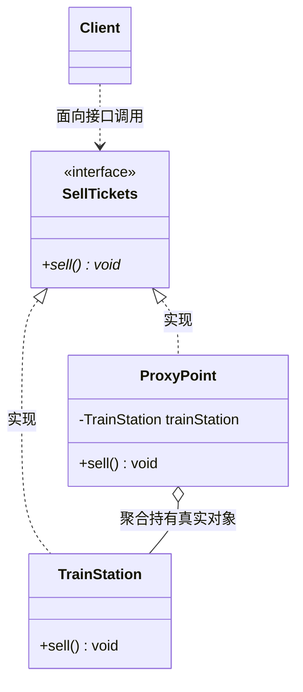

# 代理模式（Proxy Pattern）期末复习笔记

---

## 📌 一、核心定义（一句话考点）
> **定义**：给某一个对象提供一个代理，并由代理对象**控制对原对象的引用**。
>
> 💡 **核心抓手**：代理对象在客户端与目标对象之间起到**“中介”**作用，可以在不修改目标对象的前提下，通过代理对象**控制访问权限（保护/拦截）**或**添加额外服务（增强功能）**。

---

## 🎯 二、三大核心角色（期末必考）

| 角色名称 | 英文 | 本工程对应类 | PPT 对标 | 通俗理解与职责 |
| :--- | :--- | :--- | :--- | :--- |
| **抽象主题** | Subject | [`SellTickets.java`](SellTickets.java) | `Subject` | 业务接口。声明真实主题和代理主题的公共业务方法，确保**代理对象与真实对象对客户端是透明可替换的**。 |
| **真实主题** | RealSubject | [`TrainStation.java`](TrainStation.java) | `RealSubject` | 核心业务本体（火车站）。拥有真正核心业务逻辑（真正的出票、扣减库存），是最终干活的人。 |
| **代理主题** | Proxy | [`ProxyPoint.java`](ProxyPoint.java) | `Proxy` | 门卫/代售点。**实现抽象主题并聚合真实主题**，在调用真实主题前后增加前置/后置功能（如收取手续费、验身权限）。 |

---

## 💡 三、结构类图与标准调用链（Mermaid）



### 经典调用执行流程（PPT 标准模板）：
```java
public void sell() {
    // 1. preRequest(): 前置增强（如收取 5 元手续费、验证身份权限）
    System.out.println("Some service fee!");
    
    // 2. 真实委托：调用真实主题的核心业务
    trainStation.sell();
    
    // 3. postRequest(): 后置增强（如打印流水账单、日志记录）
}
```

---

## ⚖️ 四、PPT 内容答疑：讲的是静态代理还是动态代理？

**结论**：你的 PPT **核心主体 100% 讲的是静态代理（Static Proxy）**！
- **PPT 16.1 ~ 16.4 全部是静态代理**：包括定义、三大角色、类图代码、两个大综合实例（论坛权限控制代理、收费商务查询系统代理），全都是程序员在编译前手写 `ProxyPoint` 类。
- **动态代理（Dynamic Proxy）**：仅在 PPT 最后（16.5 模式扩展 Slide 30-31）作为**拓展补充**提到（使用 JDK 的 `InvocationHandler` 和 `Proxy.newProxyInstance`）。
- **期末复习结论**：**主攻静态代理**即可，理解“实现同一接口 + 内部持有真实对象”的静态写法；对动态代理只需记住“运行时通过反射动态生成代理类，常用于 Spring AOP”即可。

---

## ❓ 五、高频期末简答与核心考点（考试拉分项）

### Q1：为什么代理类不能直接自己把票卖了，而必须聚合 `TrainStation` 并委托它卖票？
**答题核心要点**：
1. **核心业务与权限的唯一性**：
   - 票务系统的总库存扣减、防伪编码生成、数据库落盘等核心能力，只有真实对象（火车站）才具备；代售点根本没有造票的权限与能力。
2. **单一职责原则与开闭原则**：
   - 火车站只专注核心出票业务；代售点只专注外围服务（收费、核身）。若直接在代售点重写业务，就变成了“篡改原有业务”，失去了代理“中介协调、无侵入增强”的本质。

### Q2：常见代理模式有哪些类型？（PPT Slide 11-12 重点考点）
1. **远程代理（Remote Proxy）**：为一个位于不同地址空间（如另一台服务器）的对象提供本地代理（如 Java RMI、RPC 远程调用）。
2. **虚拟代理（Virtual Proxy）**：对于开销巨大的对象，先创建一个较小的虚拟代理占位，真正使用时才去创建真实对象（如网页大图加载前先显示占位小图标）。
3. **保护代理（Protect Proxy）**：控制对一个对象的访问权限，给不同用户提供不同权限级别（PPT 实例 1：论坛已注册用户与游客的权限控制）。
4. **缓冲代理（Cache Proxy）**：为操作结果提供缓存，避免重复调用耗时计算。
5. **智能引用代理（Smart Reference Proxy）**：在访问对象时附加额外操作（如计算被调用的次数、垃圾回收计数）。

### Q3：装饰者模式 VS 代理模式有什么区别？（期末高频对比辨析题）
| 比较维度 | 代理模式（Proxy） | 装饰者模式（Decorator） |
| :--- | :--- | :--- |
| **核心意图** | **控制访问**（中介、权限拦截、延迟加载） | **增强功能**（动态叠加职责、丰富自身行为） |
| **对象创建** | 通常代理类**自己内部管理真实对象的生命周期**（如 `private TrainStation trainStation = new TrainStation();`），客户端可能根本感知不到真实对象的存在 | 客户端通常自己创建核心对象，然后像套娃一样作为构造参数传进去（如 `new Bacon(new Egg(rice))`） |
| **层次结构** | 只有一层代理中介 | 可以无限层级嵌套包装（俄罗斯套娃） |

---

## ☕ 六、JDK / 框架中的经典应用
1. **Spring AOP（面向切面编程）**：Spring 最底层的日志切面、事务注解（`@Transactional`）本质都是通过代理模式实现的。
2. **MyBatis Mapper 接口**：我们只写接口不写实现类，MyBatis 在底层为接口生成代理对象执行 SQL。
3. **Java RMI（远程方法调用）**：客户端的 `Stub`（存根）就是服务端的远程代理对象。
