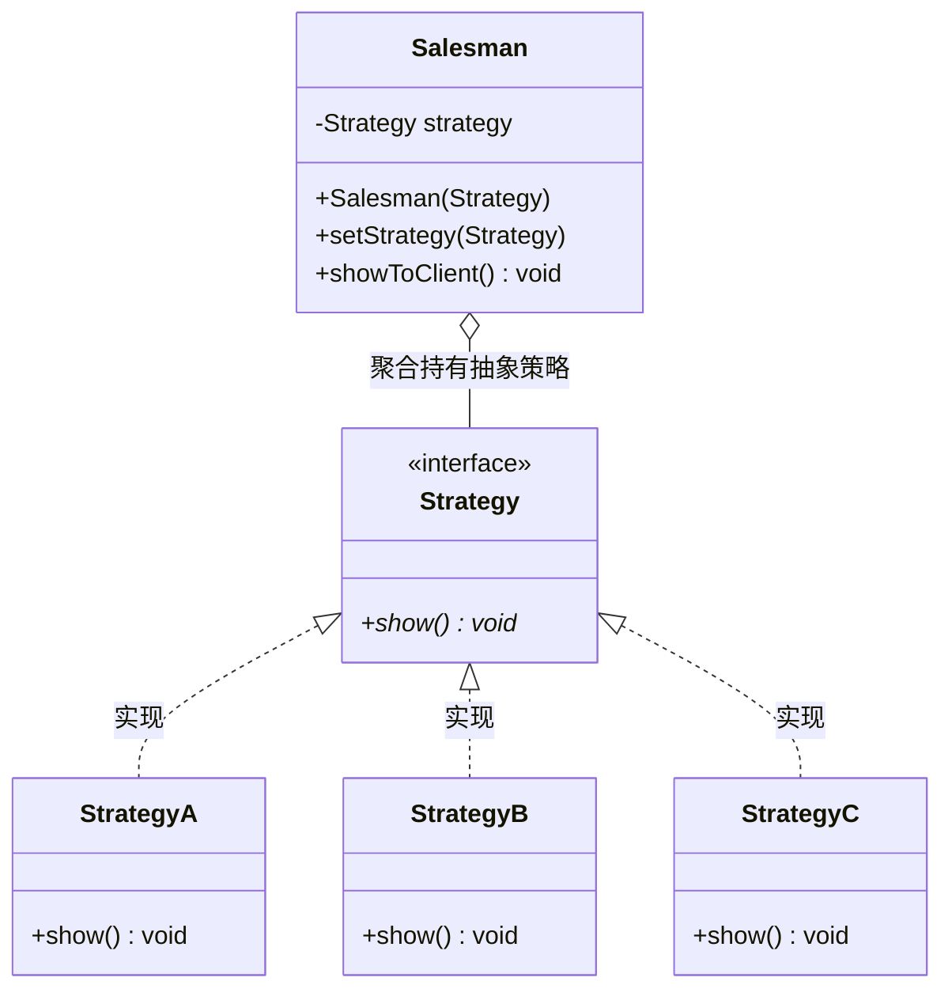

# 策略模式（Strategy Pattern）期末复习笔记

---

## 📌 一、核心定义（一句话考点）
> **定义**：定义一系列算法，将每一个算法封装起来，并让它们可以**相互替换**。策略模式让算法独立于使用它的客户而变化。
>
> 💡 **核心地位**：**GoF 23 种设计模式之一**（属于**对象行为型**模式），又称为**政策（Policy）模式**。
> - 一句话本质：**“条条大路通罗马，算法自由切换”**。用面向对象的多态，彻底消灭臃肿难维护的 `if-else` 或 `switch-case`。

---

## 🎯 二、三大核心角色（期末必背）

| 角色名称 | 英文 | 本工程对应类 | PPT 对标 | 职责说明 |
| :--- | :--- | :--- | :--- | :--- |
| **环境类 / 上下文** | Context | [`Salesman.java`](Salesman.java) | `Context` | 业务管理者。维持一个对抽象策略类的引用（`strategy`），负责把请求委托给具体策略执行。 |
| **抽象策略** | Strategy | [`Strategy.java`](Strategy.java) | `Strategy` | 策略接口或抽象类。声明所有具体算法的公共接口（如 `show()` 或 `algorithm()`）。 |
| **具体策略** | ConcreteStrategy | [`StrategyA.java`](StrategyA.java)、[`StrategyB.java`](StrategyB.java)、[`StrategyC.java`](StrategyC.java) | `ConcreteStrategy` | 具体算法实现类。实现抽象策略接口，封装具体的算法逻辑（如“买一送一”、“满减”）。 |

---

## 💡 三、结构与类关系图（Mermaid）



---

## 🧠 四、Java 底层语法答疑：JVM 是怎么知道调 A 的？

当你写：
```java
Salesman salesman = new Salesman(new StrategyA());
salesman.showToClient(); // 内部执行: strategy.show();
```
为什么声明的是接口 `Strategy`，运行却能精确命中 `StrategyA` 的代码？

### 核心考点：Java 的三大特性之一 —— 【多态与动态绑定（Dynamic Binding）】
1. **编译期看“左边”（静态类型检查）**：
   - 编译器在编译 `strategy.show()` 时，只看变量声明类型是 `Strategy` 接口，发现接口里确实声明了 `void show()`，因此**编译顺利通过**。
2. **运行期看“右边”（动态多态绑定）**：
   - 当 JVM 运行时，堆内存中实际躺着的是一个 `StrategyA` 对象；
   - 对象头里包含着指向 `StrategyA` 类的方法表（vtable）；
   - 执行到 `show()` 时，JVM 发生**虚方法调用（Virtual Method Invocation）**，直接顺着指针找到实际对象 `StrategyA` 重写的 `show()` 方法进行执行。

---

## ⚖️ 五、优缺点与设计原则（期末简答重点）

### 优点：
1. **完美遵循开闭原则（OCP）**：新加一个打折算法（如 StrategyD），只需新增一个实现类，现有代码完全不需要改动。
2. **避免多重条件判断语句（消灭 if-else）**：把复杂的分支逻辑分散到各个策略子类中，代码整洁易维护。
3. **算法复用性强**：不同的环境类（如销售员、收银台、网店系统）都可以复用同一个 `StrategyA`。

### 缺点（必背）：
1. **客户端必须知道所有的策略类**：Client 必须清楚 StrategyA、StrategyB、StrategyC 分别是干嘛的，才能自行选择传入哪一个。
2. **策略类数量较多**：每有一种算法就产生一个类，造成类数量增多。

---

## 🥊 六、期末拉分大题：策略模式 VS 状态模式（PPT Slide 24 重点）

| 对比维度 | 策略模式（Strategy Pattern） | 状态模式（State Pattern） |
| :--- | :--- | :--- |
| **核心意图** | 封装**可相互互换的独立算法**，供客户端自由选择 | 对象的行为随着**内部状态的改变而改变** |
| **客户端角色** | **主动选择**：客户端清楚各种策略，主动挑选并传入 | **被动调用**：客户端只管调用方法，不关心内部状态怎么变 |
| **状态/策略之间关系** | **完全独立**：StrategyA 根本不知道 StrategyB 的存在 | **存在前后关联**：状态知道自己的下一个状态流转（状态机） |
| **切换控制权** | 由 **客户端（Client）** 显式切换 | 由 **环境类内部或状态自身** 自动流转 |
| **生活比喻** | 出门旅行：**主动选择**坐飞机、高铁还是自驾 | 人类的心情转换：高兴 $\rightarrow$ 愤怒 $\rightarrow$ 平静（自动受环境刺激转换） |

---

## ☕ 七、JDK / 经典开源应用（期末满分案例）

### 1. Java 容器布局管理器（GUI 经典，PPT Slide 21-22 提到）
- `Container`（如 `JPanel`）就是**环境类**；
- `LayoutManager` 就是**抽象策略**；
- `BorderLayout`、`FlowLayout`、`GridLayout` 就是**具体策略**。
```java
panel.setLayout(new BorderLayout()); // 策略自由切换！
```

### 2. Java 排序比较器（`Comparator`）
```java
// Comparator 就是抽象策略接口，后面的 Lambda 就是具体策略算法！
Collections.sort(list, (a, b) -> b.compareTo(a));
```
