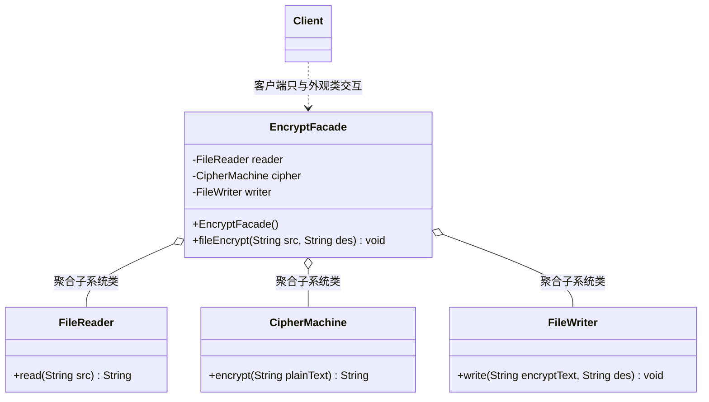
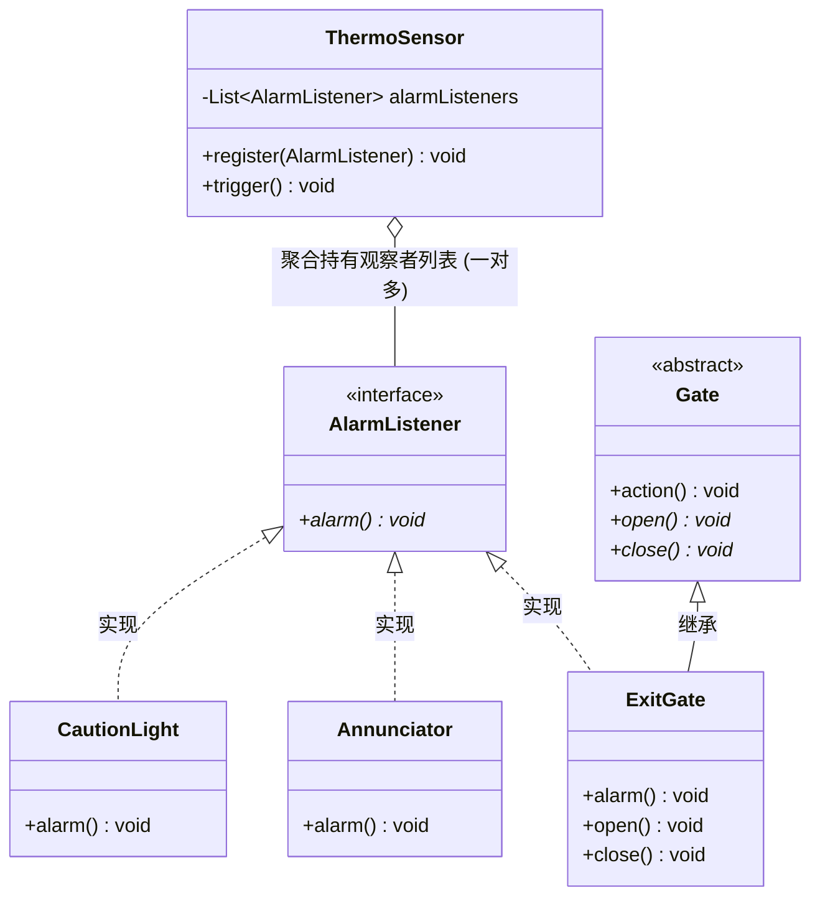

# 期末真题设计大题与代码实战全真权威精解

---

## 🎯 试卷压轴大题命题规则分析
太原理工大学期末试卷的最后一题通常是**设计题 / 综合程序题**，分值为 **10 ~ 20 分**。
考查形式非常规范，通常分为两大部分：
1. **模式选型与角色分析**（问：使用哪种设计模式？为什么？各个类充当什么角色？）；
2. **绘制 UML 类图**；
3. **补充 / 手写 Java 核心业务代码**。

以下是 2023 年、2024 年真实考卷以及题库中最常考的 **5 大经典设计题完全权威解析**！

---

## 🏆 案例一：2024年期末真题——文件加密模块（外观模式 Facade，10分）

### 【题目要求】
某系统需要提供一个文件加密模块，加密流程包括三个操作，分别是读取源文件、加密、保存加密之后的文件。读取文件和保存文件使用流来实现，这三个操作相对独立，其业务代码写在三个不同的类中（`FileReader` 类、`CipherMachine` 类、`FileWriter` 类）。
现在需要提供一个统一的加密类，用户可以直接使用该加密类（`EncryptFacade` 类）完成文件的读取、加密和保存三个操作，而不需要与每一个类进行交互。请设计该加密模块。
1. **应使用哪种设计模式来实现系统？为什么？（3分）**
2. **请绘制类图并作必要说明。（7分）**

---

### 【满分权威解答】

#### 1. 模式选型与原因（3分）：
- **应使用的设计模式**：**外观模式（Facade Pattern）**（又称门面模式）。
- **理由**：
  - ① 题干要求“提供一个统一的加密类，用户可以直接使用该类完成一系列独立操作，而无需与每一个子系统类进行交互”，这完全符合外观模式“为子系统中的一组接口提供一个统一的高层入口”的定义；
  - ② 符合**迪米特法则（最少知识原则）**，通过引入 `EncryptFacade` 降低了客户端与三个子系统类之间的耦合度。

#### 2. UML 类图设计（4分）：


#### 3. 核心代码实现（3分，考试加分项）：
```java
// 1. 三个独立的子系统业务类
public class FileReader {
    public String read(String src) {
        System.out.println("读取文件: " + src);
        return "明文数据";
    }
}

public class CipherMachine {
    public String encrypt(String plainText) {
        System.out.println("对数据进行加密");
        return "密文数据[ENCRYPTED]";
    }
}

public class FileWriter {
    public void write(String encryptText, String des) {
        System.out.println("保存密文到文件: " + des);
    }
}

// 2. 外观门面角色
public class EncryptFacade {
    private FileReader reader;
    private CipherMachine cipher;
    private FileWriter writer;

    public EncryptFacade() {
        this.reader = new FileReader();
        this.cipher = new CipherMachine();
        this.writer = new FileWriter();
    }

    // 统一的业务入口方法
    public void fileEncrypt(String src, String des) {
        String plainText = reader.read(src);
        String encryptText = cipher.encrypt(plainText);
        writer.write(encryptText, des);
    }
}

// 3. 客户端
public class Client {
    public static void main(String[] args) {
        EncryptFacade facade = new EncryptFacade();
        facade.fileEncrypt("src.txt", "des.txt");
    }
}
```

---

## 🏆 案例二：2023年期末真题——机房温度监控报警系统（观察者模式 Observer，20分）

> ⚠️ **避坑警示**：试卷照片上手写红字错误地标注了“策略模式”，**这是完全错误的！正解 100% 为观察者模式！**

### 【题目要求】
某公司欲开发一套机房监控系统，如果机房达到某一指定温度，传感器将作出反应，将信号传递给响应设备，如警示灯（`CautionLight`）将闪烁、报警器（`Annunciator`）将发出警报、安全逃生门（`ExitGate`）将自动开启、隔热门将自动关闭等。每一种响应设备的行为由专门的程序来控制。为了支持将来引入新类型的响应设备，采用设计模式设计该系统。
- `ThermoSensor` 是温度传感器，定义了增加响应设备的方法 `register()` 和触发方法 `trigger()`；
- `AlarmListener` 接口是抽象响应设备类，声明了警示方法 `alarm()`；
- `CautionLight`、`Annunciator` 和 `ExitGate` 是具体响应设备类，实现 `alarm()` 方法；
- `ExitGate` 是抽象类 `Gate` 的子类，实现了在 `Gate` 类中声明的 `open()` 和 `close()` 方法。

**请回答**：
1. **该系统设计采用了哪种设计模式？类图中的类充当了哪些角色？（2分）**
2. **根据给出的部分代码，完善 `ThermoSensor` 类、`ExitGate` 类和测试类 `Test` 的代码。（每类6分，共18分）**

---

### 【满分权威解答】

#### 1. 模式选型与角色对应（2分）：
- **设计模式**：**观察者模式（Observer Pattern）**（或发布-订阅模式）。
- **角色对应**：
  - `ThermoSensor`：**目标类 / 被观察者角色（Subject / ConcreteSubject）**；
  - `AlarmListener`：**抽象观察者角色（Observer）**；
  - `CautionLight`、`Annunciator`、`ExitGate`：**具体观察者角色（ConcreteObserver）**；
  - `Gate`：业务抽象父类。

#### 2. UML 类图关系图解：


#### 3. 填空补全 Java 核心源码（18分满分代码）：

```java
import java.util.ArrayList;
import java.util.List;

// 1. 抽象观察者接口
interface AlarmListener {
    void alarm();
}

// 2. 逃生门业务抽象父类
abstract class Gate {
    public void action() {
        open();
        close();
    }
    public abstract void open();
    public abstract void close();
}

// 3. 【答题点1】：完善 ThermoSensor 类（目标角色，6分）
class ThermoSensor {
    // 维护观察者集合列表
    private List<AlarmListener> alarmListeners;

    public ThermoSensor() {
        this.alarmListeners = new ArrayList<AlarmListener>();
    }

    // 注册订阅观察者 (attach)
    public void register(AlarmListener listener) {
        alarmListeners.add(listener);
    }

    // 状态改变触发广播通知 (notify)
    public void trigger() {
        System.out.println("温度达到指定阈值，触发报警:");
        for (AlarmListener listener : alarmListeners) {
            listener.alarm(); // 遍历触发所有设备的报警方法
        }
    }
}

// 4. 【答题点2】：完善 ExitGate 类（具体观察者，多重继承/实现，6分）
class ExitGate extends Gate implements AlarmListener {
    @Override
    public void open() {
        System.out.println("安全逃生门自动开启！");
    }

    @Override
    public void close() {
        System.out.println("隔热门自动关闭！");
    }

    @Override
    public void alarm() {
        System.out.println("出口门响应报警信号：");
        open();
        close();
    }
}

// 5. 【答题点3】：完善测试类 Test（客户端装配与触发，6分）
public class Test {
    public static void main(String[] args) {
        // 创建目标对象（传感器）
        ThermoSensor thermoSensor = new ThermoSensor();

        // 创建各个具体观察者设备
        ExitGate exitGate = new ExitGate();
        CautionLight cautionLight = new CautionLight();
        Annunciator annunciator = new Annunciator();

        // 注册订阅
        thermoSensor.register(cautionLight);
        thermoSensor.register(annunciator);
        thermoSensor.register(exitGate);

        // 模拟温度超标，触发报警联动！
        thermoSensor.trigger();
    }
}
```

---

## 🏆 案例三：题库经典大题——多线程安全单例类设计（10分）

### 【题目要求】
现在需要开发一款游戏软件，请以单例模式来设计其中的 Boss 角色（或开发打印管理软件设计其中的打印池 `PrintSpooler`）。
**要求**：该类可以在多线程并发环境中使用。（10分）

### 【满分权威解答】

提供两种满分实现方案，考试任选一种即可：

#### 方案一：双重检查锁定方式（DCL，标准工业级方案，满分10分）
```java
public class Boss {
    // 1. 私有静态变量，必须加上 volatile 禁止指令重排序保证可见性（3分）
    private static volatile Boss instance = null;

    // 2. 私有构造函数，防止外部 new（2分）
    private Boss() {
        System.out.println("Boss角色初始化完毕");
    }

    // 3. 公共静态访问点，双重检查锁定机制（5分）
    public static Boss getInstance() {
        if (instance == null) {                         // 第一次检查，避免不必要加锁
            synchronized (Boss.class) {                 // 类锁排队
                if (instance == null) {                 // 第二次检查，防止并发重复创建
                    instance = new Boss();
                }
            }
        }
        return instance;
    }
}
```

#### 方案二：饿汉式方案（最简且天生线程安全，满分10分）
```java
public class PrintSpooler {
    // 1. 类加载时即完成初始化，JVM 保证天生线程安全（4分）
    private static PrintSpooler instance = new PrintSpooler();

    // 2. 私有构造方法（3分）
    private PrintSpooler() {}

    // 3. 静态公有获取方法（3分）
    public static PrintSpooler getInstance() {
        return instance;
    }
}
```

---

## 🏆 案例四：题库经典大题——水果培育农场（工厂方法模式，10分）

### 【题目要求】
一个农场公司专门负责培育各种水果，有葡萄（`Grape`）、草莓（`Strawberry`）和苹果（`Apple`）。请使用**工厂方法模式**，编写工厂类和主程序，并在主程序中完成草莓生长状态的描述。（10分）

### 【满分权威解答】

```java
// 1. 抽象产品接口
public interface Fruit {
    void plant();
    void grow();
    void harvest();
}

// 2. 具体产品类（以草莓为例）
public class Strawberry implements Fruit {
    public void plant() { System.out.println("种植草莓"); }
    public void grow() { System.out.println("草莓正在生长..."); }
    public void harvest() { System.out.println("收获草莓！"); }
}

// 3. 抽象工厂接口（工厂方法模式核心，3分）
public interface Factory {
    Fruit createFruit();
}

// 4. 具体工厂类（专一生产草莓，3分）
public class StrawberryFactory implements Factory {
    @Override
    public Fruit createFruit() {
        return new Strawberry();
    }
}

// 5. 客户端主程序（4分）
public class MainUI {
    public static void main(String[] args) {
        // 面向工厂接口编程
        Factory factory = new StrawberryFactory();
        Fruit fruit = factory.createFruit();
        
        fruit.plant();
        fruit.grow();
        fruit.harvest();
    }
}
```

---

## 🏆 案例五：题库经典大题——树形层级展示（组合模式，12分）

### 【题目要求】
给定树形结构，请应用**组合模式**在客户端完成数据的层次展示。
要求：输出如下信息：
```text
Root
  Leaf A
  Comp B
    Leaf BX
    Leaf BY
  Leaf C
```
1. 绘制组合模式类图（4分）；
2. 编写简单元素（Leaf）和复杂元素（Composite）的代码（4分）；
3. 客户端构建树形数据并输出（4分）。

### 【满分权威解答】

#### 1. 类图结构：
`Component` 接口 $\leftarrow$ (`Leaf` 实现类, `Composite` 容器类内部维护 `List<Component>`)。

#### 2. 核心代码：
```java
import java.util.ArrayList;
import java.util.List;

// 1. 抽象构件
interface Component {
    void display();
    void add(Component c);
    void remove(Component c);
}

// 2. 简单元素（叶子构件，没有子节点）
class Leaf implements Component {
    private String name;
    public Leaf(String name) { this.name = name; }
    
    public void display() { System.out.println("  " + name); }
    public void add(Component c) { throw new UnsupportedOperationException(); }
    public void remove(Component c) { throw new UnsupportedOperationException(); }
}

// 3. 复杂元素（容器构件，持有子列表）
class Composite implements Component {
    private String name;
    private List<Component> list = new ArrayList<Component>();

    public Composite(String name) { this.name = name; }

    public void add(Component c) { list.add(c); }
    public void remove(Component c) { list.remove(c); }

    public void display() {
        System.out.println(name);
        for (Component c : list) {
            c.display(); // 递归打印子构件
        }
    }
}

// 4. 客户端
public class Test {
    public static void main(String[] args) {
        Component root = new Composite("Root");
        root.add(new Leaf("Leaf A"));

        Component compB = new Composite("Comp B");
        compB.add(new Leaf("Leaf BX"));
        compB.add(new Leaf("Leaf BY"));
        root.add(compB);

        root.add(new Leaf("Leaf C"));

        root.display();
    }
}
```
