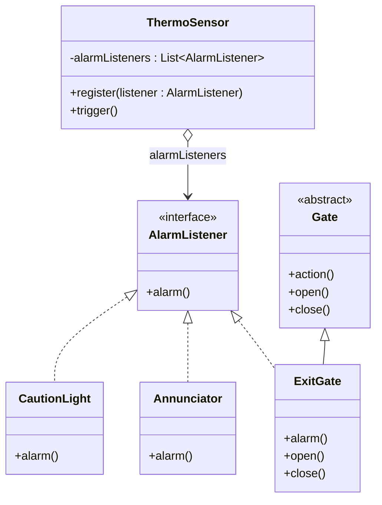

# 2023 年 5 月 太原理工大学《软件详细设计 R》试卷 A（高清整理 + 权威正解）

> **来源归档**：原卷来自 [2023题.pdf](file:///D:/Developer/gitclone/MyNote/学习笔记/本科/本科三年级term1/JavaDesignPattern/试卷/详细设计/2023题.pdf) 与 [软件详细设计R2023.5.24](file:///D:/Developer/gitclone/MyNote/学习笔记/本科/本科三年级term1/JavaDesignPattern/试卷/详细设计/软件详细设计R2023.5.24)（`IMG_1973.JPG` ~ `IMG_1984.JPG`，共 10 页试卷中的第 1~8 页题目原卷；第 9~10 页为五、设计题空白作答区，未单独成照）。  
> **排雷说明**：原 PDF 红字标注及当年群聊截图（`IMG_1985`~`IMG_1997`）包含**超过 15 处严重错误**（如把“观察者模式”设计大题误答成“策略模式”，把“桥接模式”误写为“组合复用”等）。下文所有答案均已对照课程 PPT 与官方原题库（`题库1.doc`）逐题核验修正。

- **适用专业**：软件工程 | **考试方式**：闭卷 | **考试日期**：2023.05 | **时间**：120 分钟 | **总分**：100 分

---

## 一、填空题（每空 2 分，共 20 分）

1. 在软件系统中对象并不是孤立存在的，一个对象行为的改变可能会导致一个或者多个其他与之存在依赖关系的对象行为发生改变，`________` 模式用于描述对象之间的依赖关系。
2. 简单程度仅次于单例模式和迭代器模式的创建型设计模式是 `________`。
3. `________` 模式是代理模式的特殊应用，共同点是都具有相同的接口，不同点是代理模式着重对代理过程的控制，该模式着重类的功能变化。
4. 单例模式有两种方式实现，分别为饿汉式和 `________`。它们共同的特征是构造函数的访问属性必须是私有（`private`）。
5. 原型模式的本质就是对象的 `________`。
6. 工厂方法模式简称工厂模式，也叫虚拟构造器模式或者多态工厂模式，它属于 `________` 模式。
7. “各人自扫门前雪，哪管他人瓦上霜”是对 `________` 原则的生动描述。
8. 面向对象设计原则中，`________` 是指高层模块不应该依赖于低层模块，他们都应该依赖抽象。
9. `________` 将抽象部分与它的实现部分解耦，使得两者都能够独立变化。
10. 当需要创建的产品对象有复杂的内部结构时可以考虑使用 `________` 模式。

### ✅ 一、填空题参考答案与排雷解析

| 题号 | 权威正解 | 原卷红字/网传错误 | 权威解析与背诵出处 |
| :-: | :--- | :--- | :--- |
| 1 | **观察者** | — | 观察者模式描述对象间一对多的依赖关系（后已有“模式”二字）。 |
| 2 | **原型模式**（或 原型） | ❌ 工厂方法模式 | 第 8 章原型模式 PPT 原文：“简单程度仅次于单例模式和迭代器模式”。 |
| 3 | **装饰**（或 装饰器） | ❌ 动态代理 | `题库1.doc` 判断原题：装饰模式是代理模式的特殊应用，前者重功能增强、后者重控制访问过程。 |
| 4 | **懒汉式** | ❌ 饱汉式 | 课程规范术语为“饿汉式”和“懒汉式”，“饱汉式”属民间俗称，考试务必写**懒汉式**。 |
| 5 | **复制**（或 **克隆**） | — | 第 8 章原型模式 PPT 原文。 |
| 6 | **类创建型**（或 创建型） | — | 按范围和目的划分，工厂方法属于 GoF 中唯一的**类创建型**模式。 |
| 7 | **接口隔离** | ❌ 迪米特 | `题库1.doc` 第 469 题官方原答案：**接口隔离**（要求接口方法尽量少，客户端只关心自己需要的方法；注意部分网传资料误作迪米特，考场按原题库填“接口隔离”）。 |
| 8 | **依赖倒转**（或 依赖倒置） | — | DIP 核心定义。 |
| 9 | **桥接模式** | ❌ 组合复用 | 第 11 章桥接模式官方定义一字不差。 |
| 10 | **建造者** | — | 建造者模式适用场景：产品内部结构复杂、需要分步构建。 |

---

## 二、选择题（每题 1 分，共 30 分）

1. 在不破坏类封装性的基础上，使得类可以同以前没有估计到的系统进行交互，主要体现在（ ）
   - A、外观模式 &emsp; B、装饰模式 &emsp; C、桥接模式 &emsp; D、组合模式
2. 简单工厂模式中，（ ）是简单工厂模式的核心，负责实现创建所有实例的内部逻辑。
   - A、工厂角色 &emsp; B、抽象产品角色 &emsp; C、具体产品角色 &emsp; D、抽象工厂角色
3. 在依赖倒转原则中，具体类的对象通过依赖注入方式注入其他对象，以下不属于依赖注入方式的是（ ）
   - A、构造注入 &emsp; B、Setter 注入 &emsp; C、抽象类注入 &emsp; D、接口注入
4. 动态地给一个对象增加一些额外的职责是（ ）。
   - A、适配器模式 &emsp; B、桥接模式 &emsp; C、组合模式 &emsp; D、装饰模式
5. 策略模式针对一组算法，将每一个算法封装到具有（ ）接口的独立的类中，从而使得它们可以相互替换。
   - A、不同 &emsp; B、一样 &emsp; C、共同 &emsp; D、都不是
6. 以下应用场景能使用桥接模式的是（ ） *(注：原卷此处疑漏印“不”字，详见解析)*
   - A、需要在抽象化和具体化之间增加更多灵活性，避免在两个层次之间建立静态的继承关系
   - B、抽象部分和实现部分可以以继承的方式独立扩展而互不影响
   - C、一个类存在两个（或多个）独立变化的维度，且维度都需要进行独立扩展
   - D、频繁访问数据库或文件的对象
7. 下列哪一原则是实现高内聚，低耦合的指导方针（ ）
   - A、单一职责原则 &emsp; B、开闭原则 &emsp; C、依赖倒置原则 &emsp; D、迪米特法则
8. 以下情况下能够使用简单工厂模式的是（ ）
   - A、某一系统的某一功能模块提供了两个服务分别是查找和修改
   - B、工厂类负责创建的对象比较少
   - C、工厂类负责创建的对象比较多
   - D、客户端关心传入工厂类的参数和创建对象的过程
9. 以下能够使用单一职责场景的是（ ）
   - A、客户数量增加导致数据库进行扩展
   - B、某系统经常需要进行不同类型数据格式转换
   - C、某系统在已搭建完成的基础上需求发生改变，功能需要改动
   - D、某系统的某一功能模块提供了两个服务分别是查找和修改
10. 将一个请求封装为一个对象，从而让你可以用不同的请求对客户进行参数化，对请求排队或者记录请求日志，以及支持可撤销的操作，属于什么模式（ ）
    - A、责任链模式 &emsp; B、命令模式 &emsp; C、迭代器 &emsp; D、解释器模式
11. 关于外观模式，以下说法错误的是（ ）
    - A、对客户端屏蔽了子系统组件，减少了客户端所需处理的对象数目。
    - B、实现了子系统与客户端之间的松耦合关系。
    - C、子系统的变化不会影响到调用它的客户端。
    - D、一个子系统的修改对其他子系统没有任何影响，但子系统的内部变化会影响到外观对象。
12. 下列类型，不属于工厂模式的是（ ）。
    - A、单例 &emsp; B、简单工厂 &emsp; C、抽象工厂 &emsp; D、工厂方法
13. 以下设计模式属于结构模式的是（ ）。
    - A、观察者模式 &emsp; B、单例模式 &emsp; C、迭代器模式用强调在一个新的对 *(原卷印刷残字)* &emsp; D、适配器模式
14. 对接口进行规范时，拆分接口时，应满足（ ）
    - A、单一职责原则 &emsp; B、开闭原则 &emsp; C、依赖倒置原则 &emsp; D、合成复用原则
15. 对象适配器模式是（ ）原则的典型应用。
    - A、里氏代换原则 &emsp; B、依赖倒转原则 &emsp; C、迪米特原则 &emsp; D、组合/聚合复用原则
16. 下图是关于房间状态的描述，可以使用（ ）模式进行设计。
    ```
    [空闲] --预订--> [已预订] --入住--> [已入住]
      ^                  |                  |
      +-----取消预订-----+                  |
      ^                                     |
      +----------------退房-----------------+
    (另有：空闲 --直接入住--> 已入住)
    ```
    - A、组合模式 &emsp; B、桥接模式 &emsp; C、责任链模式 &emsp; D、状态模式
17. 哪一种模式限制了创建类的实例数量（ ）
    - A、工厂方法模式 &emsp; B、单例模式 &emsp; C、原型模式 &emsp; D、建造者模式
18. 以下关于命令模式的叙述错误的是（ ）。
    - A、命令模式将一个请求封装为一个对象，从而可以用不同的请求对客户进行参数化
    - B、命令模式可以将请求发送者和请求接收者解耦
    - C、使用命令模式会导致某些系统有过多的具体命令类，导致有些系统中命令模式变得不切实际
    - D、命令模式是对命令的封装，命令模式把发出命令的责任和执行命令的责任机制在同一个类中，委派给同一的类来进行处理
19. 结构最简单的设计模式是（ ）
    - A、建造者模式 &emsp; B、单例模式 &emsp; C、原型模式 &emsp; D、工厂模式
20. 将一个类的接口转换成客户希望的另一个接口，这句话是对（ ）设计模式的描述
    - A、策略模式 &emsp; B、桥接模式 &emsp; C、适配器模式 &emsp; D、单例模式
21. 下列哪个不是软件设计模式的层次（ ）
    - A、架构模式 &emsp; B、设计模式 &emsp; C、系统模式 &emsp; D、习惯用法
22. 不通过 `new` 关键字来产生一个对象，而是通过对象复制来实现的模式叫做（ ）。
    - A、抽象工厂模式 &emsp; B、工厂方法模式 &emsp; C、单例模式 &emsp; D、原型模式
23. 迭代器模式用于处理具有（ ）性质的类。
    - A、抽象 &emsp; B、聚集 &emsp; C、单例 &emsp; D、共享
24. 下列哪一项不是观察者模式的别称（ ）
    - A、发布-订阅（Publish-Subscribe）模式
    - B、模型-视图（Model-View）模式
    - C、游标（Cursor）模式
    - D、从属者（Dependents）模式
25. Spring 框架中的 AOP 技术是那种模式的典型应用（ ）
    - A、代理模式 &emsp; B、外观模式 &emsp; C、桥接模式 &emsp; D、组合模式
26. 下图表示哪个模式（ ）
    ```mermaid
    classDiagram
        class Director {
            -builder: Builder
            +construct()
        }
        class Builder {
            +buildPartA()
            +buildPartB()
            +buildPartC()
            +getResult()
        }
        class ConcreteBuilder {
            +buildPartA()
            +buildPartB()
            +buildPartC()
            +getResult()
        }
        class Product
        Director o--> Builder : builder
        Builder <|-- ConcreteBuilder
        ConcreteBuilder ..> Product
    ```
    > *(图中 `construct()` 注释：`builder.buildPartA(); builder.buildPartB(); builder.buildPartC(); return builder.getResult();`)*
    - A、建造者模式 &emsp; B、单例模式 &emsp; C、抽象工厂模式 &emsp; D、原型模式
27. 以下关于工厂模式说法不正确的是（ ）
    - A、工厂模式主要是为创建类产生接口
    - B、简单工厂模式中的抽象产品角色必须由接口或抽象类来实现
    - C、简单工厂模式中只有一个工厂类
    - D、工厂方法模式里具有不同的工厂子类
28. 关于模式适用性，在以下情况不适合使用 Abstract Factory 模式（ ）
    - A、一个系统要独立于它的产品的创建、组合和表示时。
    - B、一个系统要由多个产品系列中的一个来配置时。
    - C、当你要强调一系列相关的产品对象的设计以便进行联合使用时。
    - D、当一个类希望由它的子类来指定它所创建的对象的时候。
29. 下列关于里氏替换原则错误的是（ ）
    - A、在软件中一个基类对象和他的子类对象可以相互替换
    - B、在程序中尽量使用基类类型来对对象进行定义，而在运行时再确定其子类类型，用子类对象替换父类对象
    - C、运用时应该将父类设计为抽象类或者接口，让子类继承父类或者实现父接口，并实现父类中的方法
    - D、无需修改原有子类代码，增加新功能可通过增加新的子类实现
30. 下列关于模式描述错误的是（ ）
    - A、创建型模式主要用于创建对象
    - B、类模式是处理类和子类之间的关系，这些关系在运行时变换，更具动态性
    - C、结构型模式用来处理类或对象的组合
    - D、行为型模式主要用于描述对象或类如何交互和怎样分配职责

### ✅ 二、选择题参考答案与速解

| 题号 | 答案 | 关键解析与避坑 | 题号 | 答案 | 关键解析与避坑 |
| :-: | :-: | :--- | :-: | :-: | :--- |
| 1 | **C** | **原卷红字误选A**。`题库1.doc` 第 332 题原题正解为 **C 桥接模式**。 | 16 | **D** | 房间在空闲/已预订/已入住状态间迁移并改变行为 $\rightarrow$ **状态模式**。 |
| 2 | **A** | 工厂角色是简单工厂核心。 | 17 | **B** | 单例模式控制实例数量为 1。 |
| 3 | **C** | DI 三种方式：构造、Setter、接口；没有“抽象类注入”。 | 18 | **D** | **原卷红字误选C**。命令模式将请求发出者和执行者解耦，**委派给不同对象**而非同一类。 |
| 4 | **D** | 动态增加职责 $\rightarrow$ 装饰模式。 | 19 | **B** | 单例模式结构最简单。 |
| 5 | **C** | **原卷红字误选A**。封装到具有**共同接口**的独立类中。 | 20 | **C** | 适配器模式定义。 |
| 6 | **见解析** | **原卷漏印“不”字**！A/B/C 全是 `11 桥接模式.pptx` 原文适用场景，D 为**单例**场景；若考场按原题“不适用”意图选 **D**（群传B误选）。 | 21 | **C** | **原卷红字误选D**。三层次：架构模式、设计模式、习惯用法（无“系统模式”）。 |
| 7 | **A** | 单一职责是高内聚、低耦合的指导方针。 | 22 | **D** | 通过复制创建对象 $\rightarrow$ 原型模式。 |
| 8 | **B** | **原卷红字误选C**。工厂类创建对象较少、逻辑不复杂时用简单工厂。 | 23 | **B** | **原卷红字误选A**。迭代器用于访问/遍历**聚集（Aggregate）**对象。 |
| 9 | **D** | **原卷红字误选A**。查找与修改是两个不同职责（A 合成复用，B 依赖倒转，C 开闭）。 | 24 | **C** | 游标（Cursor）是**迭代器模式**的别称。 |
| 10 | **B** | **原卷红字误选A**。题干一字不差为命令模式定义。 | 25 | **A** | Spring AOP 底层是动态**代理模式**。 |
| 11 | **D** | `14 外观模式.pptx` 原文：子系统的内部变化**不会**影响到外观对象。 | 26 | **A** | `Director`/`Builder`/`ConcreteBuilder`/`Product` 经典结构 $\rightarrow$ 建造者模式。 |
| 12 | **A** | **原卷红字误选D**。单例与工厂无关。 | 27 | **A** | **原卷红字误选B**。`题库1.doc` 原解：工厂模式主要是为创建**对象**提供过渡接口，非“为创建类产生接口”。 |
| 13 | **D** | 适配器属结构型（观察者、迭代器为行为型，单例为创建型）。 | 28 | **D** | D 为**工厂方法模式**适用条件，其余 ABC 均适合抽象工厂。 |
| 14 | **A** | `2-6 接口隔离.pptx` Slide 15 原话：“拆分接口时，首先还得满足单一职责”。 | 29 | **A** | 子类可替换基类，反之**不能相互替换**。 |
| 15 | **D** | **原卷红字误选B**。对象适配器通过组合/聚合适配者类实现复用。 | 30 | **B** | 类模式通过继承在**编译期静态确定**；对象模式才更具动态性。 |

---

## 三、判断题（每题 1 分，共 10 分）

1. （ ）简单工厂模式属于类创建型模式，符合单一职责和开闭原则。
2. （ ）不同的方法，不同的执行顺序，产生不同的事件结果时，可以采用建造者模式。
3. （ ）适配器模式的用意是改变对象的接口而不一定改变对象的性能，而装饰模式的用意是保持接口并增加对象的职责。
4. （ ）桥接模式分离了抽象接口及其实现部分，极大地减少子类的个数，提高系统的可扩展性。
5. （ ）透明组合模式是将管理成员对象的方法放到抽象类中，是不安全的。
6. （ ）外观模式是为子系统中的一组接口提供一个统一的入口。外观模式定义了一个高层接口，这个接口使得这一子系统更加容易使用。
7. （ ）迭代器模式（Iterator Pattern）是一种使用频率非常低的行为型设计模式，因为它增加了系统的复杂度，迭代器用于对一个聚合对象进行遍历。
8. （ ）观察者模式中，观察者被调用时可以知道目标对象发生了什么变化。
9. （ ）若同时想要使用多个策略，策略模式是无法实现的。
10. （ ）使用浅克隆方式保存对象的状态，使用原型模式将对象复制一份并将其状态保存起来，以便在需要的时候使用（例如恢复到历史某一状态），可辅助实现撤销操作。

### ✅ 三、判断题参考答案与排雷解析

| 题号 | 正解 | 原卷红字 | 核心理由 |
| :-: | :-: | :-: | :--- |
| 1 | **✗** | ❌ `√` | 简单工厂**违反开闭原则**（新增产品必须修改工厂静态方法）。 |
| 2 | **✗** | `×` | 原文应为“**相同的方法**，不同的执行顺序，产生不同的事件结果”才适用建造者模式。 |
| 3 | **✓** | ❌ `×` | `题库1.doc` 原题：适配器重在改接口，装饰器重在保持接口下增职责，表述正确。 |
| 4 | **✓** | `√` | 桥接用组合替代多重继承，大幅减少类个数，符合课程 PPT。 |
| 5 | **✓** | ❌ `×` | `12 组合模式.pptx` Slide 13 明写：透明组合模式在抽象构件定义管理方法，对叶子节点**不够安全**。 |
| 6 | **✓** | ❌ `×` | 外观模式官方定义一字不差。 |
| 7 | **✗** | ❌ `√` | `20 迭代器模式.pptx` Slide 3 明写：迭代器模式是使用频率**非常高**的行为型模式。 |
| 8 | **✓** | `√` | 目标状态变更时触发 `notify()`，传递变化通知观察者。 |
| 9 | **✓** | ❌ `×` | **极易错！** `25 策略模式.pptx` Slide 19 缺点明确写出：**无法同时在客户端使用多个策略类**（环境类一次只能持有一个策略引用）。 |
| 10 | **✗** | `×` | 必须用**深克隆**保存独立快照；若用浅克隆，引用属性随后续操作变动，无法还原历史状态。 |

---

## 四、简答题（每题 5 分，共 20 分）

1. **什么是设计模式？设计模式的基本要素有哪些？**
   - **答**：
     - **定义**：设计模式是一套被反复使用的、多数人知晓的、经过分类编目的、代码设计经验的总结。
     - **四个基本要素**：**模式名称（Pattern Name）**、**问题（Problem）**、**解决方案（Solution）**、**效果（Consequences）**。

2. **请简单介绍两种常用代理模式。** *(注：课程第 16 章 PPT 总结了 5 种常用类型，考场任选两种准确答出即可；若从实现方式补充静态/动态代理亦可，以下按课程 PPT 标准作答)*
   - **答**（任选其二，建议写最清晰的虚拟代理 + 保护代理）：
     1. **虚拟代理（Virtual Proxy）**：当创建一个资源消耗较大的对象时，先创建一个消耗相对较小的代理对象来表示，真实对象只在真正需要时才被创建，从而降低系统开销、缩短响应时间（如网页大图延迟加载）。
     2. **保护代理（Protect Proxy）**：控制对真实对象的访问，根据客户端身份提供不同级别的使用权限（如系统权限拦截与认证）。
     *(拓展备选：远程代理 / 缓冲代理 / 智能引用代理，详见《[06_课程全覆盖(16+1)设计模式背诵终极宝典.md](../06_课程全覆盖%2816+1%29设计模式背诵终极宝典.md)》)*

3. **讨论组合模式中透明组合模式和安全组合模式。**
   - **答**：
     - **透明组合模式**：在抽象构件 `Component` 中声明所有用于管理成员对象的方法（如 `add()`、`remove()`、`getChild()`）。客户端对叶子构件和容器构件提供完全一致的接口，**客户端无需区分二者，对客户端透明**；但**不够安全**，因为叶子对象本无子节点，若误调管理方法可能引发运行时错误或只能做空/异常处理。
     - **安全组合模式**：抽象构件 `Component` 中**不声明**任何管理成员对象的方法，而只在容器构件 `Composite` 中声明和实现这些方法。叶子节点无法调用管理方法，**安全性高**；但**不够透明**，客户端必须显式区分叶子与容器，无法完全面向抽象编程。

4. **简述继承复用与组合/聚合复用的差异。**
   - **答**：
     1. **实现机制与本质不同**：继承复用通过类继承建立 `"is-a"` 关系，属**“白盒复用”**（父类内部实现细节对子类可见）；组合/聚合复用通过对象成员引用建立 `"has-a"` 关系，属**“黑盒复用”**（只通过公共接口调用，无需了解内部细节）。
     2. **绑定时机与耦合度不同**：继承在**编译期静态决定**，父类与子类紧耦合，父类修改直接影响子类；组合在**运行期动态注入和替换**，系统耦合度低、扩展灵活，因此设计原则要求**优先使用组合/聚合复用，少用继承**。

---

## 五、设计题（共 20 分）

某公司欲开发一套机房监控系统，如果机房达到某一指定温度，传感器将作出反应，将信号传递给响应设备，如警示灯（`CautionLight`）将闪烁、报警器（`Annunciator`）将发出警报、安全逃生门将自动开启、隔热门将自动关闭等，每一种响应设备的行为由专门的程序来控制。为支持将来引入新类型的响应设备，采用设计模式设计该系统，参考类图如下：



> 题目补充说明：`ThermoSensor` 是温度传感器，定义了增加响应设备的方法 `register()` 和触发方法 `trigger()`。`AlarmListener` 接口是抽象响应设备类，声明了警示方法 `alarm()`，而警示灯类 `CautionLight`、报警器类 `Annunciator` 和安全门类 `ExitGate` 是具体响应设备类，它们实现了警示方法 `alarm()`。`ExitGate` 是抽象类 `Gate` 类的子类，它将实现在 `Gate` 类中声明的 `open()` 方法和 `close()` 方法，用于开启逃生门并关闭隔热门，`Gate` 类中的 `action()` 方法用于同时执行 `open()` 方法和 `close()` 方法。

**请问：**
1. 该系统设计采用了哪种设计模式？类图中的类充当了哪些角色？（2 分）
2. 根据给出的部分代码，完善 `ThermoSensor` 类、`ExitGate` 类和测试类 `Test` 的代码。（每个类 6 分，共 18 分）

题目已给出的部分代码：
```java
import java.util.*;

interface AlarmListener {
    public void alarm();
}

abstract class Gate {
    public void action() {
        open();
        close();
    }
    public abstract void open();
    public abstract void close();
}

class CautionLight implements AlarmListener {
    public void alarm() {
        System.out.println("警示灯闪烁！");
    }
}

class Annunciator implements AlarmListener {
    public void alarm() {
        System.out.println("报警器发出警报！");
    }
}
```

### ✅ 五、设计题权威满分答案

#### （1）模式与角色判定（❌ 绝对不要写成群答案里的“策略模式”！）
- **核心设计模式**：**观察者模式（Observer Pattern）**（同时在 `ExitGate` 上结合使用了**类适配器模式**，将抽象类 `Gate` 适配为 `AlarmListener` 接口）。
- **各类的角色**：
  - `ThermoSensor`：**具体主题 / 具体目标（ConcreteSubject）**（维护监听者集合并负责通知）；
  - `AlarmListener`：**抽象观察者（Observer）**（亦作适配器模式中的目标接口 Target）；
  - `CautionLight`、`Annunciator`、`ExitGate`：**具体观察者（ConcreteObserver）**（其中 `ExitGate` 同时充当**类适配器 Adapter**，继承 `Gate` 适配者类并实现目标接口 `AlarmListener`）。

#### （2）补全三个类的核心 Java 代码
> ⚠️ **排雷提醒**：当年群聊流出代码中 `Test` 类胡乱写成了 `new WarningLight()` 和 `new Alarm()`，与题目给出的 `CautionLight`、`Annunciator` 类名严重不符，考试抄写必扣分！以下已修正为严格匹配原题的规范代码：

```java
// 1. 温度传感器类（具体目标类）
class ThermoSensor {
    private List<AlarmListener> alarmListeners = new ArrayList<AlarmListener>();

    public void register(AlarmListener listener) {
        alarmListeners.add(listener);
    }

    public void trigger() {
        System.out.println("机房温度达到警戒阈值，传感器触发报警！");
        for (AlarmListener listener : alarmListeners) {
            listener.alarm();
        }
    }
}

// 2. 安全门类（具体观察者 + 类适配器）
class ExitGate extends Gate implements AlarmListener {
    @Override
    public void alarm() {
        action(); // 复用父类 Gate 的模板行为：同时开启逃生门并关闭隔热门
    }

    @Override
    public void open() {
        System.out.println("安全逃生门自动开启！");
    }

    @Override
    public void close() {
        System.out.println("隔热门自动关闭！");
    }
}

// 3. 测试类 Test
public class Test {
    public static void main(String[] args) {
        ThermoSensor sensor = new ThermoSensor();
        // 注册各类响应设备（面向抽象接口 AlarmListener 注册）
        sensor.register(new CautionLight());
        sensor.register(new Annunciator());
        sensor.register(new ExitGate());
        // 触发报警，自动联动所有观察者
        sensor.trigger();
    }
}
```
