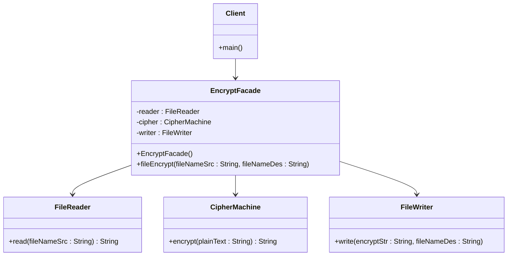

# 2024 年 9 月 太原理工大学《软件详细设计 R》试卷（高清整理 + 权威正解）

> **来源归档**：原卷完整还原自 [详细设计24年.pdf](file:///D:/Developer/gitclone/MyNote/学习笔记/本科/本科三年级term1/JavaDesignPattern/试卷/详细设计24年.pdf)（共 3 页双栏扫描件，涵盖试卷第 1~6 页全部题目）。  
> **排雷说明**：原扫描件卷面上带有零星铅笔/蓝笔作答痕迹（如单选第 19 题错涂 D、第 25 题错选 A、判断第 10 题错打 `√`）。以下所有答案均已按照课程 PPT 与原题库全面校准。

- **适用专业**：软件工程 | **考试方式**：闭卷 | **考试日期**：2024.09 | **时间**：120 分钟 | **总分**：100 分

---

## 一、选择题（每题 2 分，共 60 分）

1. 要依赖于抽象，不要依赖于具体，即针对接口编程，不要针对实现编程，是（ ）
   - A、开闭原则 &emsp; B、接口隔离原则 &emsp; C、里氏代换原则 &emsp; D、依赖倒转原则
2. 在依赖倒转原则中，针对抽象层编程时将具体类的对象通过（ ）注入到其他对象
   - A、构造注入 &emsp; B、设值注入 &emsp; C、依赖注入 &emsp; D、接口注入
3. 不属于创建型模式的是（ ）
   - A、工厂模式 &emsp; B、策略模式 &emsp; C、建造者模式 &emsp; D、原型模式
4. 依据设计模式思想，程序开发中应优先使用的是（ ）关系实现复用
   - A、组合聚合 &emsp; B、继承 &emsp; C、创建 &emsp; D、以上都不对
5. 下列哪一项不属于适配器模式的角色（ ）
   - A、目标角色 &emsp; B、源角色 &emsp; C、关联角色 &emsp; D、适配器角色
6. 下列描述正确的是（ ）
   - A、建造者模式是简单的创建型模式 &emsp; B、抽象工厂模式比工厂方法模式更为抽象
   - C、原型模式结构较为复杂 &emsp; D、单例模式是结构最复杂的设计模式
7. 行为型模式主要的作用是（ ）
   - A、创建对象 &emsp; B、处理类和对象的关系
   - C、描述类和对象如何交互和怎样分配职责 &emsp; D、描述类和对象的属性
8. 哪一种模式限制了创建类的实例数量（ ）
   - A、工厂方法模式 &emsp; B、单例模式 &emsp; C、原型模式 &emsp; D、建造者模式
9. 简单工厂模式的结构是（ ）
   - A、工厂角色、抽象工厂角色、抽象产品角色
   - B、工厂角色、抽象产品角色、具体产品角色
   - C、产品角色、抽象工厂角色
   - D、产品角色、具体产品角色
10. 策略模式的意图是（ ）
    - A、定义一系列的算法，把它们一个个的封装起来，并且使它们可相互替换。
    - B、为一个对象动态连接附加的职责。
    - C、你希望只拥有一个对象，但不用全局对象来控制对象的实例化。
    - D、在对象之间定义一种一对多的依赖关系，这样当一个对象的状态改变时，所有依赖于它的对象都将得到通知并自动更新。
11. 以下哪条是简单工厂类独有的缺点（ ）
    - A、分离了对象的创建和使用
    - B、系统扩展困难，一旦添加新产品不得不修改工厂逻辑
    - C、添加新的产品的时候，系统中类的个数增加，导致增加了系统的复杂度，增加系统性能的开销
    - D、需要引入抽象层，在客户端代码中均使用抽象层进行定义，增加了系统的抽象性和理解难度
12. 关于单一职责的优点，以下错误的是（ ）
    - A、提高系统的可维护性 &emsp; B、提高系统的效率 &emsp; C、降低类的复杂度 &emsp; D、提高类的可读性
13. 不要和陌生人说话是（ ）原则的通俗表达。
    - A、接口隔离 &emsp; B、里氏代换 &emsp; C、依赖倒转 &emsp; D、迪米特法则
14. Java 的异常处理机制可理解为（ ）行为模式
    - A、观察者模式 &emsp; B、迭代器模式 &emsp; C、职责链模式 &emsp; D、策略模式
15. （ ）模式是用于把抽象化与实现化解耦，使得二者可以独立变化。
    - A、适配器模式 &emsp; B、代理模式 &emsp; C、桥接模式 &emsp; D、策略模式
16. 以下关于原型模式的优缺点描述错误的是（ ）
    - A、简化对象的创建过程
    - B、扩展性较差，扩展困难
    - C、简化了创建结构
    - D、当深克隆存在多重嵌套的引用时，每层对象对应的类都必须支持深克隆
17. 当客户端只知道传入工厂类的参数，对于如何创建对象不关心时，考虑使用（ ）模式。
    - A、简单工厂 &emsp; B、工厂方法 &emsp; C、抽象工厂 &emsp; D、原型
18. 在（ ）时无须使用命令模式
    - A、实现撤销操作和恢复操作
    - B、将请求的发送者和接收者解耦
    - C、不改变聚合类的前提下定义作用于聚合中元素的新操作
    - D、不同的时间指定请求，并将请求排队
19. 在迭代器模式中将数据存储与数据遍历分离，数据存储由聚合类负责，数据遍历由迭代器负责，这种设计方案是（ ）的具体应用。
    - A、依赖倒转原则 &emsp; B、接口隔离原则 &emsp; C、单一职责原则 &emsp; D、合成复用原则
20. 下列关于迭代器模式表述错误的是（ ）
    - A、迭代器用于对一个聚合对象进行遍历
    - B、迭代器模式提供了一种方法顺序访问一个聚合对象中各个元素并暴露该对象的内部表示
    - C、迭代器模式符合“单一职责原则”的要求
    - D、迭代器可以将数据的遍历功能从聚合对象中分离出来，聚合对象只负责存储数据
21. 以下模式中不属于 GoF 23 种模式之一的是（ ）
    - A、工厂方法模式 &emsp; B、建造者模式 &emsp; C、简单工厂模式 &emsp; D、单例模式
22. 如果我们实现一个功能，一开始只有查询功能，后续不断新增需求要求有添加、删除等功能，这时可以增加一个抽象类，让查询、增加、删除作为这个抽象类的子类，这样就不会改变原有类。这是（ ）原则的运用。
    - A、开闭原则 &emsp; B、接口隔离原则 &emsp; C、里氏代换原则 &emsp; D、依赖倒转原则
23. 可以实现请求的撤销和恢复操作的是（ ）
    - A、观察者模式 &emsp; B、命令模式 &emsp; C、解释器模式 &emsp; D、迭代器模式
24. 单例模式的要素包括（ ）。
    - A、某个类只能有一个实例 &emsp; B、必须自行创建这个实例
    - C、必须自行向整个系统提供这个实例 &emsp; D、以上全部
25. 通过电视机遥控器可以实现对电视机频道进行选择，其实选择电视频道就是（ ）
    - A、命令模式 &emsp; B、观察者模式 &emsp; C、迭代器模式 &emsp; D、单例模式
26. 桥接模式的意图是（ ）。
    - A、将抽象部分与实现部分相分离，使它们可以独立的变化。
    - B、将抽象部分与实现部分相分离，但它们不能独立的变化。
    - C、将抽象部分与实现部分相结合，但它们可以独立的变化。
    - D、将抽象部分与实现部分相结合，使它们相互依赖。
27. 以下关于结构型模式说法不正确的是（ ）。
    - A、结构型模式可以在不破坏类封装性的基础上，实现新的功能。
    - B、结构型模式主要用于创建一组对象。
    - C、结构型模式可以创建一组类的统一访问接口。
    - D、结构型模式可以在不破坏类封装性的基础上，使得类可以同不曾估计到的系统进行交互。
28. 在现实生活中，居民身份证号码具有唯一性，居民可以申请身份证号码或补办身份证号码（还是使用原来的身份证号码，不会产生新的号码），我们可以使用（ ）来模拟实现居民身份证号码办理。
    - A、命令模式 &emsp; B、桥接模式 &emsp; C、单例模式 &emsp; D、责任链模式
29. 在简单工厂模式中，如果需要增加新的具体产品，通常需要修改（ ）的源代码。
    - A、抽象产品类 &emsp; B、其他具体产品类 &emsp; C、工厂类 &emsp; D、客户类
30. 下列哪一个不是外观模式的使用场景（ ）。
    - A、为一个复杂的模块或子系统提供一个供外界访问的接口。
    - B、子系统相对独立。
    - C、需要动态的给一个对象增加功能。
    - D、预防低水平人员带来风险扩散。

### ✅ 一、选择题参考答案与速解

| 题号 | 答案 | 关键解析 | 题号 | 答案 | 关键解析 |
| :-: | :-: | :--- | :-: | :-: | :--- |
| 1 | **D** | 针对接口编程，依赖抽象不依赖具体 $\rightarrow$ DIP。 | 16 | **B** | 原型模式“扩展性较好”，说“扩展性较差”是错误的。 |
| 2 | **C** | `2-5 依赖倒置.pptx` Slide 7 原话：“通过依赖注入（DI）方式注入”。 | 17 | **A** | 只传参数不管过程 $\rightarrow$ 简单工厂。 |
| 3 | **B** | 策略模式是行为型，非创建型。 | 18 | **C** | C 是**访问者模式**（23种之一，课程未重讲）的功能，不用命令模式。 |
| 4 | **A** | 合成复用原则：优先使用组合/聚合，少用继承。 | 19 | **C** | **原卷手写 D 错！** 存储与遍历职责分离 $\rightarrow$ **单一职责原则**。 |
| 5 | **C** | 适配器只有：目标、源（适配者）、适配器 3 个角色。 | 20 | **B** | 注意少字陷阱：应“**不用**暴露内部表示”，选项说“并暴露”故错！ |
| 6 | **B** | A 错（建造者最复杂）、C 错（原型较简单）、D 错（单例最简单）。 | 21 | **C** | 简单工厂不属于 GoF 23 种模式。 |
| 7 | **C** | 行为型模式：描述类/对象如何交互和分配职责。 | 22 | **A** | 通过增加子类扩展功能、不改原有类 $\rightarrow$ 开闭原则。 |
| 8 | **B** | 单例模式限制只能有 1 个实例。 | 23 | **B** | 命令模式支持请求日志、排队与 Undo/Redo。 |
| 9 | **B** | 简单工厂 3 角色：工厂、抽象产品、具体产品。 | 24 | **D** | 单例三要素全对。 |
| 10 | **A** | B 是装饰，C 是单例，D 是观察者，A 是策略模式。 | 25 | **C** | **原卷笔迹 A 错！** `20 迭代器.pptx` 与 `题库1.doc` #99 明文：**C 迭代器模式**（选择频道即遍历频道集合）。 |
| 11 | **B** | 新增产品须修改工厂判断逻辑，违背 OCP，是简单工厂独有缺陷。 | 26 | **A** | 桥接模式官方定义。 |
| 12 | **B** | 单一职责不保证“提高系统执行效率”。 | 27 | **B** | “主要用于创建对象”是创建型模式特征。 |
| 13 | **D** | 迪米特法则俗称。 | 28 | **C** | 身份证号全局唯一且复用同一号码 $\rightarrow$ 单例模式。 |
| 14 | **C** | *课程 16+1 外高频考点*：Java 异常向上级联捕获处理 $\rightarrow$ 职责链模式。 | 29 | **C** | 新增具体产品须修改工厂类的条件分支。 |
| 15 | **C** | 桥接模式核心意图。 | 30 | **C** | “动态给一个对象增加功能”是**装饰模式**使用场景。 |

---

## 二、填空题（每空 1 分，共 10 分）

1. 适配器模式，分为类的适配器和对象的适配器两种实现。其中类的适配器采用的是继承关系，而对象的适配器采用的是 `________` 关系。
2. 建造者模式通过将客户端与包含多个组成部分的 `________` 分离，使得客户端无需知道复杂对象的内部组成部分与装配方式，只需要知道建造者的类型即可。
3. 将类之间的静态继承关系转换为动态的对象组合关系的结构型模式是 `________`。
4. 使用 `________` 模式将容器对象和叶子对象进行递归组合，使得用户在使用时无须对它们进行区分，可以一致地对待容器对象和叶子对象。
5. `________` 模式提供一种方法顺序访问一个聚合对象中各个元素，且不用暴露该对象的内部表示。
6. 外观模式中，客户端与 `________` 交互，而无需与子系统类交互。
7. 观察者模式中定义了对象间的一种 `________` 的依赖关系，当一个对象的状态发生改变时，所有依赖它的对象都得到通知并自动更新。
8. 在深克隆中，除了对象本身被复制外，对象所包含的所有 `________` 也将被复制。
9. 装饰模式使用 `________` 关系来替代继承机制。
10. 为所有的具体观察者定义一个接口，在得到主题通知时更新自己。这句话描述的是观察者模式的 `________` 角色。

### ✅ 二、填空题参考答案

| 题号 | 权威正解 | 解析要点 |
| :-: | :--- | :--- |
| 1 | **组合**（或 聚合/关联） | 对象适配器持有适配者对象的引用，通过组合委托调用。 |
| 2 | **复杂对象的创建过程**（或 **复杂对象**） | 题库1原句为“复杂对象的创建过程”，简洁填空也可写“复杂对象”。 |
| 3 | **桥接模式** | 题库1第 397 题原文答案。 |
| 4 | **组合** | 组合模式将叶子与容器统一为树形递归组合。 |
| 5 | **迭代器** | 迭代器模式官方定义。 |
| 6 | **外观角色**（或 外观类 / Facade） | 客户端只面向 `Facade` 接口。 |
| 7 | **一对多** | 一个目标通知多个观察者。 |
| 8 | **成员变量**（或 **引用对象**） | PPT 原文“所有成员变量”，相对浅克隆特指里面的**引用对象**也会复制。 |
| 9 | **关联**（或 组合） | `13 装饰模式.pptx` Slide 6 原话“关联”（部分网传答案写“组合”，二者语义一致，优先记“组合/关联”）。 |
| 10 | **抽象观察者**（或 Observer） | `Observer` 声明 `update()` 接口。 |

---

## 三、判断题（每题 1 分，共 10 分）

1. （ ）饿汉式单例模式在类创建的同时就实例化一个静态对象出来，不管之后会不会使用这个单例，都会占据一定的内存，但是相应的，在第一次调用时速度也会更快，因为其资源已经初始化完成。
2. （ ）正方形/长方形问题不符合里氏代换原则。
3. （ ）在程序中随意替换父类和其子类的做法违反了依赖倒置原则。
4. （ ）若同时想要使用多个策略，策略模式是无法实现的。
5. （ ）当一个对象的行为取决于它所处的状态时，我们应该使用桥接模式。
6. （ ）工厂方法模式提供一个创建一系列相关或相互依赖对象的接口，而无须指定它们具体的类。
7. （ ）在算法设计时，采用策略模式可能会增加大量的类。
8. （ ）在迭代器模式中，新增的聚合类可以使用以前的迭代器对象。
9. （ ）观察者模式定义了对象之间的一种多对一的依赖关系，使得每当一个对象状态发生改变时，其相关依赖对象都得到通知并被自动更新。
10. （ ）透明装饰模式不能实现对同一对象的多次装饰，半透明装饰模式不能单独调用新增函数。

### ✅ 三、判断题参考答案与排雷

| 题号 | 正解 | 核心解析 |
| :-: | :-: | :--- |
| 1 | **✓** | 饿汉式预加载占内存，但调用快、天然线程安全。 |
| 2 | **✓** | `2-4 里氏代换.pptx` 经典反例：正方形继承长方形会破坏长宽独立设值的前置/后置契约。 |
| 3 | **✗** | 子类与基类替换约束属于**里氏代换原则**，且并非“随意双向互换”。 |
| 4 | **✓** | `25 策略模式.pptx` 第 19 页缺点原文：**无法同时在客户端使用多个策略类**。 |
| 5 | **✗** | 行为取决于内部状态 $\rightarrow$ **状态模式**，非桥接模式。 |
| 6 | **✗** | 该句是**抽象工厂模式**（创建产品族/一系列相关对象）的定义，不是工厂方法。 |
| 7 | **✓** | 每增加一种算法就多一个具体策略类，`25 策略模式.pptx` Slide 19 原话。 |
| 8 | **✗** | `20 迭代器.pptx` Slide 24：增加新聚合类时需**成对增加**新的具体迭代器类。 |
| 9 | **✗** | 应该是**一对多**的依赖关系，非“多对一”。 |
| 10 | **✗** | **原卷笔迹 `√` 错！** 正好说反了：透明装饰**可以**多次装饰（但无法单独调用新增方法）；半透明装饰**不能**对同一对象多次装饰（但能单独调用新增方法）。 |

---

## 四、简答题（每题 5 分，共 10 分）

1. **什么是设计模式？设计模式的基本要素有哪些？**
   - **答**：设计模式是一套被反复使用的、多数人知晓的、经过分类编目的、代码设计经验的总结。四个基本要素是：**模式名称**、**问题**、**解决方案**、**效果**。

2. **简述继承复用与组合/聚合复用的差异。**
   - **答**：
     1. **方式不同**：继承通过子类继承父类实现复用（`"is-a"` 关系，白盒复用，父类实现暴露给子类）；组合/聚合通过成员对象引用实现复用（`"has-a"` 关系，黑盒复用，仅通过接口交互）。
     2. **耦合度与灵活性不同**：继承在编译期静态确定，耦合度高、父类变更牵连子类；组合可在运行期动态组合和替换，耦合度低、灵活性强。设计中应优先使用组合/聚合复用。

---

## 五、设计题（10 分）

某系统需要提供一个文件加密模块，加密流程包括三个操作，分别是读取源文件、加密、保存加密之后的文件。读取文件和保存文件使用流来实现，这三个操作相对独立，其业务代码封装在三个不同的类中。现在需要提供一个统一的加密类，用户可以直接使用该加密类（`EncryptFacade` 类）完成文件的读取（`FileReader` 类）、加密（`CipherMachine` 类）和保存（`FileWriter` 类）三个操作，而不需要与每一个类进行交互，请设计该加密模块。
- （1）应使用哪种设计模式来实现系统，为什么？（3 分）
- （2）请绘制类图并作必要说明。（7 分）

### ✅ 五、设计题参考答案

#### （1）模式选择及理由（3 分）
- 应使用**外观模式（Facade Pattern）**。
- **理由**：外观模式符合**迪米特法则**，能够为复杂的子系统（文件读取、加密算法、文件保存三个独立模块）提供一个统一的入口接口 `EncryptFacade`，对客户端屏蔽各子系统组件的内部细节与调用次序，减少客户端需直接交互的对象数量，降低客户类与子系统间的耦合度。

#### （2）类图设计及必要说明（7 分）

- **角色与类说明**：
  1. `EncryptFacade`（**外观角色**）：持有一个 `FileReader`、一个 `CipherMachine` 和一个 `FileWriter` 实例，对外暴露统一的 `fileEncrypt(fileNameSrc, fileNameDes)` 方法，内部依次编排 `read() -> encrypt() -> write()` 流程。
  2. `FileReader`、`CipherMachine`、`FileWriter`（**子系统角色**）：各自封装独立的源文件内容读取、明文加密转换、密文文件保存业务，互不耦合。
  3. `Client`（**客户端**）：只需创建并调用 `EncryptFacade` 的 `fileEncrypt()` 方法即可完成整个加密流程，无需知晓 3 个子系统类的具体细节。
