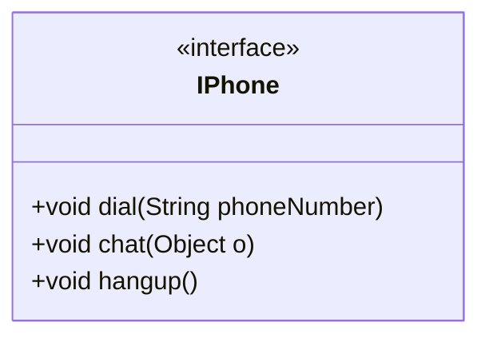
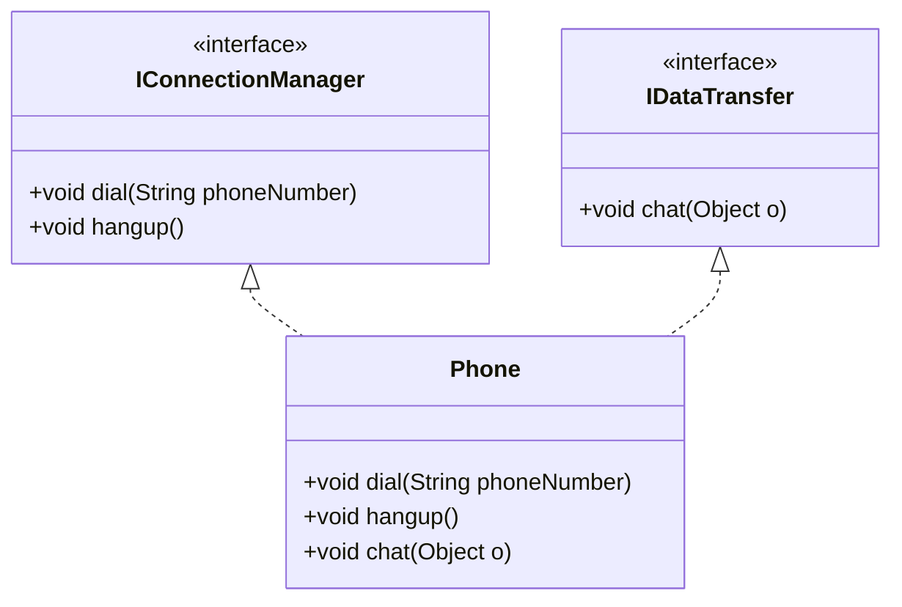
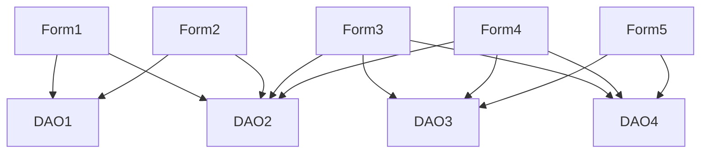
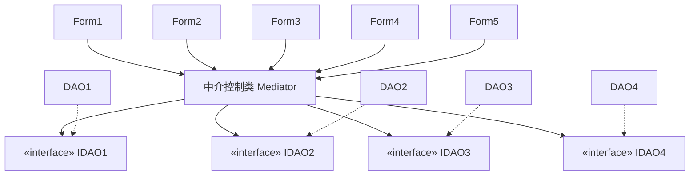
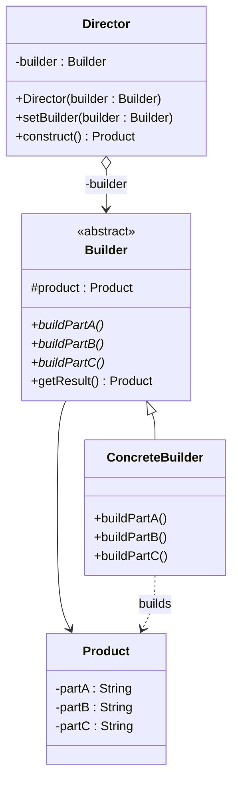
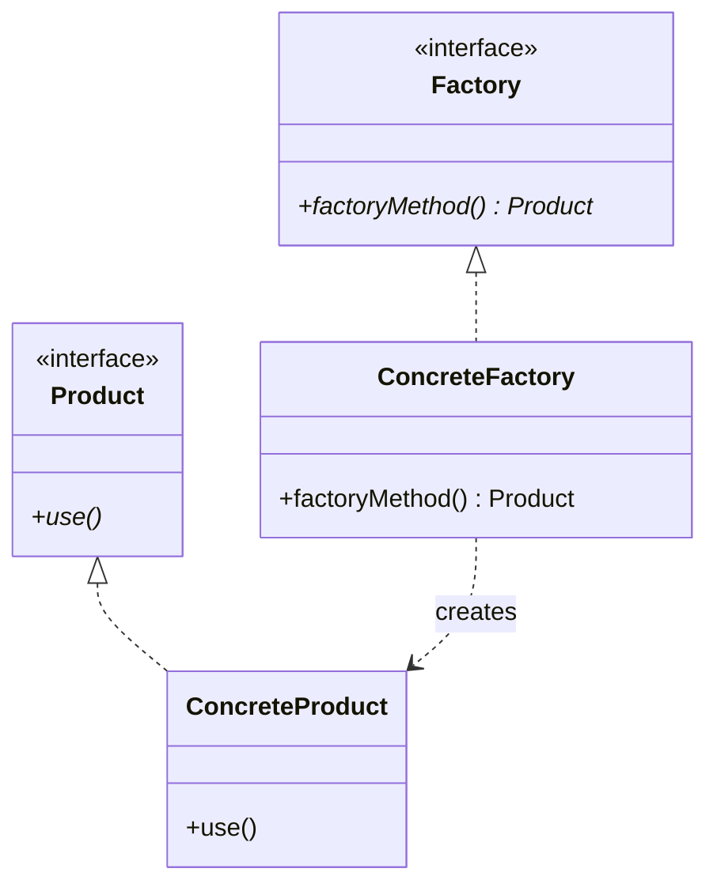
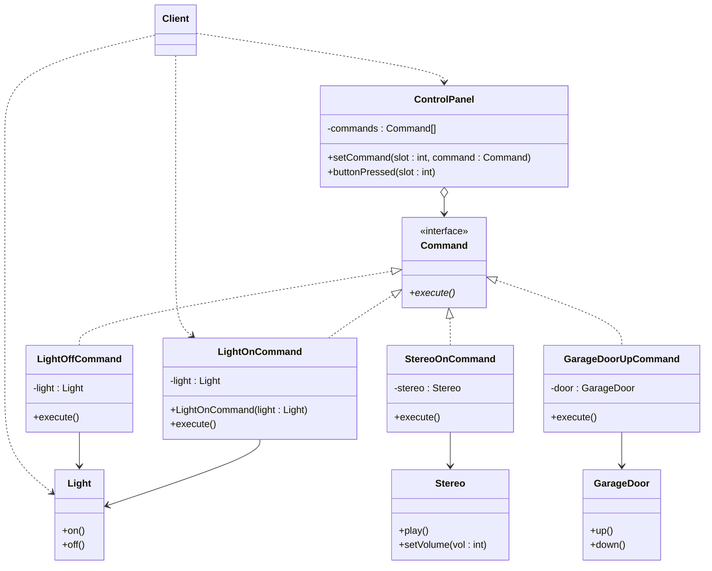

# 2025 年 12 月 30 日 太原理工大学《软件详细设计 R》试卷 B（高清整理 + 权威正解）

> **来源归档**：整理自 [软件详细设计2025.12.30](file:///D:/Developer/gitclone/MyNote/学习笔记/本科/本科三年级term1/JavaDesignPattern/试卷/软件设计与体系结构/软件详细设计2025.12.30) 文件夹中的 35 个文件（经 MD5 核验去重为 2 张长截图 + 5 张试题实拍图 + 群聊答案附图，原卷共 6 页，涵盖第 1~5 页完整试题；第 6 页为空白答题区域）。  
> **重磅排雷说明**：原群聊中“B 卷答案”有多处明显错误：
> 1. **综合题 四(4)** 题目要求画**工厂方法模式**通用类图，群内附图却画成了**简单工厂模式**（缺少具体工厂子类 `ConcreteCreator`），若照抄必扣分！
> 2. **综合题 四(2)** 原题只有 `DAO1~DAO4` 共 4 个数据访问类，群内附图错画成了 `DAO1~DAO5`；
> 3. **设计题 五(2)** 群聊最初错发了一张毫不相干的 `DataAccessInterface` 类图，后来虽补发修改图，但代码中仍存在方法名 `on()/off()` 与类图 `turnOn()/turnOff()` 不一致的问题。以下全部已为你订正为满分标准版！

- **适用专业**：软件工程 | **考试方式**：闭卷 | **考试日期**：2025.12.30 | **时间**：120 分钟 | **总分**：100 分

---

## 一、选择题（每题 1 分，共 20 分）

1. 不要和陌生人说话是（ ）原则的通俗表达。
   - A、接口隔离 &emsp; B、里氏代换 &emsp; C、依赖倒转 &emsp; D、迪米特
2. 在依赖倒转原则中，针对抽象层编程时将具体类的对象通过（ ）注入到其他对象
   - A、构造注入 &emsp; B、设值注入 &emsp; C、依赖注入 &emsp; D、接口注入
3. 不属于创建型模式的是（ ）
   - A、工厂模式 &emsp; B、策略模式 &emsp; C、建造者模式 &emsp; D、原型模式
4. 依据设计模式思想，程序开发中应优先使用的是（ ）关系实现复用
   - A、组合聚合 &emsp; B、继承 &emsp; C、创建 &emsp; D、以上都不对
5. 代理模式有多种类型，其中，智能引用代理是指（ ）
   - A、为某一个目标操作的结果提供临时的存储空间，以便多个客户端可以共享这些结果
   - B、保护目标不让恶意用户接近
   - C、使几个用户能够同时使用一个对象而没有冲突
   - D、当一个对象被引用时，提供一些额外的操作，例如将此对象被调用的次数记录下来
6. 下列描述正确的是（ ）
   - A、建造者模式是简单的创建型模式 &emsp; B、抽象工厂模式比工厂方法模式更为抽象
   - C、原型模式结构较为复杂 &emsp; D、单例模式是结构最复杂的设计模式
7. 行为型模式主要的作用是（ ）
   - A、创建对象 &emsp; B、处理类和对象的关系
   - C、描述类和对象如何交互和怎样分配职责 &emsp; D、描述类和对象的属性
8. 桥接模式的意图是（ ）
   - A、将抽象部分与实现部分相分离，使它们可以独立的变化。
   - B、将抽象部分与实现部分相分离，但它们不能独立的变化。
   - C、将抽象部分与实现部分相结合，但它们可以独立的变化。
   - D、将抽象部分与实现部分相结合，使它们相互依赖。
9. 打印池在操作系统中是一个用于管理打印任务的应用程序，系统中只能有一个打印池。我们可以使用（ ）来模拟实现打印池的设计。
   - A、命令模式 &emsp; B、桥接 &emsp; C、责任链 &emsp; D、单例模式
10. 策略模式的意图是（ ）
    - A、定义一系列的算法，把它们一个个的封装起来，并且使它们可相互替换。
    - B、为一个对象动态连接附加的职责。
    - C、你希望只拥有一个对象，但不用全局对象来控制对象的实例化。
    - D、在对象之间定义一种一对多的依赖关系，这样当一个对象的状态改变时，所有依赖于它的对象都将得到通知并自动更新。
11. 以下关于结构型模式说法不正确的是（ ）
    - A、结构型模式可以在不破坏类封装性的基础上，实现新的功能。
    - B、结构型模式主要用于创建一组对象。
    - C、结构型模式可以创建一组类的统一访问接口。
    - D、结构型模式可以在不破坏类封装性的基础上，使得类可以同不曾估计到的系统进行交互。
12. 关于单一职责的优点，以下错误的是（ ）
    - A、提高系统的可维护性 &emsp; B、提高系统的效率 &emsp; C、降低类的复杂度 &emsp; D、提高类的可读性
13. 假设猫是老鼠和狗的观察目标，老鼠和狗是观察者，猫叫老鼠跑，狗也跟着叫，可以使用（ ）描述该过程。
    - A、命令模式 &emsp; B、观察者模式 &emsp; C、责任链模式 &emsp; D、单例模式
14. 原型模式本质上就是对象的（ ）
    - A、引用 &emsp; B、复制 &emsp; C、串行化 &emsp; D、序列化
15. （ ）模式是用于把抽象化与实现化解耦，使得二者可以独立变化。
    - A、适配器模式 &emsp; B、代理模式 &emsp; C、桥接模式 &emsp; D、策略模式
16. 以下不属于装饰模式优点的是（ ）。
    - A、装饰类和被装饰类可以独立发展，而不会相互耦合，它有效地把类的核心职责和装饰功能区分开来
    - B、装饰模式是继承关系的一个替代方案
    - C、装饰模式可以动态地扩展一个实现类的功能
    - D、多层装饰比较复杂
17. 当客户端只知道传入工厂类的参数，对于如何创建对象不关心时，考虑使用（ ）模式。
    - A、简单工厂 &emsp; B、工厂方法 &emsp; C、抽象工厂 &emsp; D、原型
18. 以下哪种模式是结构型模式（ ）
    - A、适配器模式、组合模式、原型模式
    - B、装饰模式、建造者模式、工厂模式
    - C、代理模式、桥接模式、组合模式
    - D、原型模式、单例模式、工厂模式
19. 在迭代器模式中将数据存储与数据遍历分离，数据存储由聚合类负责，数据遍历由迭代器负责，这种设计方案是（ ）的具体应用。
    - A、依赖倒转原则 &emsp; B、接口隔离原则 &emsp; C、单一职责原则 &emsp; D、合成复用原则
20. 将一个类的接口转换成客户希望的另一个接口，是哪一种模式（ ）
    - A、策略模式 &emsp; B、桥接模式 &emsp; C、适配器模式 &emsp; D、单例模式

### ✅ 一、选择题参考答案

| 题号 | 答案 | 解析要点 | 题号 | 答案 | 解析要点 |
| :-: | :-: | :--- | :-: | :-: | :--- |
| 1 | **D** | 迪米特法则俗称“不要和陌生人说话”。 | 11 | **B** | “主要用于创建一组对象”不是结构型模式。 |
| 2 | **C** | `2-5` PPT 原话：通过依赖注入（DI）注入。 | 12 | **B** | 单一职责提高可维护性/可读性、降低复杂度，非“提高系统效率”。 |
| 3 | **B** | 策略模式属于行为型模式。 | 13 | **B** | 一对多联动响应（经典课本实例）$\rightarrow$ 观察者模式。 |
| 4 | **A** | 合成复用原则优先使用组合/聚合。 | 14 | **B** | 原型模式核心即对象的复制/克隆。 |
| 5 | **D** | A 是缓冲代理，B 是保护代理，D 是智能引用代理。 | 15 | **C** | 桥接模式官方定义。 |
| 6 | **B** | 抽象工厂比工厂方法抽象层次更高。 | 16 | **D** | “多层装饰比较复杂、排错难”是装饰模式的**缺点**。 |
| 7 | **C** | 行为型模式关注交互与职责分配。 | 17 | **A** | 只传参数不管实现 $\rightarrow$ 简单工厂。 |
| 8 | **A** | 桥接将抽象与实现分离、独立变化。 | 18 | **C** | 代理、桥接、组合全部是结构型模式。 |
| 9 | **D** | 系统中只能有一个打印池 $\rightarrow$ 单例模式。 | 19 | **C** | 存储与遍历职责分离 $\rightarrow$ 单一职责原则。 |
| 10 | **A** | 策略模式意图：封装可互换算法族。 | 20 | **C** | 适配器模式定义。 |

---

## 二、判断题（每题 1 分，共 10 分）

1. （ ）饿汉式单例模式在类创建的同时就实例化一个静态对象出来，不管之后会不会使用这个单例，都会占据一定的内存，但是相应的，在第一次调用时速度也会更快，因为其资源已经初始化完成。
2. （ ）当一个对象的行为取决于它所处的状态时，这时我们应该使用桥接模式。
3. （ ）适配器模式是一种创建型设计模式。
4. （ ）依赖倒置原则表明高层模块不应该依赖于低层模块，他们应该都依赖于抽象，且抽象依赖于细节。
5. （ ）对于客户端而言，具体构件对象和具体装饰对象没有任何区别。
6. （ ）在工厂方法中，返回类型是具体产品类型。
7. （ ）单例模式确保一个类只有一个实例，并提供一个全局访问点来访问这个唯一实例。
8. （ ）在迭代器模式中，新增的聚合类可以使用以前的迭代器对象。
9. （ ）面向对象设计原则中，开闭原则是指软件实体应当对扩展关闭，对修改开放。
10. （ ）简单工厂模式符合开闭原则。

### ✅ 二、判断题参考答案

| 题号 | 正解 | 核心解析 |
| :-: | :-: | :--- |
| 1 | **✓** | 饿汉式预加载占内存、免同步、首次调用快。 |
| 2 | **✗** | 行为取决于内部状态应使用**状态模式**，非桥接模式。 |
| 3 | **✗** | 适配器属于**结构型**模式。 |
| 4 | **✗** | 后半句错：抽象**不应该**依赖于细节，细节应该依赖于抽象。 |
| 5 | **✓** | `13 装饰模式.pptx` Slide 13 原话（透明装饰模式下客户端无需区分二者）。 |
| 6 | **✗** | 工厂方法 `factoryMethod()` 返回类型应为**抽象产品类型（`Product`）**。 |
| 7 | **✓** | 单例模式官方定义一字不差。 |
| 8 | **✗** | 新增聚合类须成对新增与之对应的具体迭代器类。 |
| 9 | **✗** | 写反了：应当对**扩展开放**，对**修改关闭**。 |
| 10 | **✗** | 简单工厂违反开闭原则（新增产品需改工厂源码）。 |

---

## 三、简答题（每题 5 分，共 20 分）

1. **在迪米特法则中对于一个对象，它的朋友包含哪些？**
   - **答**（对照 `2-8 迪米特法则.pptx` Slide 8，5 条要点必背）：
     1. **当前对象本身**（`this`）；
     2. **以参数形式传入**到当前对象方法中的对象；
     3. **当前对象的成员对象**（成员变量直接引用的对象）；
     4. 如果当前对象的成员对象是一个集合，**集合中的元素**也是朋友；
     5. **当前对象所创建的对象**（注：方法体内部局部创建并交流的类不算成员朋友类时亦需谨慎控制）。

2. **简述代码复用的两种方法。**
   - **答**：面向对象中代码复用主要通过**继承复用**与**组合/聚合复用**两种方式：
     1. **继承复用**：通过类继承（`"is-a"` 关系）复用父类属性和方法。优点是直观简单；缺点是属“白盒复用”，编译期静态绑定，父类与子类高耦合，父类变动会影响子类且缺乏运行时灵活性。
     2. **组合/聚合复用**：在新类中持有已有对象的成员引用（`"has-a"` 关系），通过调用其接口实现复用。优点是属“黑盒复用”，耦合度低、可在运行时动态替换成员对象；缺点是需编写转发调用代码。设计原则推荐**优先使用组合/聚合复用**。

3. **讨论简单工厂方法模式、工厂方法模式与抽象工厂模式的异同，并讨论它们使用的情景。**
   - **答**：
     - **相同点**：三者均属创建型模式，都将对象的创建与使用分离，对客户端隐藏具体实例化细节，降低系统耦合度。
     - **不同点与适用情景**：
       1. **简单工厂模式**（非 GoF 23 种）：只有一个具体工厂类，通过静态方法与条件判断创建同一个抽象产品等级结构下的不同产品；**违反开闭原则**；适用于**工厂负责创建的对象较少、产品种类相对稳定**的场景。
       2. **工厂方法模式**（类创建型）：定义抽象工厂接口并由不同具体工厂子类各生产一种具体产品（一对一平行等级结构）；**完全符合开闭原则**；适用于**单个产品等级结构、需频繁新增具体产品**的场景。
       3. **抽象工厂模式**（对象创建型）：抽象工厂定义多个工厂方法，每个具体工厂负责生产属于**同一产品族的一系列相关产品**；新增产品族符合开闭原则，新增新产品等级结构则不便；适用于**系统需要跨多产品族切换且强调同一族产品联合使用**的场景。

4. **建造者模式在什么情况下使用？（列出至少 3 个）**
   - **答**（对照 `7 建造者模式.pptx` / 题库标准 4 条，考场写足 4 条最稳）：
     1. 需要生成的**产品对象具有复杂的内部结构**，这些产品通常包含多个成员属性/部件；
     2. 需要生成的**产品对象的属性相互依赖**，需要指定其组装与生成顺序；
     3. 对象的**创建过程独立于创建该对象的类**，通过指挥者（`Director`）隔离复杂对象的构建与表示，使相同构建过程可得到不同表现；
     4. 需要隔离复杂对象的创建和使用，相同方法在不同执行顺序/组装细节下产生不同结果，且**产品间存在较多共同组成部分**。

---

## 四、综合题（每小题 5 分，共 20 分）

### 1. 根据单一职责原则，修改下面的类图

原类图：


#### ✅ 标准参考修改类图（出自 `2-2 单一职责.pptx` Slide 12~13）
- **分析**：`dial()` 和 `hangup()` 负责**通信协议/连接管理**，而 `chat()` 负责**数据交换传输**，二者属于两种不同职责；按课程 PPT“接口一定要做到单一职责”，应拆分为两个职责单一的接口：


*(说明：接口命名也可写作 `ICall` 与 `IChat`，但注意**方法名务必保留原题的 `dial`、`hangup`、`chat`**，不要擅自改名。)*

---

### 2. 如图所示为某系统界面类与数据访问类之间的调用关系，请用所学 OOP 设计原则对下列关系进行优化

原耦合图（注意：**原图只有 4 个 DAO：`DAO1 ~ DAO4`**）：


#### ✅ 权威优化方案（出自 `2-8 迪米特法则.pptx` Slide 15~16 + 依赖倒置原则）
- **排雷提示**：原群内附图把 `DAO1~DAO4` 错写成了 5 个 `DAO1~DAO5`。
- **优化原则**：根据**迪米特法则（最少知识原则）**，引入一个合理的“第三者”——**中间控制类（中介层 `Mediator`）**，隔断界面类（`Form1~5`）与数据访问类（`DAO1~4`）之间的多对多网状直接依赖；同时可结合**依赖倒置原则**，为各 `DAO` 提取抽象接口 `IDAO1~IDAO4`，使中介类面向接口编程。



---

### 3. 请画出建造者模式的通用类图

#### ✅ 标准参考类图（注意带 `getResult()` 与 `construct()` 完整方法）



---

### 4. 请画出工厂方法模式的通用类图

> ⚠️ **重磅排雷**：2025 群内 `四4` 答案错画成了“只有 1 个 `creator` 类的简单工厂模式”，没有工厂继承树！考场务必画下面这个包含 **4 个核心角色 + 两条平行继承线** 的标准工厂方法类图：



---

## 五、设计题（30 分）

**智能家居通用控制系统的设计**  
某智能家居企业正在研发一款名为“智控面板”的硬件产品，该面板配备了若干个可编程的物理按键，用于集中控制家中特定的智能电器。在该项目中，系统需要控制的具体设备及功能严格限定为以下三类：一是智能吸顶灯，具备“开启照明”和“关闭照明”两个功能；二是多媒体音响，具备“开启播放”和“设置音量”两个功能；三是电动车库门，具备“向上开启”和“向下关闭”两个功能。系统的核心设计目标是实现控制面板（请求发送者）与上述具体电器（请求接收者）之间的完全解耦。这意味着面板的底层驱动程序不应直接依赖于吸顶灯、音响或车库门的具体类实现，也不应包含任何关于设备操作细节的逻辑。此外，系统必须支持运行时动态配置，比如用户可以在不修改或重新编译代码的情况下，通过软件设置将面板上的“按键 1”从控制“吸顶灯开启”随时切换为控制“车库门开启”。

**问题：**
1. 应使用哪种设计模式来实现系统，为什么？（5 分）
2. 画出设计类图。（10 分）
3. 请给出设计代码（设计模式中的每种角色若有多个实现类，则只需要给出其中一个实现类的核心代码）。（15 分）

### ✅ 五、设计题权威满分答案

#### （1）模式选择与理由（5 分）
- 应使用**命令模式（Command Pattern）**。
- **理由**：
  1. 命令模式将对家电的每一次请求封装为独立的命令对象，使**请求发送者（智控面板 `ControlPanel`）与请求接收者（`Light`、`Stereo`、`GarageDoor`）完全解耦**；
  2. `ControlPanel` 只面向抽象命令接口 `Command` 编程，内部不包含具体电器控制细节，各物理按键通过引用不同的命令对象实现绑定，支持在**不修改、不重编已有面板驱动的前提下运行时动态重新配置按键功能**，完美符合开闭原则。

#### （2）设计类图（10 分）



#### （3）核心 Java 设计代码（15 分）
*(按题目要求，每个角色若有多个实现类，重点给出其中典型实现类及组装测试代码，保证类名与类图 100% 一致)*

```java
// 1. 抽象命令角色（Command）
public interface Command {
    void execute();
}

// 2. 请求接收者角色之一（Receiver）：智能吸顶灯
public class Light {
    public void on() {
        System.out.println("智能吸顶灯：开启照明");
    }

    public void off() {
        System.out.println("智能吸顶灯：关闭照明");
    }
}

// （其他接收者如 GarageDoor 供动态切换演示）
public class GarageDoor {
    public void up() {
        System.out.println("电动车库门：向上开启");
    }

    public void down() {
        System.out.println("电动车库门：向下关闭");
    }
}

// 3. 具体命令角色之一（ConcreteCommand）：吸顶灯开启命令
public class LightOnCommand implements Command {
    private Light light;

    public LightOnCommand(Light light) {
        this.light = light;
    }

    @Override
    public void execute() {
        light.on();
    }
}

public class GarageDoorUpCommand implements Command {
    private GarageDoor door;

    public GarageDoorUpCommand(GarageDoor door) {
        this.door = door;
    }

    @Override
    public void execute() {
        door.up();
    }
}

// 4. 调用者角色（Invoker）：智控面板（与具体电器彻底解耦）
public class ControlPanel {
    private Command[] commands = new Command[10];

    public void setCommand(int slot, Command command) {
        commands[slot] = command;
    }

    public void buttonPressed(int slot) {
        if (commands[slot] != null) {
            commands[slot].execute();
        }
    }
}

// 5. 客户端测试类（演示运行时动态配置按键）
public class Client {
    public static void main(String[] args) {
        ControlPanel panel = new ControlPanel();
        Light light = new Light();
        GarageDoor door = new GarageDoor();

        // 初始配置按键 1 为吸顶灯开启
        panel.setCommand(0, new LightOnCommand(light));
        panel.buttonPressed(0);

        // 运行时动态重新配置按键 1 为车库门向上开启（无需改动 ControlPanel 代码）
        panel.setCommand(0, new GarageDoorUpCommand(door));
        panel.buttonPressed(0);
    }
}
```
