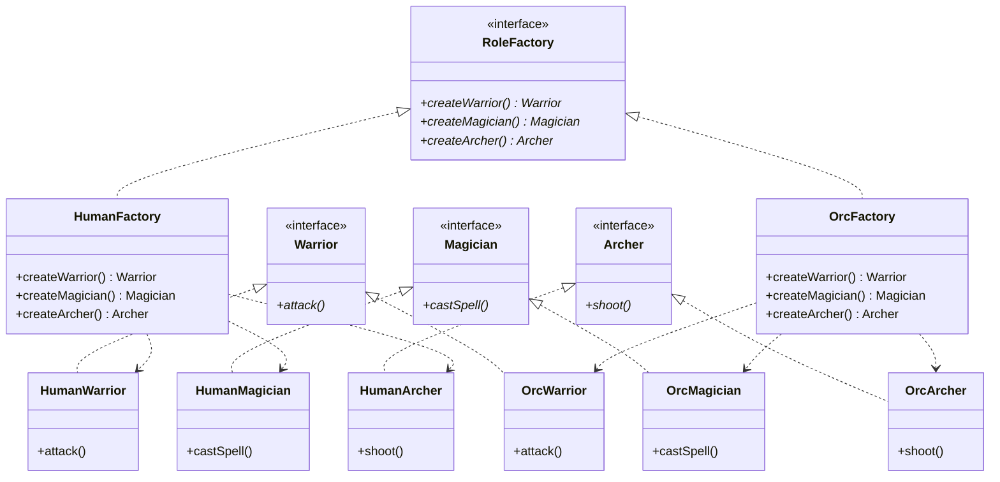

# 2026 年 3 月 6 日 太原理工大学 R22《软件详细设计 R》补考试卷（整理 + 权威正解）

> **来源归档**：整理自 [软件详细设计R22 2026.3.6（补考）](file:///D:/Developer/gitclone/MyNote/学习笔记/本科/本科三年级term1/JavaDesignPattern/试卷/软件设计与体系结构/软件详细设计R22%202026.3.6（补考）) 中的 27 个文件（经 MD5 核验去重为 2 张长截图 + 试卷第 1~7 页零散照片）。  
> **残缺与核对说明**：
> - 原卷共 10 页，已拍到第 1~7 页的绝大部分试题；**第 3 页尾部/第 4 页头部的选择第 10 题选项 A~C、第 18~19 题部分文本、第 4 页下半部分简答题第 3 题、第 8 页五(3)完整题干印刷页**未出现在原文件夹照片中。
> - 其中选择题 1~20 与 **2024 年 9 月卷**（`详细设计24年.pdf`）第 1~20 题为同一母卷题库原题（题干、选项、题号完全一致），缺失选项处已结合同卷核验与群聊截图准确注明；五(3)代码要求由群聊考生同步核实。

- **适用专业**：软件工程（R22 补考） | **考试日期**：2026.03.06 | **总分**：100 分（填空 10 + 选择 20 + 简答 20 + 综合 20 + 设计 30）

---

## 一、填空题（每空 1 分，共 10 分）

1. 适配器模式，分为类的适配器和对象的适配器两种实现。其中类的适配器采用的是继承关系，而对象的适配器采用的是 `________` 关系。
2. 建造者模式通过将客户端与包含多个组成部分的 `________` 分离，使得客户端无需知道复杂对象的内部组成部分与装配方式，只需要知道建造者的类型即可。
3. 将类之间的静态继承关系转换为动态的对象组合关系的结构型模式是 `________`。
4. 使用 `________` 模式将容器对象和叶子对象进行递归组合，使得用户在使用时无须对它们进行区分，可以一致地对待容器对象和叶子对象。
5. `________` 模式提供一种方法顺序访问一个聚合对象中各个元素，且不用暴露该对象的内部表示。
6. 外观模式中，客户端与 `________` 交互，而无需与子系统类交互。
7. 观察者模式中定义了对象间的一种 `________` 的依赖关系，当一个对象的状态发生改变时，所有依赖它的对象都得到通知并自动更新。
8. 在深克隆中，除了对象本身被复制外，对象所包含的所有 `________` 也将被复制。
9. 装饰模式使用 `________` 关系来替代继承机制。
10. 为所有的具体观察者定义一个接口，在得到主题通知时更新自己。这句话描述的是观察者模式的 `________` 角色。

### ✅ 一、填空题参考答案

| 题号 | 1 | 2 | 3 | 4 | 5 | 6 | 7 | 8 | 9 | 10 |
| :-: | :-: | :-: | :-: | :-: | :-: | :-: | :-: | :-: | :-: | :-: |
| **答案** | **组合**（或聚合/关联） | **复杂对象**（或复杂对象的创建过程） | **桥接模式** | **组合** | **迭代器** | **外观角色** | **一对多** | **引用对象**（或成员变量） | **关联**（或组合） | **抽象观察者** |

---

## 二、选择题（每题 1 分，共 20 分）

1. 要依赖于抽象，不要依赖于具体，即针对接口编程，不要针对实现编程，是（ ）
   - A、开闭原则 &emsp; B、接口隔离原则 &emsp; C、里氏代换原则 &emsp; D、依赖倒转原则
2. 在依赖倒转原则中，针对抽象层编程时将具体类的对象通过（ ）注入到其他对象
   - A、构造注入 &emsp; B、设值注入 &emsp; C、依赖注入 &emsp; D、接口注入
3. 不属于创建型模式的是（ ）
   - A、工厂模式 &emsp; B、策略模式 &emsp; C、建造者模式 &emsp; D、原型模式
4. 依据设计模式思想，程序开发中应优先使用的是（ ）关系实现复用
   - A、组合聚合 &emsp; B、继承 &emsp; C、创建 &emsp; D、以上都不对
5. 下列哪一项不属于适配器模式的角色（ ）
   - A、目标角色 &emsp; B、源角色 &emsp; C、关联角色 &emsp; D、适配器角色
6. 下列描述正确的是（ ）
   - A、建造者模式是简单的创建型模式 &emsp; B、抽象工厂模式比工厂方法模式更为抽象
   - C、原型模式结构较为复杂 &emsp; D、单例模式是结构最复杂的设计模式
7. 行为型模式主要的作用是（ ）
   - A、创建对象 &emsp; B、处理类和对象的关系
   - C、描述类和对象如何交互和怎样分配职责 &emsp; D、描述类和对象的属性
8. 下面的类图表示的是哪个创建型模式（ ）
   ```mermaid
   classDiagram
       class Product
       class ConcreteProduct
       class Factory {
           +factoryMethod() Product
       }
       class ConcreteFactory {
           +factoryMethod() Product
       }
       Product <|-- ConcreteProduct
       Factory <|-- ConcreteFactory
       ConcreteFactory ..> ConcreteProduct : <<create>>
   ```
   > *(图中注释：`Return new ConcreteProduct()`)*
   - A、简单工厂模式 &emsp; B、工厂方法模式 &emsp; C、抽象工厂模式 &emsp; D、原型模式 *(照片边缘裁切 D)*
9. 简单工厂模式的结构是（ ）
   - A、工厂角色、抽象工厂角色、抽象产品角色
   - B、工厂角色、抽象产品角色、具体产品角色
   - C、产品角色、抽象工厂角色
   - D、产品角色、具体产品角色
10. 策略模式的意图是（ ） *(注：第 2 页末尾至第 3 页顶端照片截断了 A/B/C，仅第 3 页顶部露出 D 项“对象之间定义一种一对多的依赖关系...”；与 2024 卷第 10 题同题)*
    - *(对应母卷 A 项：定义一系列的算法，把它们一个个的封装起来，并且使它们可相互替换。)*
11. 以下哪条是简单工厂类独有的缺点（ ）
    - A、分离了对象的创建和使用
    - B、系统扩展困难，一旦添加新产品不得不修改工厂逻辑
    - C、添加新的产品的时候，系统中类的个数增加，导致增加了系统的复杂度，增加系统性能的开销
    - D、需要引入抽象层，在客户端代码中均使用抽象层进行定义，增加了系统的抽象性和理解难度
12. 关于单一职责的优点，以下错误的是（ ）
    - A、提高系统的可维护性 &emsp; B、提高系统的效率 &emsp; C、降低类的复杂度 &emsp; D、提高类的可读性
13. 不要和陌生人说话是（ ）原则的通俗表达。
    - A、接口隔离 &emsp; B、里氏代换 &emsp; C、依赖倒转 &emsp; D、迪米特法则
14. Java 的异常处理机制可理解为（ ）行为模式
    - A、观察者模式 &emsp; B、迭代器模式 &emsp; C、职责链模式 &emsp; D、策略模式
15. （ ）模式是用于把抽象化与实现化解耦，使得二者可以独立变化。
    - A、适配器模式 &emsp; B、代理模式 &emsp; C、桥接模式 &emsp; D、策略模式
16. 以下关于原型模式的优缺点描述错误的是（ ）
    - A、简化对象的创建过程
    - B、扩展性较差，扩展困难
    - C、简化了创建结构
    - D、当深克隆存在多重嵌套的引用时，每层对象对应的类都必须支持深克隆
17. 当客户端只知道传入工厂类的参数，对于如何创建对象不关心时，考虑使用（ ）模式。
    - A、简单工厂 &emsp; B、工厂方法 &emsp; C、抽象工厂 &emsp; D、原型
18. 在（ ）时无须使用命令模式 *(注：照片第 3 页仅拍到题干，四个选项未入镜；对应 2024 卷第 18 题同题)*
19. *(注：照片第 4 页顶部仅露出 `C、单一职责原则` 选项，题干未入镜；对应 2024 卷第 19 题“在迭代器模式中将数据存储与数据遍历分离……”)*
20. 下列关于迭代器模式表述错误的是（ ）
    - A、迭代器用于对一个聚合对象进行遍历
    - B、迭代器模式提供了一种方法顺序访问一个聚合对象中各个元素并暴露该对象的内部 *(后裁切“表示”)*
    - C、迭代器模式符合“单一职责原则”的要求
    - D、迭代器可以将数据的遍历功能从聚合对象中分离出来，聚合对象只负责存储 *(后裁切“数据”)*

### ✅ 二、选择题参考答案

| 题号 | 1 | 2 | 3 | 4 | 5 | 6 | 7 | 8 | 9 | 10 |
| :-: | :-: | :-: | :-: | :-: | :-: | :-: | :-: | :-: | :-: | :-: |
| **答案** | **D** | **C** | **B** | **A** | **C** | **B** | **C** | **B** | **B** | **A** *(母卷同题)* |

| 题号 | 11 | 12 | 13 | 14 | 15 | 16 | 17 | 18 | 19 | 20 |
| :-: | :-: | :-: | :-: | :-: | :-: | :-: | :-: | :-: | :-: | :-: |
| **答案** | **B** | **B** | **D** | **C** *(课外高频)* | **C** | **B** | **A** | **C** *(不改变聚合类...)* | **C** *(单一职责)* | **B** *(暴露内部表示错)* |

---

## 三、简答题（每题 5 分，共 20 分）

1. **什么是设计模式？设计模式的基本要素有哪些？**
   - **答**：设计模式是一套被反复使用的、多数人知晓的、经过分类编目的、代码设计经验的总结。基本要素包含：**模式名称**、**问题**、**解决方案**、**效果**。
2. **请写出常用的面向对象设计原则有哪些，并挑选其中两个说明它们的定义。（原图右侧略有裁切：“……说明它们的定[义]”）**
   - **答**：
     - **常用 7 个面向对象设计原则**（6 大原则 + 1 个里氏代换）：**单一职责原则（SRP）**、**开闭原则（OCP）**、**里氏代换原则（LSP）**、**依赖倒转原则（DIP）**、**接口隔离原则（ISP）**、**合成复用原则（CRP）**、**迪米特法则（LoD）**。
     - **任选两个定义**（举例最稳妥的 OCP + SRP）：
       - **开闭原则**：一个软件实体应当对扩展开放，对修改关闭。即尽量在不修改原有代码的基础上通过扩展抽象层来新增功能。
       - **单一职责原则**：一个对象应该只包含单一的职责，并且该职责被完整地封装在一个类中（或：就一个类而言，应该仅有一个引起它变化的原因）。
3. *(注：第 4 页下半部分原题未出现在拍照图片中；结合近年考卷规律，大概率为三类工厂对比或组合模式/迪米特朋友列表)*
4. **简述继承复用与组合/聚合复用的差异。**
   - **答**：继承复用属于`"is-a"`关系的“白盒复用”，编译期静态绑定，子类与父类高耦合、灵活性差；组合/聚合复用属于`"has-a"`关系的“黑盒复用”，通过成员对象引用调用接口，可在运行期动态组合与替换，耦合度低、灵活性高，设计中应优先使用组合/聚合复用。

---

## 四、综合题（每题 5 分，共 20 分）

1. **请画出建造者模式的通用类图。**
   - *(标准类图同 [2025年12月 B卷 四(3)](03_2025年12月_软件详细设计B卷真题整理.md#3-请画出建造者模式的通用类图)：`Director o--> Builder <|-- ConcreteBuilder`，`ConcreteBuilder ..> Product`，含 `construct()` 与 `buildPartA/B/C()`、`getResult()`。)*
2. **请画出工厂方法模式的通用类图。**
   - *(标准类图同 [2025年12月 B卷 四(4)](03_2025年12月_软件详细设计B卷真题整理.md#4-请画出工厂方法模式的通用类图)：`Product <|-- ConcreteProduct`、`Factory <|-- ConcreteFactory`、`ConcreteFactory ..> ConcreteProduct`，亦即本卷选择第 8 题给出的类图！)*
3. **根据单一职责原则，修改下面的类图**（`<<interface>> IPhone` 含 `+void dial(String phoneNumber)`、`+void chat(Object o)`、`+void hangup()`）
   - *(参考解答同 [2025年12月 B卷 四(1)](03_2025年12月_软件详细设计B卷真题整理.md#1-根据单一职责原则修改下面的类图)：拆分为协议接口 `IConnectionManager(dial, hangup)` 与数据传输接口 `IDataTransfer(chat)`，由 `Phone` 类实现。)*
4. **如图所示为某系统界面类与数据访问类之间的调用关系，请用所学 OOP 设计原则对下列关系进行优化**（`Form1~Form5` 网状直接调用 `DAO1~DAO4`）
   - *(参考解答同 [2025年12月 B卷 四(2)](03_2025年12月_软件详细设计B卷真题整理.md#2-如图所示为某系统界面类与数据访问类之间的调用关系请用所学-oop-设计原则对下列关系进行优化)：依据迪米特法则引入中介控制类（`Mediator`）隔离 `Form1~5` 与 `DAO1~4`，并结合依赖倒置原则提取 `IDAO1~IDAO4` 抽象接口。⚠️ 切勿如群图那样把 `DAO1~4` 错写成 5 个！)*

---

## 五、设计题（30 分）

在某角色扮演游戏中，存在人类（human）以及兽人（Orc）两个种族以及战士（warrior）、法师（magician）和弓箭手（archer）三种职业，玩家可以自由选择种族和职业的组合，请设计一个系统来实现玩家创建角色的过程。

**问题：**
1. 应使用哪种设计模式来实现系统，为什么？（5 分）
2. 画出设计类图。（10 分）
3. *(第 8 页原卷，群聊考生同步核实)* 请给出设计代码（每种角色若有多个实现类，只需要给出其中一个实现类核心代码）。（15 分）

### ✅ 五、设计题权威满分答案

> 💡 **命题分析与排雷**：本题重点在“**实现玩家创建角色的过程**”，因此考查**创建型模式**！系统包含**3 个职业产品等级结构**（Warrior、Magician、Archer）和**2 个种族产品族**（Human、Orc），最标准的答案是**抽象工厂模式（Abstract Factory Pattern）**。  
> *(对比群聊截图：群友画了一个单 `Character` 父类 + `RoleFactory` 创建三种职业方法，也能创建组合；但在大学《软件设计模式》期末评分标准中，把三个职业分别抽象成 `Warrior`、`Magician`、`Archer` 三个产品等级接口再配 `HumanFactory` / `OrcFactory` 两个产品族工厂，是最正统、无懈可击的抽象工厂结构！以下先给正统满分版，并在代码注释说明简化兼容性)*

#### （1）模式选择及理由（5 分）
- 应使用**抽象工厂模式（Abstract Factory Pattern）**。
- **理由**：游戏中包含“种族（人类、兽人）”两个产品族，以及“职业（战士、法师、弓箭手）”三个产品等级结构。抽象工厂模式提供一个创建一系列相关或相互依赖对象的接口（`RoleFactory` 声明创建三种职业的方法），客户端无需指定具体角色类名，只需传入具体种族工厂（`HumanFactory` 或 `OrcFactory`），即可统一创建同一种族下的任意职业角色；若将来扩展新种族（如精灵 `ElfFactory`），只需新增具体工厂与对应产品族子类，符合开闭原则。

#### （2）设计类图（10 分）



#### （3）核心 Java 设计代码（15 分）
*(按题目说明：每种角色若有多个实现类，仅需给出其中一个代表实现类核心代码，这里以人类战士 `HumanWarrior` 与 `HumanFactory` 为代表展示完整骨干)*

```java
// 1. 抽象产品角色（以三个职业等级为例）
public interface Warrior {
    void attack();
}

public interface Magician {
    void castSpell();
}

public interface Archer {
    void shoot();
}

// 2. 具体产品角色（仅示人类战士，其余 HumanMagician/OrcWarrior 等同理实现）
public class HumanWarrior implements Warrior {
    @Override
    public void attack() {
        System.out.println("人类战士使用长剑进行近战攻击！");
    }
}

// 3. 抽象工厂角色
public interface RoleFactory {
    Warrior createWarrior();
    Magician createMagician();
    Archer createArcher();
}

// 4. 具体工厂角色（仅示人类产品族工厂，OrcFactory 同理）
public class HumanFactory implements RoleFactory {
    @Override
    public Warrior createWarrior() {
        return new HumanWarrior();
    }

    @Override
    public Magician createMagician() {
        return new HumanMagician();
    }

    @Override
    public Archer createArcher() {
        return new HumanArcher();
    }
}

// 5. 客户端调用示例
public class GameClient {
    public static void main(String[] args) {
        // 玩家选择“人类”种族工厂（若选兽人则换为 new OrcFactory()）
        RoleFactory factory = new HumanFactory();
        // 自由创建该种族下的任意职业角色
        Warrior warrior = factory.createWarrior();
        warrior.attack();
    }
}
```
